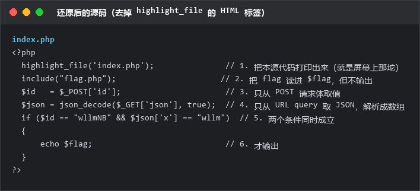
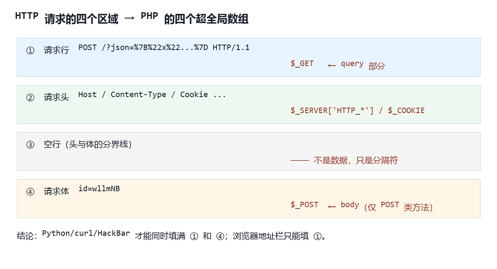
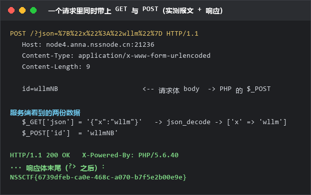

# NSSCTF · 简单 GET 与 POST —— Writeup

> 分类：Web（HTTP 参数分区 + PHP `json_decode`）
> 难度：入门
> 环境：`Apache/2.4.25 (Debian)` + `PHP/5.6.40`
> 做题日期：2026-10-26
> Flag：`NSSCTF{6739dfeb-ca0e-468c-a070-b7f5e2b00e9e}`（动态靶机，重开会变）

---

## 30 秒速查卡

页面只有一段花花绿绿的代码，没有输入框。**那段"乱码"是 `highlight_file()` 加的 HTML 颜色标签**，去掉标签就是 7 行 PHP。

还原后的源码要求两件事同时成立：

```php
$id   = $_POST['id'];                        // 来自请求体
$json = json_decode($_GET['json'], true);    // 来自 URL query
if ($id == "wllmNB" && $json['x'] == "wllm") { echo $flag; }
```

所以必须发**一个**同时带 query 和 body 的请求：

| 位置 | 内容 |
|------|------|
| URL | `http://<host>:21236/?json=%7B%22x%22%3A%22wllm%22%7D` |
| 方法 | POST |
| Content-Type | `application/x-www-form-urlencoded` |
| Body | `id=wllmNB` |

一行命令（任选：

```powershell
# PowerShell
Invoke-WebRequest -Uri "http://<host>:21236/?json=%7B%22x%22%3A%22wllm%22%7D" `
  -Method POST -Body @{ id = "wllmNB" } -UseBasicParsing | % Content
```

```python
import requests
r = requests.post("http://<host>:21236/", params={"json": '{"x":"wllm"}'}, data={"id": "wllmNB"})
print(r.text.split("</code>")[-1].strip())
```

```javascript
// F12 Console
fetch('/?json=' + encodeURIComponent('{"x":"wllm"}'), { method:'POST', body:'id=wllmNB' })
  .then(r => r.text()).then(t => console.log(t.match(/NSSCTF\{.*?\}/)?.[0]));
```

---

## 1. 现象

打开题目就是一个"代码显示器"：整页没有表单、没有链接，只有一坨带 `<span style="color: #0000BB">` 的代码，末尾没有任何 flag。



**关键认知**：那些 `<span style="color:#0000BB">` 是 `highlight_file()` 给语法加的颜色，**不是代码内容**。把标签删掉、`&nbsp;` 换成空格，代码立刻变成 10 行。

## 2. 读懂条件

| 行 | 代码 | 含义 |
|----|------|------|
| 3 | `$id = $_POST['id']` | 只从**请求体**取值 |
| 4 | `$json = json_decode($_GET['json'], true)` | 只从 **URL query** 取，且当 JSON 解析 |
| 5 | `if ($id == "wllmNB" && $json['x'] == "wllm")` | 两个都成立才 `echo $flag` |

`json_decode($s, true)` 第二个参数 `true` = 解析成**关联数组**，所以下一行才能写 `$json['x']`；如果省略 `true`，得到的是 `stdClass` 对象，必须写 `$json->x`。

## 3. 为什么必须手工构造请求

HTTP 请求报文分四个区域，`$_GET` 和 `$_POST` 读的是**不同的两个区域**：



> 此图为示意图，用于说明请求分区与超全局数组的对应关系。

浏览器地址栏**只能填第 ① 区**（query），永远填不出第 ④ 区（body）。
而代码把两个条件分别绑死在这两个区上——这就是本题唯一的技术门槛。

### 实验对照（当时实测）

| 编号 | 放法 | 结果 | 原因 |
|------|------|------|------|
| A | 两个参数都放 GET | ❌ | `$_POST['id']` 为空 |
| B | 两个参数都放 body | ❌ | `$_GET['json']` 为空 |
| C | id 走 GET、json 走 POST（反着放） | ❌ | 位置必须和代码一一对应 |
| D | query 带 json + body 带 id | ✅ **flag** | 两个条件同时成立 |
| E | GET 方法但硬塞 body | ❌ | 非 POST 时 body 不进 `$_POST` |

## 4. 成功的那一个请求



```
POST /?json=%7B%22x%22%3A%22wllm%22%7D HTTP/1.1
Host: node4.anna.nssnode.cn:21236
Content-Type: application/x-www-form-urlencoded
Content-Length: 9

id=wllmNB
```

服务端视角：

```
$_GET['json'] = '{"x":"wllm"}'   --json_decode-->  ['x' => 'wllm']
$_POST['id']  = 'wllmNB'
-> if 成立 -> echo $flag
```

响应体（`highlight_file` 的 HTML 之后）：

```
NSSCTF{6739dfeb-ca0e-468c-a070-b7f5e2b00e9e}
```

## 5. 三个必踩的坑

### 坑 1：URL 里少了 `?`

`/json=%7B...` 会被 Apache 当成一个**文件路径**去查找 → 404，PHP 根本没执行。

### 坑 2：`Content-Type` 不对，body 写了也白写

PHP 只在 `application/x-www-form-urlencoded` 或 `multipart/form-data` 时才填充 `$_POST`。实测：

| Content-Type | body | 结果 |
|---|---|---|
| `application/x-www-form-urlencoded` | `id=wllmNB` | ✅ 出 flag |
| `text/plain` | `id=wllmNB` | ❌ |
| `application/json` | `{"id":"wllmNB"}` | ❌ |

### 坑 3：值里带 `&` `=` 不编码

`&` `=` `#` `+` 在 query 里是**分隔符/保留字符**，值里出现必须编码（`%26` `%3D` `%23` `%2B`），
否则服务器会把你的一个参数劈成两个。

> 顺带：本题靶机的 Apache+PHP **容忍**未编码的 `{` `"` `:`（`?json={"x":"wllm"}` 也能过），
> 但 Burp / curl 的 Raw 模式没人兜底，标准写法永远是 `%XX`。

## 6. 原理复盘：参数"位置不一致"本身就是漏洞

这题是教学版，但同样的结构在真实漏洞里长这样：

| 真实场景 | 问题 |
|---|---|
| 校验读 `$_GET['admin']`，执行读 `$_POST['admin']` | 只喂校验那一侧 |
| `$_REQUEST` 同时收 GET/POST/Cookie，顺序由 `variables_order` 决定 | 覆盖顺序绕过 |
| 校验用 `$_POST`（解码后表单），取数用 `php://input`（原始 body） | 同一份 body 两种理解 |
| `?id=1&id=2` | HTTP 参数污染（HPP），框架取首/取尾/成数组 |

## 7. 同类变体（下次这样想）

| 题面长相 | 套路 |
|---|---|
| `if ($_GET['a'] != $_POST['b'])` | 混合 GET/POST，同本题 |
| `if (!$_GET['num'] && $_POST['num'])` | 同名参数，GET 不给、POST 给 |
| `if ($a == $b && $a !== $b)` | 数组绕过 `a[]=1&b[]=2`，或 `0e` |
| `include($_GET['file'])` + `preg_match` | 文件包含 / `php://filter` 读源码 |
| `isset($_SERVER['HTTP_X_FORWARDED_FOR'])` | 加自定义头（HackBar Custom / Burp） |

## 8. 工具速记

| 工具 | 定位 |
|---|---|
| HackBar（Edge/Chrome 插件） | 藏在 F12 里的手工发请求面板 |
| DevTools Console + `fetch` | 不装插件的最快等价方案 |
| `curl` / `Python requests` | 写脚本、批量、复杂 body |
| Burp Repeater | Raw 报文级别改一切 |

> HackBar 新版在 MV3 下经常加载不出来 —— **插件挂了就换 Console，效果完全一样**。
