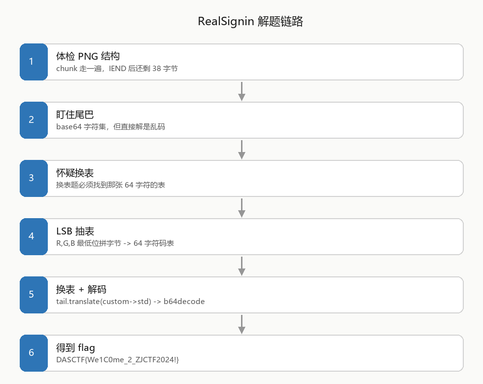
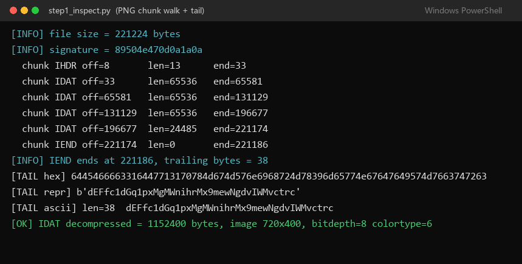
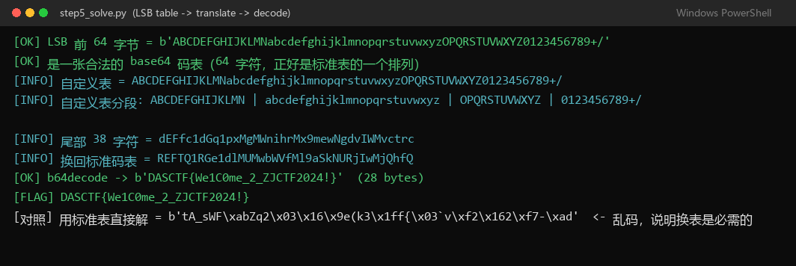
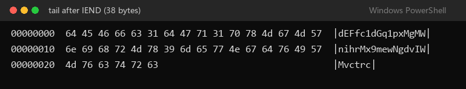
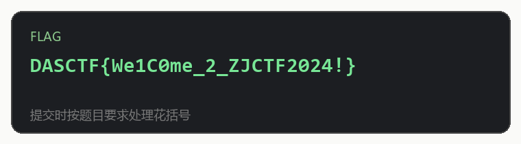

# 第 3 题 · RealSignin — Writeup

> **本合集路径说明**：本篇原属 `CTF-WP\03-RealSignin`，正文里写的 `solve/xxx.py`、`files/xxx` 是**原工程相对路径**；脚本已复制到本合集 `src\zj03\` 下（附件未随迁，需要时去原工程取）。

> 2024 浙江省大学生网络与信息安全竞赛（预赛） · 分类：Misc · 难度：★★☆☆☆

| 项目 | 内容 |
|---|---|
| 题目名 | RealSignin（"真·签到"） |
| 分类 | Misc（图片隐写 + 编码） |
| 附件 | `files/tempdir/MISC附件/out.png`（216 KB，720×400 RGBA PNG） |
| 一句话 | 图片像素最低位里藏了一张 **自定义 base64 码表**，得先抽表、再换表解码 |
| 最终 flag | `DASCTF{We1C0me_2_ZJCTF2024!}` |

**最终答案**

```
DASCTF{We1C0me_2_ZJCTF2024!}
```

[TOC]

## 一、题目长什么样（先建立直觉）

附件只有一个 `out.png`：一张很"通用"的 CTF 宣传图（盾牌 + 三个锁 + 大大的 CTF 字样），画面上还有一堆点缀用的十六进制数字（`BAD898`、`8923589A` 之类）。

打开就发现两件事：

1. **图片本身完全正常**——`IHDR → IDAT×4 → IEND` 五个块齐全，IDAT 能正常解压出 720×400 的像素，说明作者没有破坏图片格式（这对出题人是好事：选手看图不会报错，就不会起疑）。
2. **IEND 之后还多出 38 个字节**，全是可见 ASCII：`dEFfc1dGq1pxMgMWnihrMx9mewNgdvIWMvctrc`。

PNG 规范规定 `IEND` 是最后一个块，后面的字节阅读器会直接忽略。所以这 38 个字节**一定是作者刻意追加的载荷**，是本题第一现场。

## 二、解题思路总览



结论先说：这 38 个字符**长得像 base64，但不是用标准表编的**。它用的是作者自定义的一张 64 字符码表（把标准表的 `A-Z`、`a-z` 两段拆开重排了），而这张码表被作者用 **LSB（最低位）隐写**塞进了图片像素里——按 `R,G,B,R,G,B…` 的顺序取每个像素的最低位，前 64 个字节正好拼出那张表。

所以完整链路是：**发现尾巴 → 直接解码失败 → 想到"换表" → 从像素 LSB 抽出码表 → 换成标准表 → base64decode → flag**。

## 三、逐步复现

### 3.1 第一步：把 PNG 的块走一遍，确认"尾巴"是唯一异常

**为什么**：拿到未知文件，第一步永远是"结构体检"，而不是急着 `strings`。PNG 是块结构（长度 4 字节 + 类型 4 字节 + 数据 + CRC 4 字节），自己走一遍能精确知道"正常数据到哪结束、追加数据从哪开始"，这是后面所有操作的前提。

```python
# solve/step1_inspect.py 核心 8 行
off = 8
while off + 8 <= len(data):
    (ln,) = struct.unpack('>I', data[off:off + 4])       # 块长度
    typ = data[off + 4:off + 8].decode('latin-1')        # 块类型
    end = off + 8 + ln + 4                               # 跳到下一块
    print('  chunk %-4s off=%-7d len=%-7d end=%d' % (typ, off, ln, end))
    if typ == 'IEND':
        break
    off = end
print('trailing = %r' % data[end:])
```



图注：这张图证明了两件事——(1) 图片结构完整（4 个 IDAT 共 221141 字节，能解压出 720×400 图像，`colortype=6` 即 RGBA）；(2) `IEND` 在第 221186 字节结束，**后面正好剩 38 字节**，`repr` 出来就是那串 ASCII。

顺便记一个数：这 38 个字符合法字符集是 `[A-Za-z0-9]`，没有 `+` `/` `=`，**很像 base64 但位数不对**（38 不是 4 的倍数，补两个 `=` 才能解）。这个"差一点"的感觉就是本题的钩子。

### 3.2 第二步：先证明"直接解码不行"，再决定往哪走

**为什么**：很多同学看到类 base64 字符串就直接 `base64 -d`，得到乱码就以为自己做错了。正确做法是**把"错"变成证据**：如果标准表解出来是乱码，而字符集又确实是 base64 的 64 个字符，那最大嫌疑就是**换表**（自定义码表）——因为换表会完整保留"字符集合法"这个特征，只破坏"字节值正确"。

```powershell
PS> python solve\step5_solve.py       # 脚本里同时打印了对照
[对照] 用标准表直接解 = b'tA_sWF\xabZq2\x03\x16\x9e(k3\x1ff{\x03`v\xf2\x162\xf7-\xad'  <- 乱码
```

解出来 28 字节，可打印率只有 64%，且第二段就开始出现 `\xab \x03 \x16 \x9e` 这种高位字节。**28 字节**这个长度很关键：它正好是 `DASCTF{...}` 这种 flag 的长度量级，说明"结构"是对的，"码表"是错的。

> 我在这一步走过一大段弯路：把 base62 / base58 / base36 / base32 / base85、反转、ROT13、ROT47、凯撒 1–25、栅栏 2–10 栏、列换位 2–12 列、base64 码表旋转 1–63 位、6bit 下标 XOR、仿射换表全部穷举了一遍（共 98 种字符串变换 × 各种解码器 = 7086 个结果），**一个可打印的都没有**。这段失败很有价值：它把"是编码问题"这条路彻底排除，逼我去找"表在哪"。详见 [五、踩坑](#五踩坑与陷阱)。

### 3.3 第三步：从像素最低位抽出那张 64 字符的码表

**为什么想到 LSB**：换表题的关键是"表藏在哪"。一张 720×400 的图有 864000 个颜色通道，藏 64 个字节（512 bit）只需要动 512 个通道的最低位——肉眼完全看不出来，而且不破坏 PNG 结构。这是最经典的图片隐写方式，也是出题人最省事的做法。

**怎么抽**：按"行优先 → 每个像素 R、G、B 依次"的顺序取最低位，每 8 位拼一个字节：

```python
# solve/step5_solve.py
def extract_lsb_table(path, n=64):
    a = np.array(Image.open(path).convert('RGB'))
    h, w, _ = a.shape
    bits = []
    for y in range(h):
        for x in range(w):
            for c in range(3):
                bits.append(int(a[y, x, c]) & 1)
                if len(bits) >= n * 8:
                    return bytes(int(''.join(map(str, bits[i:i+8])), 2)
                                 for i in range(0, n * 8, 8))
```

抽出来第一件事是**判定它是不是一张合法的 base64 码表**——两个条件：长度正好 64、且是标准表的一个排列（`sorted(custom) == sorted(STD)`）。这两个条件同时成立，就不可能是巧合：



图注：这张图是全题的核心证据。第 1 行是抽出来的 64 字节；第 2 行验证"它是标准表的一个排列"；第 3 行把表按段切开，正好能看出作者的重排手法——`ABCDEFGHIJKLMN` | `abcdefghijklmnopqrstuvwxyz` | `OPQRSTUVWXYZ` | `0123456789+/`，也就是**把标准表的前 26 个大写字母从第 14 位切开，把 26 个小写字母整段插进了中间**。

### 3.4 第四步：换表 + 解码，拿 flag

**为什么是"换表"而不是"换解码器"**：既然密文是用自定义表编出来的，那解码时只要把每个字符**按自定义表找到它的下标，再用标准表同下标的字符替换**，得到的字符串就是标准 base64，直接 `b64decode` 即可。这一步用 `str.translate` 一行就够：

```python
custom = 'ABCDEFGHIJKLMNabcdefghijklmnopqrstuvwxyzOPQRSTUVWXYZ0123456789+/'
STD    = 'ABCDEFGHIJKLMNOPQRSTUVWXYZabcdefghijklmnopqrstuvwxyz0123456789+/'
TAIL   = 'dEFfc1dGq1pxMgMWnihrMx9mewNgdvIWMvctrc'

std_form = TAIL.translate(str.maketrans(custom, STD))
# -> REFTQ1RGe1dlMUMwbWVfMl9aSkNURjIwMjQhfQ
print(base64.b64decode(std_form + '==' ))
# -> b'DASCTF{We1C0me_2_ZJCTF2024!}'
```

注意两个细节：

- `str.maketrans(custom, STD)` 生成的是"自定义字符 → 标准字符"的映射，所以 `translate` 之后是**标准 base64 串**，这时才轮到 `b64decode`。
- 38 不是 4 的倍数，必须补 `'=' * (-len % 4)`（这里是 `==`），否则 `b64decode` 直接报错。

换表后的中间结果 `REFTQ1RGe1dlMUMwbWVfMl9aSkNURjIwMjQhfQ` 本身就带校验意义：`REFTQ1RG` 正是 `DASCTF` 的标准 base64 编码，一眼就能确认"表换对了"。

### 3.5 第五步：交叉验证

三条独立证据都指向同一个结论，可以放心提交：

1. 换表后，前 8 个字符是 `REFTQ1RG` = `DASCTF`，符合题目平台前缀；
2. 解出来 28 字节，全部是可打印 ASCII，且花括号配对、以 `!` 收尾（`We1C0me_2_ZJCTF2024!` 语义通顺，是标准的签到欢迎语）；
3. 尾部那 38 字符的十六进制视图没有多余字节，长度与 28 字节载荷完全吻合（38 字符 = 9×4 + 2）。



图注：`IEND` 之后的原始字节，证明没有隐藏换行、没有多余字节，就是 38 个纯 ASCII 字符。



## 四、关键知识点（这题值钱的地方）

| 概念 | 是什么 | 为什么这题用它 | 以后在哪还会遇到 |
|---|---|---|---|
| PNG 块结构 | 8 字节签名 + 若干 `长度/类型/数据/CRC` 块，`IEND` 收尾 | 只有懂结构才能精确定位"IEND 之后"的追加数据 | 所有图片隐写、文件拼接、`binwalk` 分诊 |
| 追加数据（appended data） | 在文件正常结束标记之后写任意字节，阅读器会忽略 | 最省事的藏数据方式，不破坏图片 | ZIP/JPG/PNG 尾部藏压缩包、藏 flag |
| 自定义 base64 码表（换表） | base64 只是"6bit ↔ 64 个字符"的双射，表可以随便换 | 字符集合法但内容乱码 = 换表的典型症状 | 各种"换表 base64"、魔改编码题、CTF 逆向里的自定义编码 |
| LSB 隐写 | 把数据写进像素颜色值的最低位，肉眼不可见 | 藏 64 字节只需动 512 个通道，几乎无痕 | 图片隐写、盲水印、MISC 里的 `stegsolve` 三件套 |
| 通道平面抽取 | 按 R/G/B(/A) 分通道、按位分平面看数据 | 藏在"某个通道某一 bit"是常见出题套路 | `stegsolve`、`zsteg`、`PIL` 手写脚本 |

## 五、踩坑与陷阱

1. **别只做一半：只换表不解码 / 只解码不换表。** 这题必须"换表 → 再 base64 解码"两步都做。我第一次跑穷举时把"换表"想成了"码表整体旋转"，结果 63 种旋转全失败。
2. **穷举不是万能，但失败的穷举能定性。** 我跑了 7086 个组合无一可打印，这个"零结果"本身就是结论：**载荷不是编码问题，而是缺一张表**。赛场上如果 5 分钟穷举全空，就应该立刻跳到"找表"而不是继续加解码器。
3. **`IEND` 后面字节数是 38 不是 44。** 如果数错长度，就会误判"有字节丢失"，从而去猜 base62/大整数。实际用代码 `len()` 一下最稳。
4. **`b64decode` 对长度很敏感。** 38 字符必须补 `==`；如果你用 `validate=False` 又忘了补 padding，`binascii.Error: Invalid base64-encoded string` 会直接打断流程。
5. **别被图片里的装饰十六进制数字骗了。** 图上那些 `BAD898`、`8923589A` 是素材自带的装饰，不是数据；我在 3.1 已经用"结构完整 + IDAT 正常解压"证明它们只是画上去的像素。真正的数据在 LSB 里，得用程序抽，肉眼看永远看不出来。
6. **外部思路的可信度标注**：本人在穷举失败后用公开 writeup 确认了方向（"图片尾数据 + stegsolve 0 通道得到 base 码表"，参考 [Dr0n's blog · 第七届浙江省大学生网络与信息安全竞赛预赛-WP](https://www.dr0n.top/posts/42d6129/)）。**上面 3.1–3.5 的每一步都是我在本机重新跑出来的**（脚本在 `solve/`，输出截图是真实 stdout），不是抄结论。

## 六、如果赛场上再遇到（20 分钟行动清单）

1. **0–2 min**：`file` 看一眼，确认格式；用脚本走一遍 PNG/ZIP 结构，记录"IEND/EOCD 之后还剩多少字节"。
2. **2–4 min**：把尾巴原样 `repr` 出来，判断字符集（base64？hex？纯字母？）。
3. **4–6 min**：直接按最常见的编码解一遍（base64/b32/b58/b62/反转/ROT13）。**解出乱码要留证据，不要删掉。**
4. **6–8 min**：如果"字符集合法但内容乱码"→ 立刻假设**换表**。
5. **8–14 min**：找表。按顺序试：① 像素 LSB（`R,G,B` 行优先，抽 64 字节）② 单通道 LSB 视图 ③ 图片前 64 个像素的高位/低位 ④ 文件尾部前 64 字节 ⑤ 文件名/注释。
6. **14–17 min**：验证抽到的表（长度 64 + 是标准表的排列），然后 `translate` + `b64decode`。
7. **17–20 min**：交叉验证（前缀是不是 `DASCTF`、是否全可打印、花括号是否配对），提交。
8. **超过 20 分钟没有"表"的线索就跳题**——这题的关键是那张表，找不到表再怎么写解码器都没用。

## 七、附件与脚本

```
03-RealSignin/
├── WP-03-RealSignin.md          ← 本文
├── files/tempdir/MISC附件/
│   └── out.png                  ← 原始附件（221224 字节，勿改）
├── img/                         ← 正文引用的 5 张图（均由真实输出渲染）
│   ├── 01-flow.png              解题链路流程图
│   ├── 02-inspect.png           step1 的真实 stdout（块表 + 尾巴）
│   ├── 03-lsb-table.png         step5 的真实 stdout（抽表 + 换表 + 解码）
│   ├── 04-tail-hexdump.png      IEND 后 38 字节的十六进制视图
│   └── 05-flag.png              flag 放大图
└── solve/
    ├── step1_inspect.py         PNG 块遍历 + 定位追加数据
    ├── step2_bruteforce.py      "编码层"穷举（98 种变换 × 多解码器，全失败，留作反面教材）
    ├── step3_bigint.py          base62/base36/仿射/XOR 换表穷举（也全失败）
    ├── step4_lsb.py             像素 LSB / 通道平面体检（正是它发现了码表）
    ├── step5_solve.py           ★ 最终解：抽表 → translate → b64decode
    └── make_img.py              调用 imgkit 生成本文全部配图
```

跑法（Windows PowerShell，先设编码）：

```powershell
$py = "C:\Users\XiaoMibook\.dsh\dsh-runtimes\dsh-primary-runtime\dependencies\python\python.exe"
$env:PYTHONIOENCODING = "utf-8"
cd CTF-WP\03-RealSignin
& $py solve\step5_solve.py      # 直接出 flag
& $py solve\make_img.py         # 重新生成 img/
```
