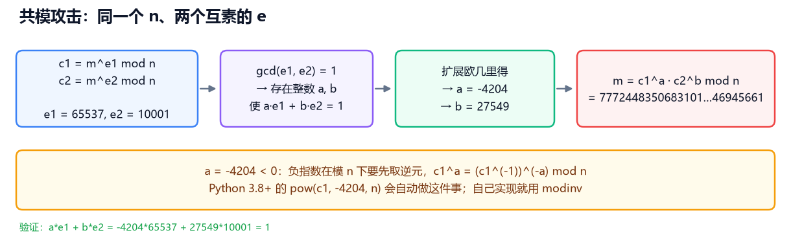
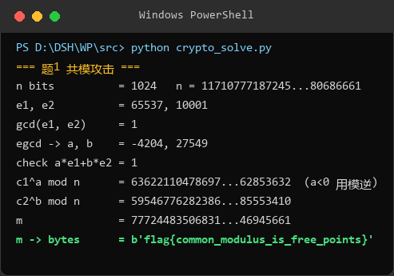

# RSA 共模攻击 · Crypto Writeup

> **来源**：本地练习 `D:\DSH\crypto题\1_共模攻击.txt`（对应省赛 RSA 共模类题）
> **考点**：同一明文、同一个 n、两个互素的 e → 扩展欧几里得直接还原明文
> **Flag**：`flag{common_modulus_is_free_points}`

---

## 1. 题目

附件给了 5 个数，没有 p、q：

```text
n  = 117107771872452175375387961467813343152188659621517377080584350833639478329925261752253694511398910310445766679855034996664672253951831060246606360601358690018119351170491351288996245120242684161339414173557870309731759980546051094475802637529560864856603982182764863279117618933538338793032108585458780686661
e1 = 65537
e2 = 10001
c1 = 42705147942957488932432820639632899268362772214621915588451660565315723770660061947222446400499888845949852412563294348144702923156966317735733585742076075494083633262409127412118643522555776673502525135906110290462089706845349001510618458205153572137076604698941987508903199977474487774524121886671275286306
c2 = 97952844063287682055380524628294205685500121188238205801521736071640808662448122834184696840241222101019066508199247927819883361012464293294945545864874085241830663298314400049783523375041785533029587260131908810250485901171897756386919637182511755459730862530187534851586250794691205473517869161420987386603
```

n 是 1024 bit（309 位十进制），c1、c2 也都是 1024 bit 以内。**没有给 p、q，也不该去分解 n。**

---

## 2. 漏洞在哪：同一份明文被两个指数加密

同一个明文 m 用同一个模数 n、两个不同的公钥指数加密了两次：

```text
c1 ≡ m^e1 (mod n)
c2 ≡ m^e2 (mod n)
```

只要 `gcd(e1, e2) = 1`，就存在整数 a、b 使：

```text
a·e1 + b·e2 = 1
```

两边同时作用在 m 上：

```text
c1^a · c2^b ≡ m^(a·e1 + b·e2) ≡ m^1 ≡ m (mod n)
```

所以**不需要私钥 d，也不需要分解 n**，直接把两个密文"组合"回来。本题 `gcd(65537, 10001) = 1`（10001 = 73×137，65537 是素数），条件满足。



*图 2-1：c1、c2 → 扩展欧几里得 → a=-4204、b=27549 → 组合出 m。*

---

## 3. 解出 a、b

扩展欧几里得（递归版）：

```python
def egcd(a, b):
    if b == 0:
        return a, 1, 0
    g, x, y = egcd(b, a % b)
    return g, y, x - (a // b) * y

g, a, b = egcd(65537, 10001)     # g=1, a=-4204, b=27549
assert a * 65537 + b * 10001 == 1
```

得到的 a 是**负数**（-4204），不能直接算 `c1 ** -4204`。处理方式有两种：

1. 先求 c1 在模 n 下的逆元，再取正指数：`pow(modinv(c1, n), -a, n)`；
2. Python 3.8+ 的 `pow` 直接支持负指数：`pow(c1, a, n)`（内部自动取模逆）。

---

## 4. 完整解题脚本

```python
import re

txt = open(r"D:\DSH\crypto题\1_共模攻击.txt", encoding="utf-8").read()
v = {k: int(x) for k, x in
     re.findall(r"^\s*(n|e1|e2|c1|c2)\s*=\s*(\d+)", txt, re.M)}
n, e1, e2, c1, c2 = v["n"], v["e1"], v["e2"], v["c1"], v["c2"]

def egcd(a, b):
    if b == 0:
        return a, 1, 0
    g, x, y = egcd(b, a % b)
    return g, y, x - (a // b) * y

def modinv(a, m):
    g, x, _ = egcd(a % m, m)
    assert g == 1
    return x % m

g, a, b = egcd(e1, e2)          # g=1, a=-4204, b=27549
m = (pow(modinv(c1, n), -a, n) * pow(c2, b, n)) % n
flag = m.to_bytes((m.bit_length() + 7) // 8, "big")
print(flag)

# 验算：m 必须能重新加密回 c1、c2
assert pow(m, e1, n) == c1 and pow(m, e2, n) == c2
```

---

## 5. 运行结果



*图 5-1：本次运行的真实输出（数字做了首尾截断显示）。*

```text
=== 题1 共模攻击 ===
n bits          = 1024   n = 11710777187245...80686661
e1, e2          = 65537, 10001
gcd(e1, e2)     = 1
egcd -> a, b    = -4204, 27549
check a*e1+b*e2 = 1
c1^a mod n      = 63622110478697...62853632  (a<0 用模逆)
c2^b mod n      = 59546776282386...85553410
m               = 77724483506831...46945661
m -> bytes      = b'flag{common_modulus_is_free_points}'
```

中间量完整值：

```text
a  = -4204
b  = 27549
m  = 777244835068310134547150529009884081435035238262359880468036647834298091516646945661
```

验算通过：`pow(m, 65537, n) == c1`、`pow(m, 10001, n) == c2` 均为 True。

---

## 6. Flag

```text
flag{common_modulus_is_free_points}
```

---

## 7. 复盘

1. **认题眼**：给同一个 n、两个 e、两个 c → 先算 `gcd(e1, e2)`，等于 1 就是共模攻击。
2. **不要分解 n**：1024 bit 的 n 拿去做 factordb/爆破是浪费时间，本题根本不需要 p、q。
3. **负指数是唯一坑**：`pow(c1, -4204, n)` 在 Python 3.8+ 可用；老版本或别的语言要先求模逆。
4. **必做验算**：把求出的 m 重新加密回 c1、c2，两次都对才说明组合没错；只看 bytes 像 flag 不够。
5. **同类变体**：gcd(e1,e2)=g>1 时只能得到 m^g，需要再开 g 次方根（且 m^g < n 时可直接整数开方）；如果 e 相同只是 c 不同，那是"广播攻击"，需要 CRT。

---

## 8. 本题文件

| 文件 | 说明 |
|---|---|
| `D:\DSH\crypto题\1_共模攻击.txt` | 题目数据 |
| `WP\src\crypto_solve.py` | 六道密码题的统一求解脚本 |
| `WP\src\out\crypto_report.txt` | 完整运行日志 |
| `WP\src\out\crypto_result.json` | 中间量与 flag |
| `WP\images\crypto1-*.png` | 本文配图 |
