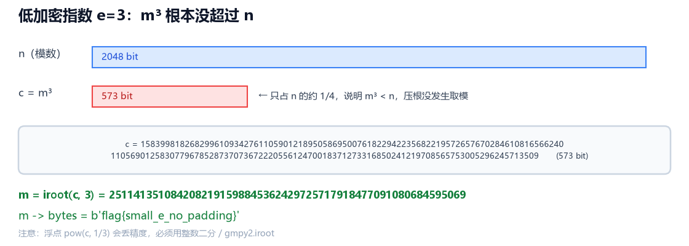
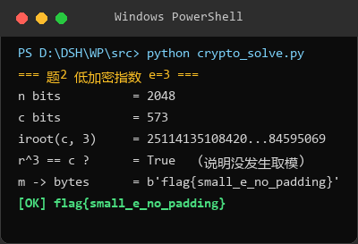

# RSA 低加密指数 · Crypto Writeup

> **来源**：本地练习 `D:\DSH\crypto题\2_低指数.txt`
> **考点**：e=3 且明文很短 → `m³ < n`，c 本身就是完全立方数，直接开整数三次方根
> **Flag**：`flag{small_e_no_padding}`

---

## 1. 题目

```text
n = 18302352059231756867174411269661585812640819688861117006152504320047382815984986341687796508737604614521631094016373953895805495572409186577700096550070187461622089011228217379172676902886334607158511054994830661649595350847553436167086261823503541464037113152078498713630554715197540254329240613808511546340340697800238896840297109705720907737076678202868872898539225120235669241010738486167264005302441050126157144105316377107546848309624001737875766224315116296632552974502581233172735640576220461809306730708973921714050422313602862841845870047464543939241432919954579054971145716119407150074706565425511383013507
e = 3
c = 15839981826829961093427611059012189505869500761822942235682219572657670284610816566240110569012583077967852873707367222055612470018371273316850241219708565753005296245713509
```

---

## 2. 判断：这次连"模"都没用上

RSA 加密是 `c = m^e mod n`。如果 `m^e < n`，那么取模这一步**什么都没做**：

```text
m³ < n  →  c = m³（普通整数）
```

看一眼位数就能判断：

| 量 | bit 长度 |
|---|---|
| n | 2048 bit |
| c | **573 bit** |

c 只有 n 的四分之一左右。一个 2048 bit 的模数，加密结果只有 573 bit，说明 `m³` 根本没到 n 的量级 —— 直接对 c 开三次方根即可。



*图 2-1：c 的位数远小于 n，m³ 没有被取模，c 是完全立方数。*

---

## 3. 必须用整数开方

```python
# 错误做法：浮点会丢精度
m = int(c ** (1/3))          # 大整数下偏差可能很大

# 正确做法：整数二分（或 gmpy2.iroot）
def iroot(x, k):
    lo, hi = 0, 1 << ((x.bit_length() // k) + 2)
    while lo < hi:
        mid = (lo + hi + 1) // 2
        if mid ** k <= x:
            lo = mid
        else:
            hi = mid - 1
    return lo
```

`iroot` 的 hi 上界用 `1 << (bit_length//k + 2)`，保证覆盖真实根，二分 `O(bit)` 次即可。

---

## 4. 完整解题脚本

```python
import re

txt = open(r"D:\DSH\crypto题\2_低指数.txt", encoding="utf-8").read()
v = {k: int(x) for k, x in re.findall(r"^\s*(n|e|c)\s*=\s*(\d+)", txt, re.M)}
n, e, c = v["n"], v["e"], v["c"]

def iroot(x, k):
    lo, hi = 0, 1 << ((x.bit_length() // k) + 2)
    while lo < hi:
        mid = (lo + hi + 1) // 2
        if mid ** k <= x:
            lo = mid
        else:
            hi = mid - 1
    return lo

m = iroot(c, e)
assert m ** e == c                      # 确认 c 是完全立方数
print(m.to_bytes((m.bit_length() + 7) // 8, "big"))
```

---

## 5. 运行结果



*图 5-1：本次运行的真实输出。*

```text
=== 题2 低加密指数 e=3 ===
n bits          = 2048
c bits          = 573
iroot(c, 3)     = 25114135108420...84595069
r^3 == c ?      = True   (说明没发生取模)
m -> bytes      = b'flag{small_e_no_padding}'
```

```text
m = 2511413510842082191598845362429725717918477091080684595069
```

`m³ == c` 为 True，这是本题最硬的判据：c 是完全立方数，不可能是"取模后的结果"（取模后一般不是完全幂）。

---

## 6. Flag

```text
flag{small_e_no_padding}
```

---

## 7. 复盘

1. **先比位数再动手**：`c.bit_length()` 远小于 `n.bit_length()`，基本就是"没取模"，先试整数开方，不要上来就分解 n。
2. **e=3 的三种情况**：`m³ < n`（本题，直接开方）、`m³ > n` 但不太大（可试 `iroot(c + k·n, 3)` 爆破 k）、`m³` 很大（要 Coppersmith 小根攻击）。先试最便宜的。
3. **整数开方不能偷懒**：`c ** (1/3)` 在几百 bit 时就会出现 ±1 甚至更大的误差，必须整数二分开方后 `assert m**3 == c`。
4. **验算方式**：`m**e == c`（而不是 `pow(m, e, n) == c`）；如果两者都成立，说明确实没取模。
5. **同源题**：省赛里"e 很小 + flag 不长"的题基本都是这条路，看到 e=3/5/17 且 c 比 n 小很多，先开方。

---

## 8. 本题文件

| 文件 | 说明 |
|---|---|
| `D:\DSH\crypto题\2_低指数.txt` | 题目数据 |
| `WP\src\crypto_solve.py` | 求解脚本（含 iroot 实现） |
| `WP\src\out\crypto_report.txt` | 完整运行日志 |
| `WP\images\crypto2-*.png` | 本文配图 |
