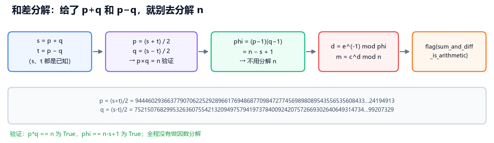
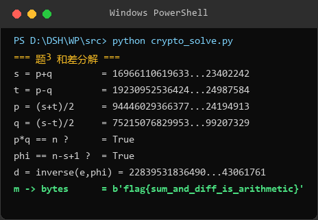

# RSA 和差分解 · Crypto Writeup

> **来源**：本地练习 `D:\DSH\crypto题\3_和差分解.txt`（对应省赛「简单数学题」类）
> **考点**：已知 `p+q` 和 `p−q`，用初等代数直接还原 p、q，**不分解 n**
> **Flag**：`flag{sum_and_diff_is_arithmetic}`

---

## 1. 题目

```text
n = 71037653550761364318085403032919956756358397928390117920709750611581713675187114292351232525162324785642632435674137071764239690448617668190250378416171682481564414388421565934888036165204315885477840519942031764758845201468867582804591813755908357507433185871594879072606710653770928468924262511701694117377
e = 65537
c = 50582232018972347421471972719643484695750656194533323653525408660909858651407325117319270446496754369289524720585019162290596972068080638739863499198682423187507151024221099296398130998456312524482217406362087176784835396581915943484654172777669978014679522520070033203887134547792308111566183901889649914786
s = 16966110619633117066980714217567452810744768736987774707588461971849231684270077719174158550184423295836256884749534667296023261976143605215431568323402242
t = 1923095253642464345469871575667936926797200718503623254202409158862936995153574823135415306271283172367004189183375223112435248926158139718749739524987584
```

题面直接说明：`s = p + q`，`t = p − q`（p > q，所以 t 为正）。

---

## 2. 思路：多余的信息就是漏洞

正常 RSA 只给 `n = p·q`，分解 1024 bit 的 n 很难。但这道题额外给了一个线性关系，p、q 就被唯一确定了：

```text
p = (s + t) / 2
q = (s − t) / 2
```

因为 p、q 都是整数，`s+t` 和 `s−t` 必然都是偶数（可以顺手断言）。

拿到 p、q 之后就是标准解密，而且欧拉函数还可以用一个更快的式子：

```text
phi = (p−1)(q−1) = pq − p − q + 1 = n − s + 1
```

也就是说**连 p×q 都不用展开**，直接用 n 和 s 就能算 phi。



*图 2-1：s、t → p、q → phi = n − s + 1 → d → m。*

---

## 3. 完整解题脚本

```python
import re

txt = open(r"D:\DSH\crypto题\3_和差分解.txt", encoding="utf-8").read()
v = {k: int(x) for k, x in
     re.findall(r"^\s*(n|e|c|s|t)\s*=\s*(\d+)", txt, re.M)}
n, e, c, s, t = v["n"], v["e"], v["c"], v["s"], v["t"]

assert (s + t) % 2 == 0 and (s - t) % 2 == 0     # p、q 必须是整数
p = (s + t) // 2
q = (s - t) // 2

assert p * q == n                                 # 还原是否正确
phi = (p - 1) * (q - 1)
assert phi == n - s + 1                           # 这个捷径也成立

d = pow(e, -1, phi)                               # Python 3.8+ 求模逆
m = pow(c, d, n)
print(m.to_bytes((m.bit_length() + 7) // 8, "big"))
```

> 没有 `pow(e, -1, phi)` 的环境，用扩展欧几里得 `modinv(e, phi)` 代替，结果一样。

---

## 4. 运行结果



*图 4-1：本次运行的真实输出。*

```text
=== 题3 和差分解 ===
s = p+q         = 16966110619633...23402242
t = p-q         = 19230952536424...24987584
p = (s+t)/2     = 94446029366377...24194913
q = (s-t)/2     = 75215076829953...99207329
p*q == n ?      = True
phi == n-s+1 ?  = True
d = inverse(e,phi) = 22839531836490...43061761
m -> bytes      = b'flag{sum_and_diff_is_arithmetic}'
```

两个 `True` 是本题的验收点：

- `p*q == n`：说明 p、q 恢复正确；
- `phi == n - s + 1`：说明 `phi` 的捷径式子成立，没算错。

---

## 5. Flag

```text
flag{sum_and_diff_is_arithmetic}
```

---

## 6. 复盘

1. **先看"多给了什么"**：正常 RSA 只有 n、e、c；本题多了 s、t 两个等式 → 直接解方程，比分解 n 快几个数量级。
2. **phi 的等价式**：`(p−1)(q−1) = n − (p+q) + 1 = n − s + 1`。记住这个式子，考场上能省一步乘法，也能当校验。
3. **整数性断言**：p、q 必须是整数，`(s±t) % 2 == 0` 不成立就说明 s、t 不是 p±q（或者你把 p、q 搞反了，t 会变负）。
4. **不要展开大数**：全程只有加减和一次 `pow`，1024 bit 也是毫秒级。
5. **同类**：给 `p+q`、给 `phi`、给 `d`、给 `dp`/`dq` 都属于"信息泄露型 RSA"，思路都是**用泄露量把 p、q 或 phi 解出来**。

---

## 7. 本题文件

| 文件 | 说明 |
|---|---|
| `D:\DSH\crypto题\3_和差分解.txt` | 题目数据 |
| `WP\src\crypto_solve.py` | 求解脚本 |
| `WP\src\out\crypto_report.txt` | 完整运行日志 |
| `WP\images\crypto3-*.png` | 本文配图 |
