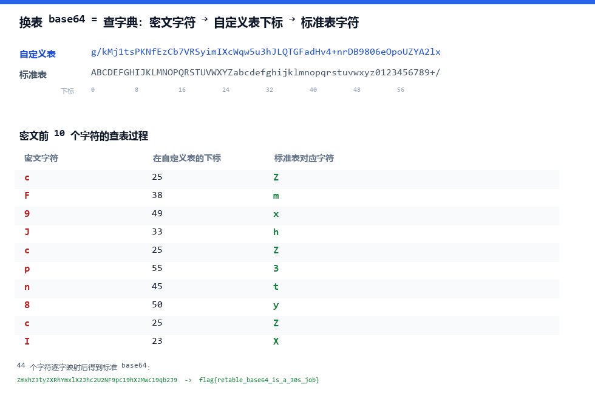
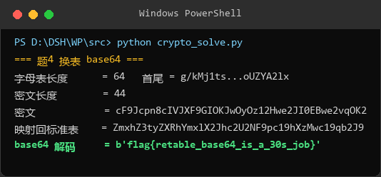

# 换表 Base64 · Crypto Writeup

> **来源**：本地练习 `D:\DSH\crypto题\4_换表base64.txt`
> **考点**：Base64 的本质是"6 bit 查表"，换字母表只是换字典，不是加密
> **Flag**：`flag{retable_base64_is_a_30s_job}`

---

## 1. 题目

```text
自定义字母表（64 个字符，顺序被打乱）：
g/kMj1tsPKNfEzCb7VRSyimIXcWqw5u3hJLQTGFadHv4+nrDB9806eOpoUZYA2lx

密文：
cF9Jcpn8cIVJXF9GIOKJwOyOz12Hwe2JI0EBwe2vqOK2
```

---

## 2. 原理：Base64 就是"6 bit → 一个字符"

标准 Base64 的字母表是：

```text
ABCDEFGHIJKLMNOPQRSTUVWXYZabcdefghijklmnopqrstuvwxyz0123456789+/
```

编码时把数据按 6 bit 切开，每 6 bit 得到 0–63 的下标，再去字母表里取第 index 个字符。**换表题只是把这个字母表换了顺序**：

- 解码时不能直接用标准表，要先用**自定义表**查出字符的下标；
- 再用这个下标去**标准表**取字符，得到一段标准 Base64；
- 最后 `base64.b64decode` 就还原了。

换句话说：**不是破解，是查字典**。



*图 2-1：密文 `c F 9 J c p n 8 …` 在自定义表里的下标是 `25 38 49 33 25 55 45 50 …`，对应标准表字符 `Z m x h Z 3 t y …`。*

---

## 3. 前几个字符的查表过程

| 密文字符 | 在自定义表的下标 | 标准表对应字符 |
|---|---|---|
| c | 25 | Z |
| F | 38 | m |
| 9 | 49 | x |
| J | 33 | h |
| c | 25 | Z |
| p | 55 | 3 |
| n | 45 | t |
| 8 | 50 | y |

拼出来的开头 `ZmxhZ3ty…` 正是 `flag{…}` 的标准 Base64 前缀（`ZmxhZ3` ↔ `flag`）。

---

## 4. 完整解题脚本

```python
import base64

STD = "ABCDEFGHIJKLMNOPQRSTUVWXYZabcdefghijklmnopqrstuvwxyz0123456789+/"
TBL = "g/kMj1tsPKNfEzCb7VRSyimIXcWqw5u3hJLQTGFadHv4+nrDB9806eOpoUZYA2lx"
CIPHER = "cF9Jcpn8cIVJXF9GIOKJwOyOz12Hwe2JI0EBwe2vqOK2"

assert len(TBL) == 64 and len(set(TBL)) == 64      # 必须是 64 个互不相同的字符

std_b64 = "".join(STD[TBL.index(ch)] for ch in CIPHER)
std_b64 += "=" * (-len(std_b64) % 4)               # 长度不是 4 的倍数就补 =

plain = base64.b64decode(std_b64)
print(std_b64)
print(plain)
```

反向（把标准 Base64 变成换表密文）只需要把两条语句的下标关系倒过来：

```python
custom = "".join(TBL[STD.index(ch)] for ch in std_b64 if ch in STD)
```

---

## 5. 运行结果



*图 5-1：本次运行的真实输出。*

```text
=== 题4 换表 base64 ===
字母表长度      = 64   首尾 = g/kMj1ts...oUZYA2lx
密文长度        = 44
密文            = cF9Jcpn8cIVJXF9GIOKJwOyOz12Hwe2JI0EBwe2vqOK2
映射回标准表    = ZmxhZ3tyZXRhYmxlX2Jhc2U2NF9pc19hXzMwc19qb2J9
base64 解码     = b'flag{retable_base64_is_a_30s_job}'
```

密文长度 44，正好是 4 的倍数，所以本题不需要补 `=`（44/4×3 = 33 字节，flag 也正好 33 字节）。

---

## 6. Flag

```text
flag{retable_base64_is_a_30s_job}
```

---

## 7. 复盘

1. **换表 = 换字典**：Base64 的 bit 流没变，改变的只是"下标 → 字符"的映射。理解这一点，换表题就是 30 秒的活。
2. **两步映射不要搞反**：密文 →（自定义表查下标）→ 标准表取字符。反过来会把数据搞得更乱。
3. **长度和填充**：Base64 长度必须是 4 的倍数；缺 `=` 要补，多了 `=` 要去掉再查表（本题没有填充）。
4. **字母表合法性**：换表题给的字符串必须正好 64 个且不重复，先 `len(set(tbl)) == 64` 断言一下，能提前发现抄错。
5. **同类延伸**：换表也常出现在"自定义 Base32/Base58"、CTF 的 `base64` 变种题里；用 CyberChef 的 "From Base64" 自定义 alphabet 也能一键做。
6. **本题的坑**：题面末尾本来就贴了 flag，但**先自己映射一遍**才知道那行是不是真的 —— 这次映射结果与题面一致。

---

## 8. 本题文件

| 文件 | 说明 |
|---|---|
| `D:\DSH\crypto题\4_换表base64.txt` | 题目数据 |
| `WP\src\crypto_solve.py` | 求解脚本 |
| `WP\src\out\crypto_report.txt` | 完整运行日志 |
| `WP\images\crypto4-*.png` | 本文配图 |
