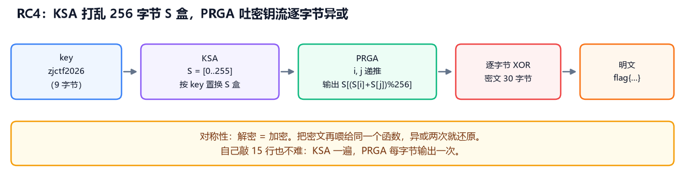
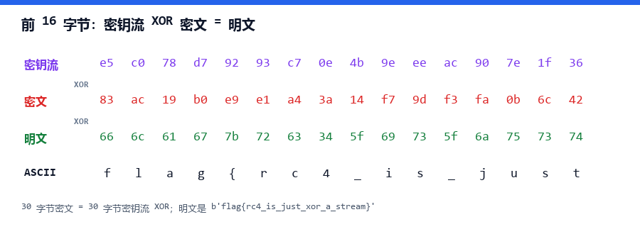
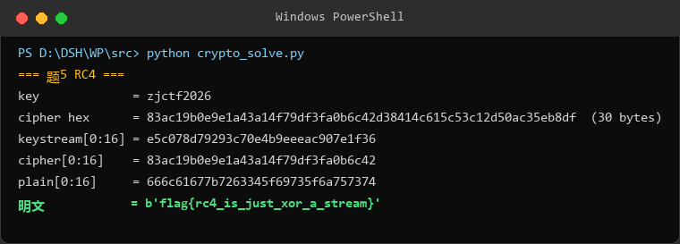

# RC4 流密码 · Crypto Writeup

> **来源**：本地练习 `D:\DSH\crypto题\5_RC4.txt`
> **考点**：RC4 是流密码，加密解密是同一个函数（异或两次还原）
> **Flag**：`flag{rc4_is_just_xor_a_stream}`

---

## 1. 题目

```text
key        = zjctf2026
密文(hex)  = 83ac19b0e9e1a43a14f79df3fa0b6c42d38414c615c53c12d50ac35eb8df   （30 字节）
```

---

## 2. RC4 是什么

RC4 只有两步：

1. **KSA（Key Scheduling Algorithm）**：用 key 把一个 256 字节的 S 盒打乱；
2. **PRGA（Pseudo-Random Generation Algorithm）**：不断交换 S 盒并输出字节，得到与明文等长的**密钥流**。

加密就是 `密文 = 明文 ⊕ 密钥流`，解密就是 `明文 = 密文 ⊕ 密钥流` —— **同一个函数，调用两次就还原**，不需要"解密算法"。



*图 2-1：key → KSA → PRGA → 逐字节 XOR。*

---

## 3. 15 行实现

```python
def rc4(key, data):
    if isinstance(key, str):
        key = key.encode()
    S = list(range(256))
    j = 0
    # KSA
    for i in range(256):
        j = (j + S[i] + key[i % len(key)]) % 256
        S[i], S[j] = S[j], S[i]
    # PRGA + XOR
    out, i, j = bytearray(), 0, 0
    for b in data:
        i = (i + 1) % 256
        j = (j + S[i]) % 256
        S[i], S[j] = S[j], S[i]
        out.append(b ^ S[(S[i] + S[j]) % 256])
    return bytes(out)
```

- KSA 跑 256 次，`j` 由 key 的循环字节决定；
- PRGA 每个明文字节输出一个密钥流字节，`k = S[(S[i] + S[j]) % 256]`；
- 加密、解密都调用 `rc4(key, data)`。

---

## 4. 逐字节看异或



*图 4-1：密钥流、密文、明文三行对齐，前 16 字节解出 `flag{rc4_is_just`。*

| 位置 | 密钥流 | 密文 | 明文 |
|---|---|---|---|
| 0–15 | `e5c078d79293c70e4b9eeeac907e1f36` | `83ac19b0e9e1a43a14f79df3fa0b6c42` | `666c61677b7263345f69735f6a757374` |
| ASCII | — | — | `flag{rc4_is_just` |

验证第一个字节：`0x83 ⊕ 0xE5 = 0x66 = 'f'`。

---

## 5. 完整解题脚本

```python
import re

txt = open(r"D:\DSH\crypto题\5_RC4.txt", encoding="utf-8").read()
key = re.search(r"key\s*=\s*(\S+)", txt).group(1)
chex = re.search(r"密文\(hex\)\s*=\s*([0-9a-fA-F]+)", txt).group(1)
ct = bytes.fromhex(chex)

def rc4(key, data):
    key = key.encode() if isinstance(key, str) else key
    S = list(range(256)); j = 0
    for i in range(256):
        j = (j + S[i] + key[i % len(key)]) % 256
        S[i], S[j] = S[j], S[i]
    out, i, j = bytearray(), 0, 0
    for b in data:
        i = (i + 1) % 256
        j = (j + S[i]) % 256
        S[i], S[j] = S[j], S[i]
        out.append(b ^ S[(S[i] + S[j]) % 256])
    return bytes(out)

print(rc4(key, ct))          # 解密 = 加密
```

> 想看密钥流，可以把 `data` 换成 `b"\x00" * len(ct)`：密文异或 0 就是密钥流本身。

---

## 6. 运行结果



*图 6-1：本次运行的真实输出。*

```text
=== 题5 RC4 ===
key             = zjctf2026
cipher hex      = 83ac19b0e9e1a43a14f79df3fa0b6c42d38414c615c53c12d50ac35eb8df  (30 bytes)
keystream[0:16] = e5c078d79293c70e4b9eeeac907e1f36
cipher[0:16]    = 83ac19b0e9e1a43a14f79df3fa0b6c42
plain[0:16]     = 666c61677b7263345f69735f6a757374
明文            = b'flag{rc4_is_just_xor_a_stream}'
```

---

## 7. Flag

```text
flag{rc4_is_just_xor_a_stream}
```

---

## 8. 复盘

1. **对称性是关键**：RC4 没有"解密模式"，把密文当输入再跑一次就还原。不要去找 `decrypt()`。
2. **key 的字节循环**：KSA 里 `key[i % len(key)]` 保证 key 用完后从头循环。
3. **S 盒是 256 字节**：`i`、`j` 都必须 `% 256`；漏掉任何一个都会算错。
4. **流密码的通病**：同一 key 重复使用、或 key 复用加密不同消息，密钥流就重复，异或一下就能还原明文 —— 这是 RC4 在真实世界里被弃用的原因之一。
5. **比赛里怎么写**：自己敲 15 行最稳（比赛机器可能没装 `pycryptodome`）；有装的话 `Crypto.Cipher.ARC4.new(key).decrypt(ct)` 等价。
6. **本题不需要爆破 key**：key 直接给了，考点是"会不会实现流密码"，不是密码分析。
7. 题目文件末尾附了 flag（练习题的答案标注）；上面的结果是从 `key + 密文` 独立算出来的，与标注一致。

---

## 9. 本题文件

| 文件 | 说明 |
|---|---|
| `D:\DSH\crypto题\5_RC4.txt` | 题目数据 |
| `WP\src\crypto_solve.py` | 求解脚本（含 keystream 函数） |
| `WP\src\out\crypto_report.txt` | 完整运行日志 |
| `WP\images\crypto5-*.png` | 本文配图 |
