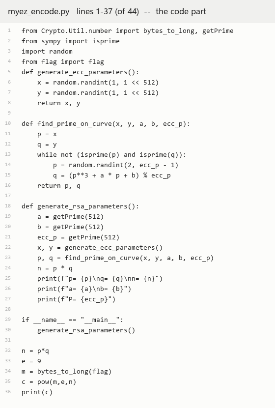
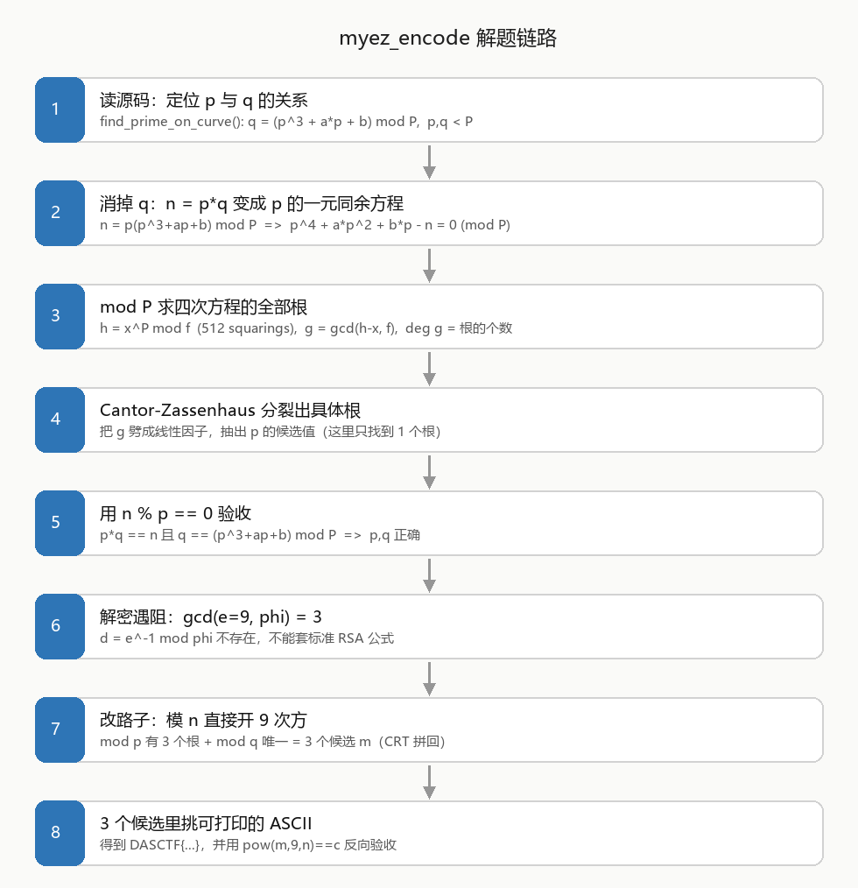
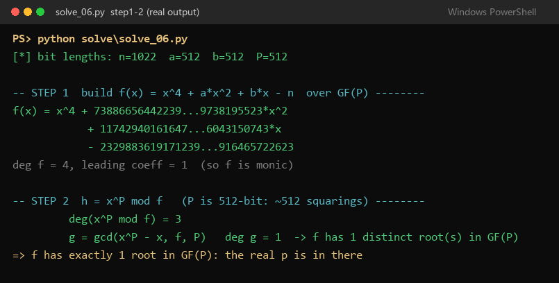
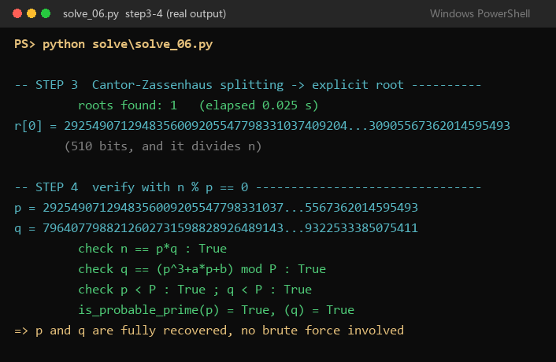
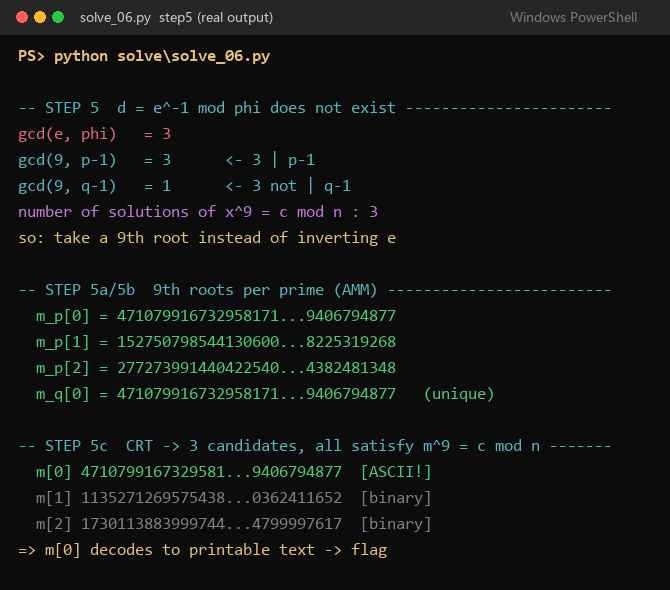
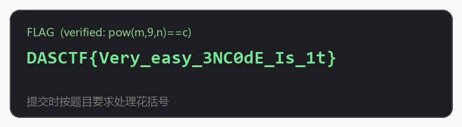

# 第 6 题 · myez_encode — Writeup

> **本合集路径说明**：本篇原属 `CTF-WP\06-myez_encode`，正文里写的 `solve/xxx.py`、`files/xxx` 是**原工程相对路径**；脚本已复制到本合集 `src\zj06\` 下（附件未随迁，需要时去原工程取）。

> 2024 浙江省大学生网络与信息安全竞赛（预赛） · 分类：Crypto · 难度：★★★☆☆

| 项目 | 内容 |
|---|---|
| 题目名 | myez_encode |
| 分类 | Crypto |
| 附件 | `files/tempdir/CRYPTO附件/myez_encode.py`（2017 B，只有源码 + 注释里的 n,a,b,P,c） |
| 一句话 | `q ≡ p³+ap+b (mod P)` 把 `n = p·q` 变成 `p` 的四次同余方程，解出 `p` 后才发现 `gcd(e,φ)=3`、`d` 不存在，改成模 `n` 开 9 次方 |
| 最终 flag | `DASCTF{Very_easy_3NC0dE_Is_1t}` |

**最终答案**

```
DASCTF{Very_easy_3NC0dE_Is_1t}
```

[TOC]

## 一、题目长什么样（先建立直觉）

附件里唯一的东西是一个 `myez_encode.py`。它做的事很“唬人”：先造一个 512 bit 的素数 `ecc_p`（记作 `P`），再造两个 512 bit 的素数 `a`、`b`，然后装模作样地“在椭圆曲线上找一个点”，要求 `p`、`q` 同时是素数，并且

```python
q = (p**3 + a * p + b) % ecc_p
```

一旦找到这样的 `(p, q)`，就拿 `n = p * q` 当 RSA 模数，`e = 9`，把 flag 加密成 `c = pow(m, 9, n)`。源码最后注释里直接给了 `n, a, b, P, c` 五个数——**没有给 `p`、`q`**。

所以这题的形状是：**一个 1022 bit 的 RSA 模数，公钥 `(n, e=9)` 齐全，但 `p`、`q` 被一段“曲线素数生成”的逻辑绑在了一起**。`n` 是 1022 bit（≈ 308 位十进制），直接分解是不可能的；能不能拿下，全看能不能把 `p`、`q` 之间那条额外关系变成可利用的方程。

关键点先摆出来：`a`、`b`、`P` 三个“应该保密”的参数，源码把它们的值全部写在注释里了。**这三个数就是整道题的钥匙**。



*图 0：附件源码的代码部分（第 1–37 行，由 `make_images.py` 直接读原文件渲染，未经改动）。第 38 行往后是注释里的 `n, a, b, P, c` 五个超长数字，正文不贴、留给脚本读。看图时请盯住第 13–15 行的 `while` 循环，以及第 32–34 行“先 `n = p*q`、再 `e = 9`、再 `c = pow(m,e,n)`”这三句——整道题就藏在这几行里。*

## 二、解题思路总览

先把结论说完：这道题是**两步**，而且第二步会绊人。

第一步（也是全题唯一的思维跳跃）：`q ≡ p³+ap+b (mod P)`，两边乘 `p` 就得到 `n ≡ p⁴+ap²+bp (mod P)`，于是 `p` 是一个**完全已知的**四次同余方程在 `GF(P)` 上的根。求出所有根，谁整除 `n` 谁就是 `p`。

第二步：算 `φ=(p−1)(q−1)` 时发现 `gcd(e=9, φ)=3`，`d = 9⁻¹ mod φ` **不存在**。标准 RSA 公式在这里直接报废，必须回到“解方程 `x⁹ ≡ c`”的本意，分别对 `p`、`q` 开 9 次方再用 CRT 拼回 3 个候选，挑可打印的那个。



*图 1：完整链路。注意第 6 块是“撞墙”而不是“胜利”——先按标准 RSA 走会卡在 `gcd(9,φ)=3`，才有第 7、8 块的开方路线。*

## 三、逐步复现

### 3.1 读源码：把 `q` 从式子里消掉（本题唯一的思维跳跃）

先看真正干活的那个函数，原文如下（`myez_encode.py` 第 10–16 行）：

```python
def find_prime_on_curve(x, y, a, b, ecc_p):
    p = x
    q = y
    while not (isprime(p) and isprime(q)):
        p = random.randint(2, ecc_p - 1)
        q = (p**3 + a * p + b) % ecc_p
    return p, q
```

注意赋值顺序：先 `p = random.randint(2, ecc_p - 1)`，再 `q = (p**3 + a*p + b) % ecc_p`。`q` 用的是**新**的 `p`。循环退出时 `isprime(p) and isprime(q)` 成立，而这一对 `(p, q)` 就是最后一次循环体算出来的那一对——所以关系一定成立。

（一个必须自己核对掉的细节：进入 `while` 之前 `p = x`、`q = y`，`x`、`y` 是两个互相独立的随机数。如果 `x`、`y` **碰巧**都是素数，循环体一次都不执行，`q` 就不满足那个三次关系了。这个概率是 `(1/ln 2⁵¹²)² ≈ (1/355)² ≈ 8×10⁻⁶`，百万分之一量级，实际不会遇到；而且我们后面会验证 `q == (p³+ap+b) mod P` 成立，等于反向确认了它确实走了循环体这条路。**结论：这类"随机初始化 + 循环重赋值"的代码，必须确认退出时用的是哪一次赋的值。**）

于是我们手里有两条同时成立的事实：

```
(1)  n = p · q                     —— n 是整数意义上的乘积（精确相等）
(2)  q ≡ p³ + a·p + b   (mod P)     —— q 是那个三次式模 P 的余数
```

**关键动作：把 (2) 的两边同乘 `p`。**

```
        q  ≡  p³ + a·p + b            (mod P)      ← (2)
     p·q  ≡  p⁴ + a·p² + b·p          (mod P)      ← 两边乘 p
        n  ≡  p⁴ + a·p² + b·p         (mod P)      ← 用 (1) 把 p·q 换成 n
```

移项，得到本题的核心方程：

```
f(x) = x⁴ + a·x² + b·x − n ≡ 0   (mod P)     ,   f(p) ≡ 0
```

**为什么这一步这么值钱？** 因为 `a, b, P, n` 四个数全是公开的（注释里就有），所以 `f(x)` 是一个**系数完全已知**的四次多项式。原来我们在找两个未知的 510 bit 素数（无解的信息量），现在变成“在一个已知多项式上找根”——而 `GF(P)` 上 `d` 次多项式最多只有 `d` 个根，候选数量从 `~2⁵¹⁰` 个直接压缩到 **4 个**。

还差最后一块拼图，它解释了为什么“模 P 的根”能直接当 `p` 用：

> `p = random.randint(2, ecc_p - 1)` ⇒ `p < P`；又 `q = (...) % ecc_p` ⇒ `q < P`。
> 所以 `p` 落在 `[0, P)` 这个“标准区间”里，模 `P` 的代表元就是它自己 —— 我们算出 `f` 在 `[0,P)` 里的哪个数是根，那个数**就是** `p`，不需要 Coppersmith、不需要格、不需要枚举 `p + kP`。

这就是本题的思维跳跃：**不是去分解 `n`，而是把 `n` 从“要分解的乘积”改写成“模方程里的常数项”**。



*图 2：`f(x)` 的构造与第一步求解（长数字用 `...` 截断，完整值在 `solve/out/result.json`）。注意 `deg(x^P mod f) = 3`（四次多项式取模后次数必 ≤ 3，符合预期），`deg g = 1` 说明这个四次方程在 `GF(P)` 里**只有一个**根。*

### 3.2 零基础补课：模多项式求根到底在干什么

这一步不写清，后面全是黑箱。用三段话说清。

**(a) `GF(P)` 上的“根”是什么。**
模 `P` 的世界里只有 `0, 1, ..., P−1` 这 `P` 个数，加减乘全部“到 `P` 就绕回来”。`f(x) ≡ 0 (mod P)` 的意思是：把某个数代进去算，结果是 `P` 的倍数。例如 `x² ≡ 1 (mod 7)` 的根是 `1` 和 `6`（因为 `6²=36=35+1`）。这就是普通的“解方程”，只是算术规则换了。

**(b) 为什么不能像中学那样套公式。**
中学解四次方程靠“配方法 + 求平方根”，而“求平方根 mod P”本身就可能无解、也可能有多个解；更要命的是 `P` 是 512 bit，我们连“这个数是不是完全平方”都不能靠试。所以真正的算法不走“求根公式”，而走一条反向的路——**先问“哪些数是根”，而不是“根等于多少”**。

**(c) 核心技巧：`x^P − x` 是一张“根的筛子”。**
费马小定理说：对任意 `r ∈ GF(P)`，都有 `r^P ≡ r (mod P)`；反过来，只有这些 `r` 满足它（`x^P − x` 在 `GF(P)` 上恰好分解成 `x(x−1)(x−2)···(x−P+1)`）。所以：

```
gcd( x^P − x , f(x) )  =  f 的「所有一次因子的乘积」
```

- 如果 `f` 在 `GF(P)` 里有 `k` 个不同根，这个 gcd 的**次数就等于 `k`**——一步就能判断“有几个根”；
- 具体是哪几个根，再把这个 gcd 劈成一次因子即可。

剩下的工程问题只有两个，都能手写：

1. `x^P mod f` 怎么算？`P` 是 512 bit，不能真的连乘 `P` 次。用**快速幂**：平方 → 取模 → 再平方，约 `log₂P ≈ 512` 轮，每轮都是“多项式乘法 + 多项式取模”，而“多项式 mod `f`”和“整数 mod `m`”逻辑一模一样（带余除法）。
2. 劈因子用什么？**Cantor–Zassenhaus**：随机取 `δ`，算 `gcd(g, (x+δ)^((P−1)/2) − 1)`，每次大约有 1/2 的概率把 `g` 劈成两半，重复到每个因子次数为 1 为止。

`P` 的大小在这里完全不是问题——512 轮多项式平方，总共 0.02 秒。**这类题的门槛不在算力，在于知不知道 `gcd(x^P−x, f)` 这一招。**

（这里没有任何库可用：环境里没有 sympy，所以 `solve/polyroots.py` 从零实现了多项式加、乘、带余除法、取模、gcd、快速幂和 CZ 分裂，并在 `__main__` 里带三个自测：`(x−1)(x−2)(x−3)(x−4)` 在 `mod 1000003` 下必须返回 `[1,2,3,4]`；`x²+1 mod 3` 必须返回空；`(x−2)²` 必须只返回 `[2]`。**先让工具在小例子上和手算对得上，再去打真题**——这一步别省。）

### 3.3 求根：先判“有几个根”，再劈出具体值

把 `a, b, n, P` 代进 `f(x) = x⁴ + a x² + b x − n`（注意没有 `x³` 项，这一项系数是 0），然后：

```python
h, info = roots_split(f, P)       # h = x^P mod f ; 返回 gcd(x^P-x, f)
roots, _ = roots_mod_prime(f, P)  # CZ 分裂 -> 具体的根
```

实跑结果：`deg(x^P mod f) = 3`、`deg g = 1`。`deg g = 1` 的含义是**这个四次方程在 `GF(P)` 里只有一个根**。

这一点值得多想一秒：从 `P ≈ 2⁵¹²` 个数里随机挑，命中四次多项式根的概率约 `4/P`，所以“期望根数 ≈ 1”是正常现象，一个根反而是最可能的结果。真正的 `p` 就在这唯一的根上——`g(x) = x + c` 直接给出 `p = −c mod P`：

```
p = 2925490712948356009205547798331037409204468852265154197929696123102317330847028997592576845375767951888373634075473448002921250636926630905567362014595493   (510 bit)
```

拿到 `p` 之后 `q = n // p`：

```
q = 7964077988212602731598828926489143570796450850963162530397620970577507270219530635660167912693046701894468774510746807002256765035407708129322533385075411   (512 bit)
```



*图 3：只有一个根（`roots found: 1`），且这个根真的整除 `n`（`<== divides n`）。下半部分是四道验收全部 `True`：`n == p*q`、`q == (p³+ap+b) mod P`、`p,q < P`、Miller–Rabin 素性。*

### 3.4 验收：为什么必须验 `n % p == 0`

求根算法（多项式 gcd、CZ）只要有一处系数或下标写错，返回的“根”就是一个看着很像、其实不相干的 510 bit 随机数——它不会报错，只会让你在后面算出乱码。所以拿到候选根后**必须**做这三道检查，任何一道不过就说明前面的推导或代码错了：

```python
assert n % p == 0                      # 它真的是 n 的因子
assert n == p * q
assert q == (p**3 + a * p + b) % P     # 它满足源码里那条曲线关系
```

实测三条全过，另外我独立验了一次 `f(p) mod P == 0`，也等于 0。到这一步 `p, q` 可以认为是**完全恢复、毫无疑问**。

### 3.5 撞墙：`e = 9` 和 `φ` 不互素，`d` 不存在

标准 RSA 解密就一行：`d = inverse(e, φ)`，`m = pow(c, d, n)`。这里第一行就炸了：

```
gcd(e, phi) = 3
```

`e = 9 = 3²`，而 `p ≡ 1 (mod 3)`，所以 `3 | (p−1)`；`q ≡ 2 (mod 3)`，所以 `3 ∤ (q−1)`。于是 `3 | φ` 但 `9 ∤ φ`，`gcd(9, φ) = 3 ≠ 1` —— **`9` 在模 `φ` 下没有逆元，`d` 根本不存在**。

（这里 `gcd` 到底是 3 还是 9，可以精确论断：令 `v₃(·)` 表示“含 3 的幂次”，则 `v₃(φ) = v₃(p−1) + v₃(q−1)`。本题 `p−1 = 3¹ · t`，`3 ∤ t`，故 `v₃(p−1) = 1`；`q ≡ 2 (mod 3)` 故 `v₃(q−1) = 0`。相加得 `v₃(φ) = 1`，即 `3 ‖ φ`，所以 `gcd(9, φ) = 3` 而不是 9。而当 `9 | φ`（例如 `9 | p−1`，或 `p−1`、`q−1` 都含因子 3）时，答案会变成 9 个解——**这个数必须按实际值算，不能凭感觉设成 3**。）

顺带一个能自己推出来的结论：模 `p` 的解数是 `gcd(9, p−1) = 3`，模 `q` 的解数是 `gcd(9, q−1) = 1`，CRT 之后总解数 = `3 × 1 = 3`。

这一步是本题最容易“写出一行代码就以为做完了”的地方。如果在这硬算 `d`，程序会抛 `ValueError`；如果用了某些库的 `inverse` 变体，可能返回一个错的 `d`，然后你会得到一堆随机字节，还以为是编码问题——**这是本题最深的坑**。

### 3.6 改路子：不“求逆”，而是真的“开 9 次方”

`d` 不存在，说明 `x ↦ x⁹` 这个映射在模 `n` 下**不是双射**（否则就有逆了）。那就不求逆，老老实实解方程 `x⁹ ≡ c (mod n)`。用 CRT 拆成两个素数上的问题：

| 位置 | `gcd(9, p−1)` | `x⁹ ≡ c` 的解数 | 怎么解 |
|---|---|---|---|
| mod `p` | 3 | **3** | 需要真·开方（AMM 算法） |
| mod `q` | 1 | **1** | 9 在模 `q−1` 下可逆，一次求逆搞定 |

解数相乘：`3 × 1 = 3`，所以模 `n` 恰好有 **3 个** 9 次根。

模 `p` 那一侧的 3 个根要用 **AMM（Adleman–Manders–Miller）算法**。它的思路其实很朴素，三句话：

1. 先把 `p−1` 写成 `3ˢ · t`（`gcd(3,t)=1`）。本题 `3 ‖ p−1`，所以 `s = 1`，`t = (p−1)/3`。（下面用 `y = c mod p` 表示"要开 9 次方的那个数"，避免和题目里的参数 `a` 撞名。）
2. 找一个"非三次剩余"的 `ρ`，令 `w = ρ^t` —— `w` 是三次单位根（`w³ = 1` 但 `w ≠ 1`）。再取 `f` 使 `3f ≡ 1 (mod t)`，令 `x₀ = y^f`。可以证明 `x₀ = x · w^j`，只差一个"单位根级别的修正"。
3. `j` 用暴力确定：`x₀³ / y = w^(3j)`，而 `w³` 生成的子群只有 `3^(s−1) = 1` 个元素（本题 `s=1`），所以 `j = 0`，`x = x₀`。最后乘上 `w` 的幂，拿到全部 3 个根。

实现放在 `solve/modroot.py`。同样地，**先在能暴力枚举的小素数上把 AMM 打到完全一致**再上真题：对 `p ∈ {101, 103}`（`e=3`）和 `p ∈ {19, 37, 97}`（`e=9`，覆盖 `9|p−1` 与 `9∤p−1` 两种情形），把 `1..p−1` 每一个剩余都用暴力法算一遍根集，与 AMM 结果逐个比对，全部一致：

```
[OK] p=101  e=3  all 100 residues agree with brute force
[OK] p=103  e=3  all 102 residues agree with brute force
[OK] p=19   e=9  all 18 residues agree with brute force
[OK] p=37   e=9  all 36 residues agree with brute force
[OK] p=97   e=9  all 96 residues agree with brute force
```

拿到 `m_p`（3 个）和 `m_q`（1 个）后，两两配对做 CRT，得到模 `n` 的全部 3 个候选：



*图 4：上半部分是撞墙的证据——`gcd(e,phi)=3`、`3|p−1` 但 `3∤q−1`、解数 = 3。中间那组是 AMM 算出的 3 个 `m_p` 和唯一的 `m_q`（因为 `m` 比 `p`、`q` 都小，`m_p[0]` 与 `m_q[0]` 数值相同）。下半部分是 CRT 拼出的 3 个候选，**三个都满足 `m⁹ ≡ c (mod n)`**（这是必验项，3 个都是数学上合法的解）。*

### 3.7 三选一：靠“是不是可打印 ASCII”定 flag

3 个候选都是 `x⁹ ≡ c` 的合法解，数学上无法区分——但 flag 是人写的明文，一定是可打印 ASCII：

```
m[0] len=30   b'DASCTF{Very_easy_3NC0dE_Is_1t}'   <== ASCII
m[1] len=128  b'\x10*\xb3_~...'                     (二进制乱码)
m[2] len=128  b'\x18\xa3<X\x03...'                  (二进制乱码)
```

（后两个只贴了前 6 个字节，后面全是不可打印随机字节。）

`m[0]` 只有 239 bit，比 `p`、`q` 都小，所以它在 `p`、`q` 两侧的代表元就是它自己（图中的 `m_p[0]` 和 `m_q[0]` 数值相同，正是这个原因）；另外两个是 1021 bit 的“数学解”，解出来就是随机字节。

最后一定要做**反向验收**，这是唯一能证明 flag 不是巧合的办法：

```python
assert pow(m, 9, n) == c        # True
```

也就是把解出来的 `m` 重新加密一次，必须还原出题目给的 `c`。过了这一步，flag 才作数。



*图 5：最终 flag。图里同时标了验收条件 `pow(m,9,n)==c`，说明它不是“看着像”，而是重新加密回到了 `c`。*

## 四、关键知识点（这题值钱的地方）

| 概念 | 是什么 | 为什么这题用它 | 以后在哪还会遇到 |
|---|---|---|---|
| 同余式代入消元 | `q ≡ g(p) (mod P)` 两边乘 `p`，把 `n = pq` 变成 `p` 的方程 | 把“分解 1022 bit 的 `n`”降级成“解一个已知多项式的根” | 任何“素数之间有关系”的 RSA 变形题（`q = next_prime(k·p)`、`q = p + 2k` 等） |
| `p, q < P` 的“标准区间” | 模 `P` 的根落回 `[0,P)` 就是原数 | 所以不用 Coppersmith / 格，求根即得 `p` | 判断题干参数范围是否“刚好”能省掉格攻击 |
| `gcd(x^P − x, f)` | 在 `GF(P)` 上筛出 `f` 的所有一次因子 | 一次 `gcd` 就知道“有几个根”，避免无解时死循环 | 所有“模素数解方程”的题；也是判断 `f` 是否完全分裂的标准手段 |
| 多项式快速幂 `x^P mod f` | 平方-乘，`~log₂P` 轮多项式乘取模 | `P` 是 512 bit，硬算不可行；快速幂只要 0.02 秒 | 有限域运算、CRC/编码理论、`GF(2⁸)` 上的 AES/RS 码 |
| Cantor–Zassenhaus | 随机 `δ` + `gcd` 劈分，把“根之积”变成“每个根” | `gcd` 只给出乘积，必须再劈一次才能拿到具体值 | 有限域分解、代数密码分析 |
| `gcd(e,φ) ≠ 1` | `e` 与 `φ` 不互素，`d` 不存在，指数映射不是双射 | 本题 `e=9`、`gcd=3`，标准解密公式直接失效 | 所有“小公钥指数”题、`e=3` 广播攻击、`e` 与 `φ` 共享因子 |
| AMM 开方 | 模素数开 `r` 次方的确定性算法（`r \| p−1` 时也能用） | `gcd(9,p−1)=3`，普通“求逆开方”退化成多个根，必须枚举 | Rabin 密码（`e=2` 四选一）、`e=3` 的立方根攻击 |
| 多解 + 可打印性筛选 | 数学上多个合法解，用“明文是 ASCII”这一额外约束挑 | 3 个候选里 2 个是随机字节 | 所有“解不唯一”的 CTF 密码题（Rabin、低指数开方、`e` 与 `φ` 不互素） |
| 反向验收 `pow(m,e,n)==c` | 重新加密，看是否回到 `c` | 唯一能排除“碰巧像 flag”的手段 | 每一个需要你交 flag 的场合，都应该做 |

## 五、踩坑与陷阱

**坑 1：以为 `d` 一定存在，直接崩。**
第一版脚本按标准流程写 `d = inverse(9, φ)`，直接抛 `ValueError`。这不是脚本 bug，是**数学上无解**。看到 `gcd(e,φ) ≠ 1` 必须立刻换路线，不要在“换一个求逆实现”上浪费时间。

**坑 2：`d` 不存在时，有些实现会“悄悄”给你一个错答案。**
如果换成不校验互素的求逆（或者 `sympy` 的某些宽松用法），可能返回一个满足 `ed ≡ 1 (mod φ/g)` 的 `d`，代进去 `pow(c,d,n)` 会得到**看起来像字节、其实全是随机**的结果。第 3.5 节那个 `gcd` 一定要打印出来亲眼看。

**坑 3：我第一版的“多项式首一化”写错了，`deg g` 直接变成 0。**
最初为了省事用 `poly_gcd(f, [1], p)` 来“首一化”，结果 `gcd` 的辗转相除把整个 `f` 除没了，`deg(x^P mod f)` 输出 0、根数为 0。**自测立刻抓到了这个问题**（`(x−1)(x−2)(x−3)(x−4)` 返回空列表，本来该返回 `[1,2,3,4]`）。这就是为什么 `polyroots.py` 里那三个自测不能删——它省下的是几小时的“为什么真题没根”。

**坑 4：CZ 分裂的循环条件写错会死循环。**
`gcd(h, (x+δ)^((p−1)/2) − 1)` 有概率返回 `1` 或者 `h` 本身（没劈开）。必须判断 `0 < deg(g) < deg(h)` 才能接受这个分支，否则换个 `δ` 重来。`δ` 要从 `[1, p)` 随机取，不能用固定小常数（容易恰好落在退化点）。

**坑 5：以为“求出根”就等于“求出 `p`”。**
严格说需要 `p < P` 才能让“模 `P` 的根”等于 `p` 本身。本题源码里 `p = random.randint(2, ecc_p − 1)`，天然满足。如果哪天遇到 `p > P`，模根只是 `p mod P`，就必须上 Coppersmith 求小根——**这一步的成立条件要自己回源码确认，不能默认**。

**坑 6：`roots` 里如果有多个候选，别忘了用 `n % p == 0` 筛。**
本题 `deg g = 1` 只有 1 个根，运气好。但四次方程最多 4 个根，写完代码就该顺手写成 `[r for r in roots if n % r == 0]`，而不是取 `roots[0]`。

## 六、如果赛场上再遇到（20 分钟行动清单）

1. **（2 分钟）扫源码，列出所有“本应保密却给了值”的参数。** 本题 `a, b, P` 全在注释里。给了就是用的，不用怀疑。
2. **（3 分钟）把素数生成逻辑写成一行同余式。** 重点是“新 `p` 才参与 `q` 的计算”这类赋值顺序细节，以及 `p, q` 的取值范围。
3. **（3 分钟）用 `n = p·q` 把 `q` 消掉。** 套路固定：`q ≡ g(p)` → 两边乘 `p` → `n ≡ p·g(p)`。得到一个只含 `p`、且系数全部已知的多项式方程。
4. **（2 分钟）确认“模根就是原数”。** 检查源码里 `p < 模数` 是否成立。成立就直接求根；不成立才考虑 Coppersmith（那是另一道题的难度）。
5. **（6 分钟）上现成工具求模根。** 有 sage 就 `f.roots()`（10 秒的事）；没 sage 就手写“多项式快速幂 + `gcd(x^P−x,f)` + CZ”，本题实测 0.02 秒。**先在小素数上对拍暴力，再打真题。**
6. **（2 分钟）验收 `n % p == 0` 与 `q == g(p) mod P`。** 不过就回去查代码，不要往下走。
7. **（2 分钟）算 `gcd(e, φ)`。** 不等于 1 就立刻放弃 `d = e⁻¹`，改走“开方 + CRT + 多解筛选”。
8. **（2 分钟）挑明文 + 反向验收。** 多解时用“可打印 ASCII + 含 `{}`”筛；最后一定 `pow(m, e, n) == c`。

**跳题线：** 25 分钟内如果卡在“第 3 步消不掉 `q`”（即写不出只含 `p` 的方程），说明 `q` 和 `p` 的关系不是纯多项式（比如涉及 `next_prime`、取整、异或），这时候应该先去试 `n` 的其他攻击面（小 `e` 广播、共模、`p`、`q` 太近），别在一条路上耗死。

## 七、附件与脚本

**`files/tempdir/CRYPTO附件/myez_encode.py`（2017 B）**
原始附件，没有改动。内含 `generate_rsa_parameters()` / `find_prime_on_curve()`，以及注释里的 `n, a, b, P, c` 五个值。注意源码 `import` 了 `Crypto`、`sympy`，**但本题不需要跑它**——它只是生成参数用的，我们要的数据注释里全有。

**`solve/polyroots.py`**
从零手写的模素数多项式工具（无 sympy）：`egcd / inv_mod`、多项式 `add/sub/mul/divmod`、`poly_monic`、`poly_powmod`（快速幂）、`poly_gcd`、`poly_squarefree`、`roots_split`（算 `gcd(x^P−x, f)`）、`_equal_degree_split` + `roots_mod_prime`（Cantor–Zassenhaus）。直接运行会跑 3 个自测。

**`solve/modroot.py`**
模素数开 `e` 次方：`rth_roots_mod_prime`（AMM 算法，含 `gcd(r,p−1)=1` 的退化分支）、`eth_roots_mod_prime`（逐层开素数方）、`crt_pair`（CRT）、`long_to_bytes`。直接运行会在 5 个小素数上把 AMM 与暴力枚举逐剩余对拍。

**`solve/solve_06.py`**
主解题脚本，`solve/out/result.json` 是它的真实输出存档。跑法：

```powershell
$py = "C:\Users\XiaoMibook\.dsh\dsh-runtimes\dsh-primary-runtime\dependencies\python\python.exe"
$env:PYTHONIOENCODING = "utf-8"
cd "C:\Users\XiaoMibook\Documents\deepseek-harness\default-workspace\CTF-WP\06-myez_encode"
& $py solve\polyroots.py      # 3 个自测，必须先过
& $py solve\modroot.py        # 5 个素数的暴力对拍，必须先过
& $py solve\solve_06.py       # 主流程，约 0.1 秒
```

**`solve/make_images.py`**
读 `solve/out/result.json`（即 `solve_06.py` 的真实输出）和附件原文件，渲染本页所有配图，没有任何手写数字。

**`solve/diag.py`**
诊断脚本，单独打印 `gcd(9, φ)`、`gcd(9, p−1)`、`gcd(9, q−1)` 以及 `p−1`、`q−1` 中 3 的幂次，用来解释“为什么解数恰好是 3”。

**说明：** 图中所有长数字为可读性做了 `...` 截断（保留头尾），完整值全部在 `solve/out/result.json` 里。
