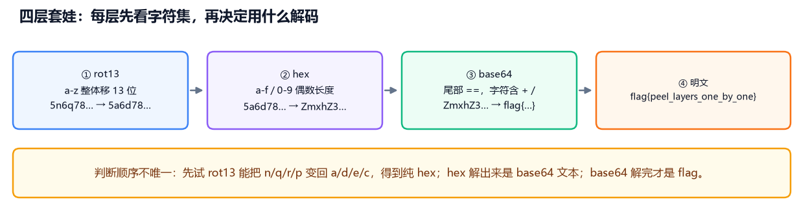
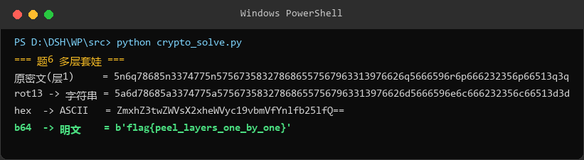

# 多层编码套娃 · Crypto Writeup

> **来源**：本地练习 `D:\DSH\crypto题\6_多层套娃.txt`
> **考点**：按字符集判断编码类型，逐层剥离（rot13 → hex → base64）
> **Flag**：`flag{peel_layers_one_by_one}`

---

## 1. 题目

```text
密文 = 5n6q78685n3374775n575673583278686557567963313976626q5666596r6p666232356p66513q3q
```

题面说 4 层、顺序未知。

---

## 2. 判断顺序：看字符集，不靠猜

```
5n6q78685n3374775n575673583278686557567963313976626q5666596r6p666232356p66513q3q
```

- 全是 `0-9a-z`，但 **有 n、q、r、p** —— 这些不是十六进制字符，所以**不是 hex**；
- 字母只出现在 a–z 且整体像被"移位"过 → 先试 **rot13**（只动字母，数字不变）；
- rot13 结果是 `5a6d78685a3374…`：纯 `0-9a-f`、长度偶数 → **hex**；
- hex 解出来是 `ZmxhZ3twZWVsX2xheWVyc19vbmVfYnlfb25lfQ==`：标准 Base64 字符集、尾部 `==` → **base64**；
- base64 解完得到 flag。



*图 2-1：三层解码：rot13 → hex → base64，最后才是明文。*

> 题面写"4 层"，是把"最终明文"也算了一层；真正的解码步骤是 3 步。

---

## 3. 逐层结果

| 层 | 操作 | 结果 |
|---|---|---|
| 1 | 原密文 | `5n6q78685n3374775n575673583278686557567963313976626q5666596r6p666232356p66513q3q` |
| 2 | rot13 | `5a6d78685a3374775a575673583278686557567963313976626d5666596e6c666232356c66513d3d` |
| 3 | hex → ASCII | `ZmxhZ3twZWVsX2xheWVyc19vbmVfYnlfb25lfQ==` |
| 4 | base64 | `flag{peel_layers_one_by_one}` |

---

## 4. 完整解题脚本

```python
import codecs, base64

raw = "5n6q78685n3374775n575673583278686557567963313976626q5666596r6p666232356p66513q3q"

# 第 1 层：rot13（只移字母，数字不变）
s1 = codecs.decode(raw, "rot13")

# 第 2 层：hex -> ASCII
s2 = bytes.fromhex(s1).decode("ascii")

# 第 3 层：base64（长度不是 4 的倍数就补 =）
s3 = base64.b64decode(s2 + "=" * (-len(s2) % 4))

print("rot13 :", s1)
print("hex   :", s2)
print("b64   :", s3)
```

判断顺序就是上表的顺序：先排除"不够 hex"的字母，再看长度/填充，最后才解码。真没头绪时，CyberChef 的 Magic（Intensive mode）可以一键试常见组合。

---

## 5. 运行结果



*图 5-1：本次运行的真实输出。*

```text
=== 题6 多层套娃 ===
原密文(层1)     = 5n6q78685n3374775n575673583278686557567963313976626q5666596r6p666232356p66513q3q
rot13 -> 字符串 = 5a6d78685a3374775a575673583278686557567963313976626d5666596e6c666232356c66513d3d
hex  -> ASCII   = ZmxhZ3twZWVsX2xheWVyc19vbmVfYnlfb25lfQ==
b64  -> 明文    = b'flag{peel_layers_one_by_one}'
```

---

## 6. Flag

```text
flag{peel_layers_one_by_one}
```

---

## 7. 复盘

1. **先看字符集，再决定算法**：出现 n/q/r/p 这种"超出 hex 范围"的字母，说明还没到 hex 层；rot13 只动字母不动数字，正好解释"数字正常、字母乱"。
2. **hex 的两个硬条件**：字符全在 `0-9a-f`，且长度为偶数。`bytes.fromhex` 遇到奇数长度会直接报错。
3. **base64 的特征**：长度是 4 的倍数、尾部可能有 `=`、字符集含 `+/`。本题解码前长度已经合规。
4. **套娃不靠穷举**：4 层排列有 24 种，但每层都有字符集指纹，按指纹走只需要 1 条路径。真没头绪再用 CyberChef 的 Magic（Intensive mode）。
5. **每一步都打印中间值**：套娃题最容易"中间某层搞反了还在往下做"，把四层结果都打出来，一眼能看出哪层不像话。
6. **别被"4 层"带偏**：题面说 4 层，实际 3 次解码 + 明文；数字对不上时以实际字符为准，不要硬凑第 4 层。
7. 题目文件末尾附了 flag（练习题的答案标注）；上面的三层剥离是独立做的，结果与标注一致。

---

## 8. 本题文件

| 文件 | 说明 |
|---|---|
| `D:\DSH\crypto题\6_多层套娃.txt` | 题目数据 |
| `WP\src\crypto_solve.py` | 求解脚本 |
| `WP\src\out\crypto_report.txt` | 完整运行日志 |
| `WP\images\crypto6-*.png` | 本文配图 |
