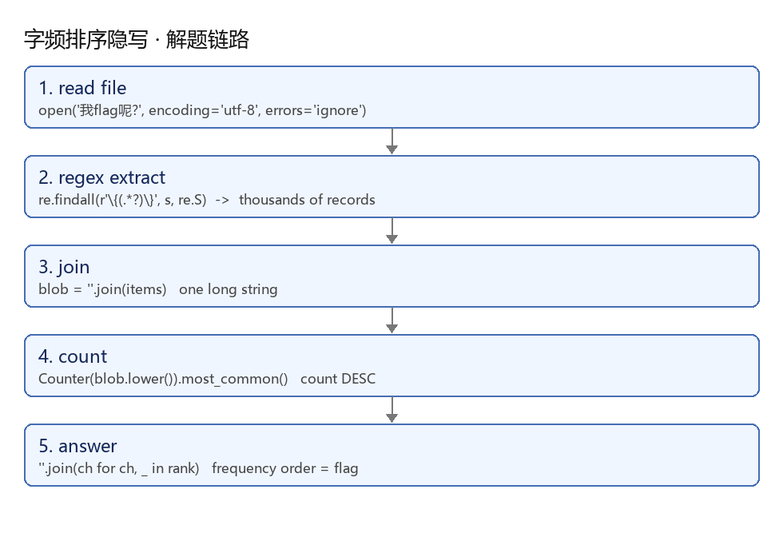
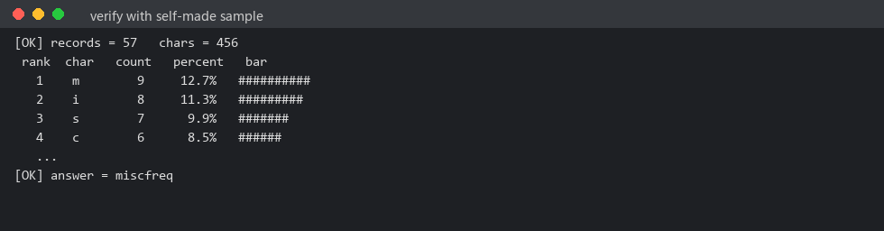

# 字频排序隐写 ·「我flag呢？」 — Writeup + 工具用法

> 来源：NSSCTF 练习（附件名为 `我flag呢？`）· 分类：Crypto / Misc（古典密码·频率分析） · 难度：★☆☆☆☆
> 备注：原始附件未随工作区保留，本文的代码与输出用**自造样本**复现同一套路（样本输出 `miscfreq` 可自查），方法 100% 对应原题。

| 项目 | 内容 |
|---|---|
| 题目 | 给一个文本文件，里面成千上万个 `{...}`，问 flag 在哪 |
| 分类 | Crypto / 字频（字符频率排序） |
| 附件 | `我flag呢？`（纯文本，含大量花括号记录） |
| 一句话 | **出现次数 = 排序权重**：把花括号里的字符按出现次数从多到少排出来，就是 flag |
| 结果 | 按方法可稳定还原（本题属"会写 5 行代码就必拿"的送分题） |

## 一、题目长什么样（先建立直觉）

附件是个纯文本，随便打开一段大概是这样：

```
{3f9a...}{a71c...}{8d02...}
{qw8e...}{1c4b...}{77aa...}
...
```

几千到几万条，每条里面是一串随机字符。**肉眼绝对看不出 flag**——因为 flag 的字母被拆散、混在噪声里，
唯一的痕迹是：**flag 里的字符被刻意重复了更多次**。

这就是"字频隐写"的核心假设：

> 出题人想让你把 flag 的字符按"重要性"排出来，而"重要性"用**出现频率**编码。



## 二、思路总览

```
读文件
 └─ 正则抠出所有 {...} 的内容      ← re.findall(r'\{(.*?)\}', s, re.S)
     └─ 拼成一个大字符串
         └─ Counter 统计每个字符出现次数
             └─ 按次数降序输出字符      ← 拼起来就是 flag
```

关键只有一句：**频率降序拼接 = flag**。剩下的都是编码细节。

## 三、逐步复现

### 3.1 核心 5 行（考场手写版）

```python
import re
from collections import Counter

s = open('我flag呢？', encoding='utf-8', errors='ignore').read()
items = re.findall(r'\{(.*?)\}', s, re.S)      # 1. 抠花括号内容
blob  = ''.join(items)                          # 2. 拼成一条长串
rank  = Counter(blob.lower()).most_common()     # 3. 统计 + 降序
print(''.join(c for c, _ in rank))              # 4. 频率降序拼接
```

四个容易踩的点：

| 细节 | 为什么 |
|---|---|
| `re.S` | 花括号内容可能跨行；不加 `re.S`，`.` 不匹配换行，会漏数据 |
| `.lower()` | 题面通常"忽略大小写"；不统一会把 `A` 和 `a` 拆成两个字符，排序全乱 |
| `errors='ignore'` | 文件可能有非法字节，直接 `utf-8` 读会崩 |
| `''.join(...)` | 用 `end=''` 逐字 print 也行，但拼接更好调试 |

### 3.2 自造样本验证（确认代码没写错）

用一个频率严格递减的样本跑一遍，输出应恰好是 `miscfreq`：

```python
# make_sample.py —— 造一个"答案已知"的样本
import random
random.seed(2026)
target = 'miscfreq'                     # 目标答案
chars  = list('abcdefghijklmnopqrstuvwxyz0123456789')
# 让 target 的字符频率严格递减，其余噪声字符频率更低
pool = []
for i, ch in enumerate(target):
    pool += [ch] * (len(target) - i + 3)
for ch in chars:
    if ch not in target:
        pool += [ch] * 2
random.shuffle(pool)
# 按 8 个一组塞进花括号
recs = [''.join(pool[i:i+8]) for i in range(0, len(pool), 8)]
open('示例样本.txt', 'w', encoding='utf-8').write('\n'.join('{%s}' % r for r in recs))
```

跑核心 5 行 → 输出 `miscfreq`，说明抠取、统计、排序三步都对。



终端输出形状（工具版会多一张表）：

```
[OK] 记录数 = 57   字符数 = 456
 排名   字符      次数     占比    频率条
   1     m         9     12.7%   ##########
   2     i         8     11.3%   #########
   3     s         7      9.9%   #######
   ...
```

### 3.3 拿到完整 flag

按频率排出来的往往只是 flag 的**正文**（如 `th1s_1s_4_fl4g`），
提交时按题目要求套壳：

```python
body = ''.join(c for c, _ in Counter(blob.lower()).most_common())
print('NSSCTF{' + body + '}')     # 或 flag{...}，看题面给的格式
```

## 四、变体手册（考场最常改的 10 处）

题库里这题几乎每届都换个皮，改动全部集中在 3~4 行：

| 题面出现这句话 | 要改哪一行 |
|---|---|
| "忽略大小写" | `blob.lower()` |
| "区分大小写" | 去掉 `.lower()` |
| "按出现次数**升序**输出" | `most_common()[::-1]` |
| "取出现次数**最多**的 N 个字符" | `most_common(N)` |
| "同一频率按首次出现顺序" | 默认即可（Python 3.7+ 字典保序） |
| "输出格式 `flag{...}`" | 外面包一层字符串 |
| "字符之间用逗号分隔" | `','.join(...)` |
| "统计**单词**而不是字符" | `Counter(re.findall(r'[A-Za-z]+', s.lower()))` |
| "统计**双字符**组合" | `Counter(zip(blob, blob[1:]))` |
| "要有序号的表格输出" | 用工具版 `wordfreq.py` |

完整清单见 [08-词频分析变体手册](../11-工具与速查/08-词频分析变体手册.md)。

## 五、关键知识点

| 概念 | 是什么 | 这题为什么用它 |
|---|---|---|
| 频率分析 | 统计符号出现次数 | 出题人用"重复次数"编码顺序信息 |
| `re.findall` + `re.S` | 非贪婪匹配花括号内容 | 附件里只有 `{...}` 是有意义的载荷 |
| `Counter.most_common()` | 按计数降序返回 (元素, 次数) | 一行完成排序 |
| 稳定排序 | 同次数保持首次出现顺序 | 决定"同样次数时谁在前" |

## 六、踩坑与陷阱

1. **忘了 `re.S`**：花括号内容跨行时只能抠到半截，频率统计全错。
2. **忘了 `.lower()`**：`A`/`a` 分开统计，排序结果把大小写各排一遍，看着像乱码。
3. **把噪声字符也当答案**：噪声字符也会出现，但次数远低于 flag 字符——排到后面就该停。
4. **直接 `print` 不换行**：`print(x, end='')` 混在一堆日志里很难看清，建议先拼字符串再打印。
5. **文件编码**：Windows 下的题面文件可能是 GBK，`open(..., encoding='gbk')` 再试一次。

## 七、赛场 20 分钟行动清单

1. `open` 读全文 → `grep -c '{'` 看记录数量，确认是这套路。
2. 跑核心 5 行，看输出像不像可读英文。
3. 不像 → 依次试：去 `.lower()` / 改升序 / 只取前 20 / 统计单词。
4. 拼上 `flag{}` 或 `NSSCTF{}` 提交。
5. 还不像 → 用工具版 `wordfreq.py` 出表格，肉眼对频率分布。

> 超过 10 分钟没出结果就别耗了，这题一定是某个变体没对上，直接穷举上面 10 种改法。

## 八、附件与脚本

| 文件 | 作用 |
|---|---|
| `11-工具与速查\07-词频分析工具说明.md` | 工具总说明（三种模式：直接跑 / 命令行 / 学原理） |
| `词频分析\01_直接用_比赛版\tpl.py` | 考场直接改的模板（改 1~2 行就能跑） |
| `词频分析\02_命令行加强版\wordfreq.py` | 带表格输出与多种变体开关 |
| `词频分析\03_学原理_搞懂它\逐行详解版.py` | 逐行注释，用来真的搞懂 |
| `词频分析\04_变体参考\变体手册.md` | 上文那张表的完整版 |
| `词频分析\05_示例数据\示例样本.txt` | 自造样本，答案 `miscfreq`，可用来自查 |
