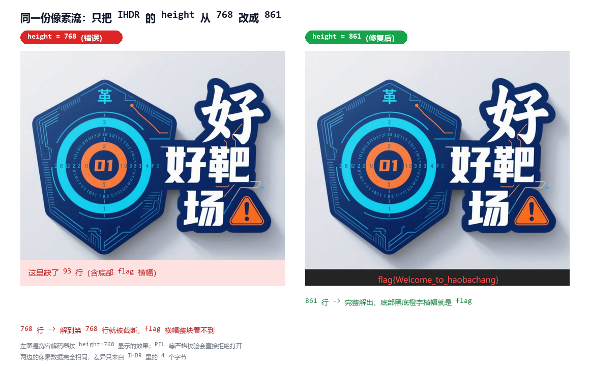
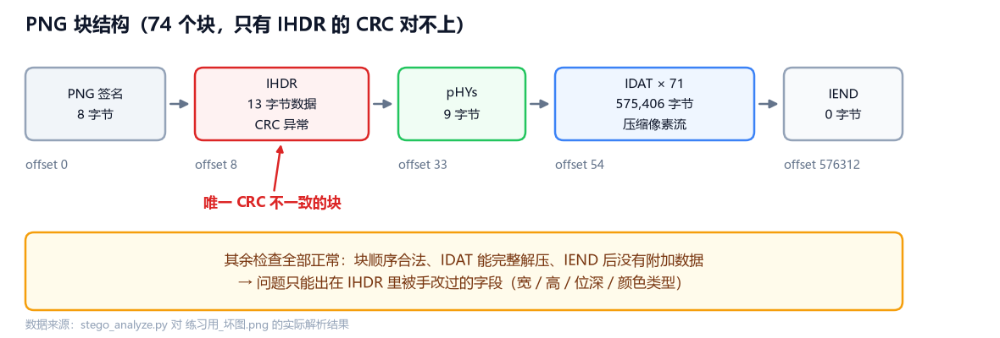
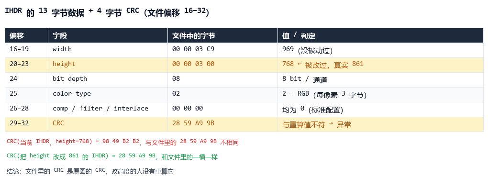
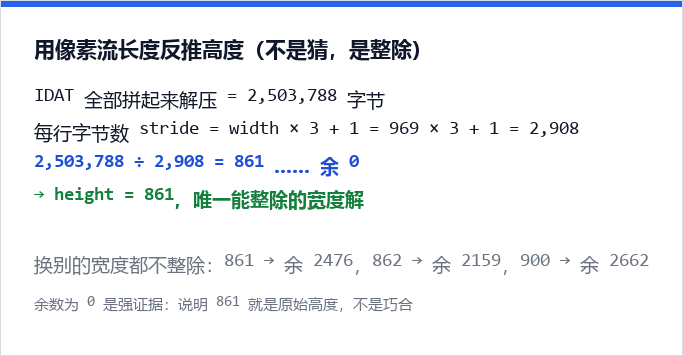
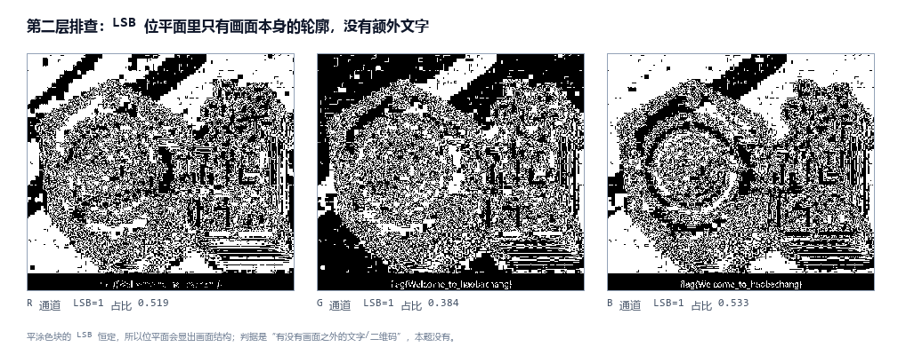

# 什么楼什么厦? · 图片隐写 Writeup

> **平台**：好靶场（haobachang）｜**难度**：Lv2｜**方向**：Misc → 图片隐写
> **考点**：PNG 块结构、IHDR 高度修复、CRC 校验
> **Flag**：`flag{Welcome_to_haobachang}`

---

## 1. 题目信息

| 项 | 值 |
|---|---|
| 题名 | 什么楼什么厦? |
| 题面提示 | 图片尺寸不对，修复下就好了 |
| 附件 | 一个 zip，里面是一张 PNG（576,324 字节） |
| 本题复现文件 | `D:\DSH\练习用_坏图.png`（坏图）、`D:\DSH\fixed.png`（修复结果） |
| 结论 | 高度被从 861 改成 768，且没有重算 IHDR 的 CRC |

> 题名是个梗：不是让你认建筑，「好好靶场」= haobachang，flag 就印在修复后的图片底部。**别被标题带偏去跑一堆隐写工具。**

---

## 2. 现象：图"能看"，但一眼不对

双击图片，有的查看器能显示，但底部明显被切掉；而用 Pillow 这种严格校验的库打开，直接报错：

```text
UnidentifiedImageError: cannot identify image file '...\练习用_坏图.png'
```

题面又明说「尺寸不对」，所以先按**结构层**问题处理，而不是先上 LSB / 盲水印。



*图 2-1：同一份像素流，左边按 height=768 解会丢掉底部 93 行（包括 flag 横幅），右边按 861 解才完整。*

---

## 3. 先看块结构：谁被改过

PNG 是「8 字节签名 + 一串块」的结构，每个块都带 CRC32。**CRC 对不上的那个块，就是被手改过的地方。**

```text
file      : 练习用_坏图.png
size      : 576324 bytes
signature : 89 50 4e 47 0d 0a 1a 0a

[1] chunk table
    total chunks = 74   {'IHDR': 1, 'pHYs': 1, 'IDAT': 71, 'IEND': 1}
    IHDR  len=13    crc_ok=False offset=8
    pHYs  len=9     crc_ok=True  offset=33
    IEND  len=0     crc_ok=True  offset=576312
    CRC 异常块: ['IHDR']
```



*图 3-1：74 个块里只有 IHDR 的 CRC 不自洽，其余全部正常。*

顺带排除掉其他可能：块顺序合法、IDAT 能完整解压、IEND 后没有附加数据 —— 问题只可能在 IHDR 的字段里。

---

## 4. 定位：IHDR 里哪个字段被改了

IHDR 的 13 字节数据是固定布局：宽(4) 高(4) 位深(1) 颜色类型(1) 压缩(1) 滤波(1) 交错(1)。



*图 4-1：height = `00 00 03 00` = 768，其余字段（8 bit、RGB、无交错）都是标准配置。*

关键证据在 CRC 上：

```text
CRC in file   = 2859a99b
CRC computed  = 9849b2b2      ← 按当前 height=768 重算
CRC(高度 861) = 2859a99b      ← 和文件里的 CRC 一模一样
```

也就是说：**文件里的 CRC 是原图（height=861）的 CRC，改高度的人只改了 4 个字节、没有重算 CRC**。这既解释了为什么只有 IHDR 报错，也直接告诉我们正确高度是 861。

---

## 5. 高度不用猜：用像素流长度整除

RGB、8 bit 时每像素 3 字节，每行前面还有 1 字节 filter 标记，所以：

```text
stride       = width × 3 + 1 = 969 × 3 + 1 = 2908
IDAT 解压后  = 2,503,788 字节
2,503,788 ÷ 2,908 = 861 …… 余 0
→ height = 861
```



*图 5-1：只有 969 这个宽度能得到余数 0 的解；换成 861/862/900 做宽度，余数分别是 2476/2159/2662，都不整除。*

---

## 6. 修复：改 4 字节 + 重算 CRC

```python
import struct, zlib

SRC = r"D:\DSH\练习用_坏图.png"
OUT = r"D:\DSH\WP\src\out\fixed_rebuilt.png"

data = bytearray(open(SRC, "rb").read())

# 1) 收集所有 IDAT，解压后按 stride 反推高度
off, idat = 8, b""
while off + 8 <= len(data):
    ln = struct.unpack(">I", data[off:off + 4])[0]
    if data[off + 4:off + 8] == b"IDAT":
        idat += data[off + 8:off + 8 + ln]
    off += 12 + ln

w = struct.unpack(">I", data[16:20])[0]
bpp = 3                                  # color type 2 = RGB
h = len(zlib.decompress(idat)) // (w * bpp + 1)   # 861

# 2) 写回高度 + 重算 IHDR 的 CRC
data[20:24] = struct.pack(">I", h)                       # 00 00 03 5d
data[29:33] = struct.pack(">I",
    zlib.crc32(b"IHDR" + bytes(data[16:29])) & 0xFFFFFFFF)  # 28 59 a9 9b

open(OUT, "wb").write(bytes(data))

# 3) 验证
from PIL import Image
im = Image.open(OUT); im.load()
print(im.format, im.size, im.mode)
```

运行结果：

```text
[3] height recovery
    IDAT compressed   = 575406 bytes
    IDAT decompressed = 2503788 bytes
    stride = w*bpp+1  = 969*3+1 = 2908
    2503788 / 2908 = 861  remainder 0
    -> height = 861  (remainder 0 means exact)

[4] fixed file written: ...\fixed_rebuilt.png 576324 bytes
    new height bytes: 00 00 03 5d ( = 861 )
    new CRC         : 28 59 a9 9b

[5] strict decoder check
    broken file: PIL refused -> UnidentifiedImageError: cannot identify image file
    fixed  file: PIL OK  PNG (969, 861) RGB

[6] trailing bytes after last chunk: 0 (none)
```

---

## 7. 读图：flag 就印在底部


*图 7-1：修复后底部黑底橙字横幅，直接就是 flag。*

```text
flag{Welcome_to_haobachang}
```

> 这道题真正的坑不是技术，是**修完不仔细看图**。很多人修好尺寸又去跑一轮隐写工具，其实答案已经明写在图上。

---

## 8. 第二层排查（确认没有后续）

CTF 里"修好图"不等于结束，还要确认有没有第二层。逐项排除：

| 检查 | 结果 |
|---|---|
| IEND 之后有没有附加数据 | 0 字节，无 |
| 有没有 tEXt / eXIf 等异常块 | 无，只有 IHDR/pHYs/71×IDAT/IEND |
| 像素流长度和尺寸是否吻合 | `2503788 = 861 × (969×3+1)`，完全吻合，没有夹带 |
| LSB 位平面有没有额外结构 | 三个通道只有画面本身的轮廓，没有文字/二维码 |



*图 8-1：平涂色块的 LSB 恒定，所以位平面会显出画面结构；判据是「有没有画面之外的文字/图案」，本题没有。*

---

## 9. 复盘

1. **拿到图片先看块表，不要先跑工具**：CRC 是否自洽能在一秒内指出被改过的块，本题精准命中 IHDR。
2. **高度不要穷举**：`解压长度 = 高度 × (宽度 × 通道数 + 1)`。用整除关系解，余数为 0 就是强证据。
3. **改字段必须重算 CRC**；反过来，**作者没重算 CRC 也是线索** —— 文件里的旧 CRC 恰好等于正确高度的 CRC。
4. **Pillow 严格、查看器宽容**：同一张图，PIL 打不开不代表图全坏了；先用块结构判断坏在哪。
5. **标题是烟雾弹**：什么楼什么厦 = 好好靶场（haobachang），考的是 PNG 结构，不是建筑识别。
6. **修完先读图**：flag 是明写的，别过度联想第二层；确认方式是把尾部/块/像素流/LSB 逐项排除，而不是凭感觉。

---

## 10. 本题文件

| 文件 | 说明 |
|---|---|
| `D:\DSH\练习用_坏图.png` | 本题坏图（576,324 字节） |
| `D:\DSH\fixed.png` | 修复后的图（969×861） |
| `WP\src\stego_analyze.py` | 复现脚本：块表 / CRC / 反推高度 / 修复 / 验证 |
| `WP\src\out\stego_report.txt` | 脚本完整输出 |
| `WP\src\out\fixed_rebuilt.png` | 本次修复产物 |
| `WP\images\stego-*.png` | 本文配图 |

> 旧 `D:\DSH\writeup.md` 里两处笔误已在本文修正：IDAT 是 **71 块**（70×8192 + 1966），不是 72 块；并且文件里的 IHDR CRC 原本就是高度 861 的值。
