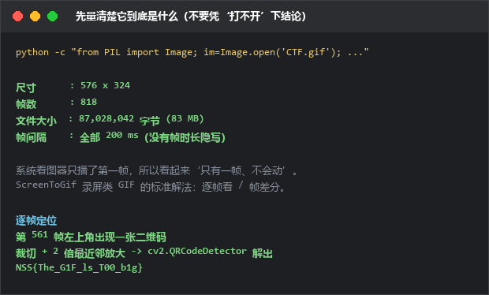
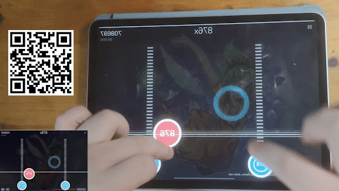
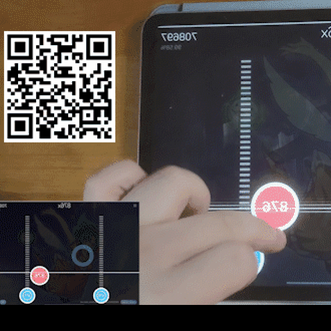

# Misc · GIF 第 561 帧里的二维码 —— Writeup

> 分类：Misc / 图片隐写（动图逐帧）
> 附件：`附件.7z` → 解出 `CTF.gif`（87,028,042 字节，576×324，**818 帧**）
> 做题日期：2026-10-28
> Flag：`NSS{The_G1F_ls_T00_b1g}`

---

## 30 秒速查卡

```
"这个 GIF 不会动 / 只有一帧"  ->  九成是假象：它是 818 帧的录屏，看图器只播了第一帧
逐帧翻 / 或直接算帧差分定位  ->  第 561 帧左上角有一张二维码
裁切 + 放大 2 倍（最近邻）    ->  cv2.QRCodeDetector 解出 NSS{The_G1F_ls_T00_b1g}
```

一行验证它到底有没有多帧：

```powershell
python -c "from PIL import Image; im=Image.open('CTF.gif'); print(im.size, im.n_frames)"
# (576, 324) 818
```

---

## 1. 现象与误判

解压 7z 得到一个 GIF。双击打开——**不动，只有一帧**。当时的第一反应是"这图是不是坏了 / 是不是藏了别的东西"。

先把它彻底量清楚，再下结论：



| 项 | 值 | 说明 |
|---|---|---|
| 尺寸 | 576 × 324 | 屏幕录制的典型尺寸 |
| **帧数** | **818** | 系统看图器只渲染第一帧 |
| 大小 | 87,028,042 字节（83 MB） | 帧数多的必然结果 |
| 帧间隔 | 全部 200 ms | **没有帧时长隐写**（这是要排除的一类考点） |

> **教训：不要用"打不开/不会动"当结论。**先用 `PIL` 或 `identify` 数帧。

## 2. 逐帧定位

### 方法 A：工具逐帧（最直观）

- StegSolve.jar → `Frame Browser`（本题公开题解里用的是这个）
- 或者工作区里的 `GIF逐帧查看器.bat`：带时间导轨，可拖动、暂停、导出当前帧、直接识别屏幕二维码

### 方法 B：脚本算帧差分（快）

818 帧 × 186,624 像素，直接看很累。先算**相邻帧差异**，把"有变化"的帧挑出来：

```python
import numpy as np
from PIL import Image

im = Image.open("CTF.gif")
prev = None
scores = []
for i in range(im.n_frames):
    im.seek(i)
    a = np.asarray(im.convert("RGB"), dtype=np.uint8)
    if prev is not None:
        scores.append((int((a != prev).any(2).sum()), i))
    prev = a
scores.sort(reverse=True)
print(scores[:20])
```

本题的结果是：

- 帧间隔**完全一致**（200 ms）→ 排除帧时长隐写
- 变化集中在**末尾帧（735–781）**
- 但二维码不在变化最大的帧里 —— 它是"静止地出现在第 561 帧"

所以本题实际上是**人工翻到第 561 帧**发现的：

> "在分解第 561 帧的时候，图片里出现了一张二维码。"

## 3. 那一帧长什么样



画面是一段手游玩家的录屏：一台平板、左右两个拇指、上下两条血条。**左上角叠了一张二维码**。

## 4. 解二维码

直接拿整帧去解，cv2 **解不出来**（二维码太小、只占左上角一小块）。两个动作就能救：

1. **裁切**到二维码区域
2. **最近邻放大 2 倍**



```python
import cv2, numpy as np
img = cv2.imdecode(np.frombuffer(open("frame_561.png","rb").read(), np.uint8), cv2.IMREAD_COLOR)
det = cv2.QRCodeDetector()
g = cv2.cvtColor(img, cv2.COLOR_BGR2GRAY)
g2 = cv2.resize(g, None, fx=2, fy=2, interpolation=cv2.INTER_NEAREST)
print(det.detectAndDecode(g2)[0])
# NSS{The_G1F_ls_T00_b1g}
```

> **为什么必须放大**：`QRCodeDetector` 对模块尺寸小于约 3 像素的码基本不响应。
> `INTER_NEAREST` 而不是 `INTER_LINEAR`——二维码是硬边，插值会把黑白边界糊掉。

## 5. 原理复盘

| 层 | 现象 | 本质 |
|---|---|---|
| 容器 | 87 MB 的 GIF | 818 帧录屏，不是"一张大图" |
| 出场方式 | 只有一帧有二维码 | 二维码被**叠加**在录屏画面上若干帧 |
| 解码 | 直接解失败 | 模块太小，需要裁切 + 整数倍放大 |

这是 `ScreenToGif` 类录屏题的标准套路：**信息不在"图里"，在"某一帧里"**。

同类变体（都要想到）：

| 变体 | 特征 | 对策 |
|---|---|---|
| 某帧藏二维码 | 帧数极多（几百上千） | 逐帧扫 / 差分定位 |
| 帧间差分拼字 | 每帧只有一个字符 | 帧差分累积 |
| 帧时长隐写 | 帧间隔不一致 | 读 GCE 的 delay，转二进制 |
| 只有几帧但每帧半张码 | 需要拼 | 叠帧（`ImageChops.lighter`） |

## 6. 踩坑记录

| 坑 | 表现 | 教训 |
|---|---|---|
| 认为"只有一帧、图片坏了" | 差点去修文件 | 先 `im.n_frames`，再谈修 |
| 直接对整帧调 `detectAndDecode` | 返回空字符串 | 二维码只占画面一角，必须先裁切 |
| 用 `INTER_LINEAR` 放大 | 仍然解不出 | 硬边图像用 `INTER_NEAREST` |
| 以为差分最大帧就是答案 | 735–781 帧变化最大，但没有码 | 差分只用来**缩小范围**，不等于定位 |
| 忽略帧间隔 | — | 先排除帧时长隐写，能省很多时间 |

## 7. 复用工具

工作区的 `Misc侦探`（`misc-triage\`）已经内置了这套能力：

| 能力 | 说明 |
|---|---|
| GIF 帧数 / 帧间隔统计 | 自动提示"帧很多 → 大概率某帧藏二维码" |
| 逐帧二维码扫描 | 装了 `opencv-python` 时全自动，命中的那一帧会导出成 PNG |
| 静态图二维码识别 | 直接拖图片进去，自动尝试 原图 / 灰度 / ×1.5 / ×2 / ×3 |

```powershell
# 手写一条也一样
python misc_triage.py "CTF.gif"
```
