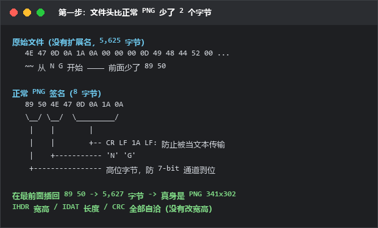
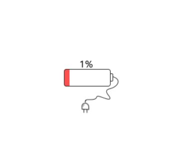
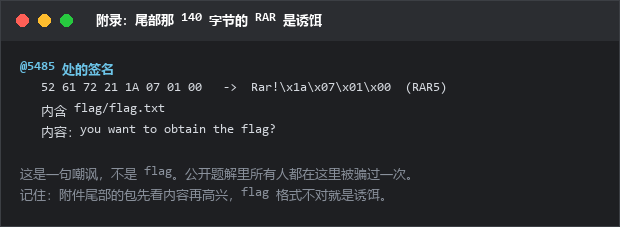
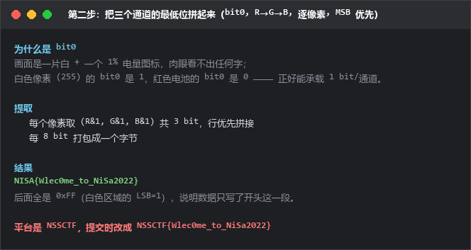

# Misc · 为什么我什么都看不见（PNG 补文件头 + LSB）—— Writeup

> 分类：Misc / 图片隐写
> 附件：`我怎么什么都看不见`（**没有扩展名**，5,625 字节）
> 做题日期：2026-10-28
> Flag：`NSSCTF{Wlec0me_to_NiSa2022}`（图片里嵌的是 `NISA{...}`，提交时换成平台前缀）

---

## 30 秒速查卡

```
1  没有后缀 + 头部 4E 47 0D 0A 1A 0A  ->  是 PNG 但少了前 2 字节 89 50
2  最前面插回 89 50 -> 341x302 的真 PNG（画面：一个 1% 电量图标）
3  尾部 @5485 挂着 140 字节 RAR -> 里面有 flag/flag.txt，内容是
   "you want to obtain the flag?"    <-- 嘲讽，不是 flag
4  真考点：LSB。bit0，R→G→B 逐像素，行优先，MSB 优先
   -> NISA{Wlec0me_to_NiSa2022}
```

一行提取：

```python
from PIL import Image
import numpy as np
a = np.array(Image.open("fixed.png").convert("RGB"))
bits = np.stack([(a[:, :, c] & 1) for c in range(3)], axis=2).reshape(-1)
b = np.packbits(bits[:len(bits)//8*8].astype(np.uint8), bitorder="big").tobytes()
print("".join(chr(x) if 32 <= x < 127 else "." for x in b[:120]))
# NISA{Wlec0me_to_NiSa2022}...
```

---

## 1. 第一步：先认它是什么

文件没有扩展名，5,625 字节。看头：



```
原始：  4E 47 0D 0A 1A 0A 00 00 00 0D 49 48 44 52 ...
        N  G  CR LF 1A LF ...
```

正常 PNG 签名是 **8 字节**：

| 字节 | 值 | 作用 |
|---|---|---|
| 1 | `89` | 高位字节，防止被 7-bit 通道把最高位吃掉 |
| 2–4 | `50 4E 47` | `"PNG"` |
| 5–6 | `0D 0A` | CR LF，检测换行转换 |
| 7–8 | `1A 0A` | DOS 的 EOF + LF，检测文本模式截断 |

本题**前两个字节 `89 50` 被砍掉了**，剩下从 `4E 47`（`NG`）开始。

在最前面插回 `89 50` → 5,627 字节 → 一张正常的 PNG 341×302。

> 这类"少了几个字节"的题很常见：**魔数不以偏移 0 开始，或者干脆缺一截**。
> 判据永远是"签名表比对"，不是"文件能不能打开"。

## 2. 修好之后看到什么



一个 **1% 电量** 的图标，整片白底。名字叫"为什么我什么都看不见"，此刻名副其实。

顺手做的三个自检（都是必要的）：

| 检查 | 结果 | 结论 |
|---|---|---|
| IHDR 宽高 vs IDAT 长度 | 302 × (1 + 341×3) = 309,248，**完全吻合** | 不是"高度被改"类题 |
| 颜色数 | 254 种，主体是纯白 `255,255,255` | 没有隐藏的图片层 |
| 非白像素 | 2,098 个，包围盒 (127–238, 120–226) | 就是那个电池图标 |

## 3. 尾部那个 RAR 是诱饵



在偏移 `5485` 处（IEND 之后）挂着 140 字节：

```
52 61 72 21 1A 07 01 00   Rar!\x1a\x07\x01\x00  (RAR5)
  内含：flag/flag.txt
  内容：you want to obtain the flag?
```

一行英文嘲讽。**公开题解里所有人都在这里被骗过一次。**

> 判据：flag 格式必须对得上平台（`NSSCTF{...}` / `flag{...}`）。
> `you want to obtain the flag?` 不是任何一种格式 —— 直接判定为干扰项。

## 4. 真考点：LSB



### 为什么是 bit0

- 画面 99% 是纯白（`R=G=B=255`），其 bit0 全为 `1`
- 红色电池是 `253,80,79`，其 bit0 有 `0` 有 `1`
- 所以 bit0 这一层"看起来全是噪点/全 1"，但**恰恰能承载数据**

### 提取参数（四个自由度，全都要对）

| 参数 | 本题取值 | 为什么 |
|---|---|---|
| 位平面 | `bit0`（最低位） | 改动 1 个最低位肉眼不可能看出 |
| 通道顺序 | `R → G → B` 逐像素 | 等价于 3 bit/像素 |
| 扫描顺序 | 行优先（row-major） | — |
| 位序 | MSB 优先（`bitorder='big'`） | 最高位先组成字节 |

试错对照（同一张图，只改一个参数）：

| bit | 通道 | 顺序 | 位序 | 结果 |
|---|---|---|---|---|
| 0 | RGB | 行 | MSB | ✅ `NISA{Wlec0me_to_NiSa2022}` |
| 0 | R / G / B 单独 | 行 | MSB | ❌ 全是 `\xff` |
| 0 | RGB | 列 | MSB | ❌ 无意义 |
| 0 | RGB | 行 | LSB | ❌ 无意义 |
| 1–7 | 任意 | 任意 | 任意 | ❌ 无意义 |

> **这就是 LSB 题的通用打法**：写一个 4 重循环把 (bit, 通道组合, 顺序, 位序) 全试一遍，
> 用 `flag{` / `ctf{` / `{` 当正则探针。比一个个手动试快得多。

## 5. 完整复现脚本

```python
from PIL import Image
import numpy as np

# 1) 补文件头
raw = open("我怎么什么都看不见", "rb").read()
png = b"\x89\x50" + raw
open("fixed.png", "wb").write(png)

# 2) 取 bit0
a = np.array(Image.open("fixed.png").convert("RGB"))
stack = np.stack([(a[:, :, c] & 1) for c in range(3)], axis=2)
bits = stack.reshape(-1)

# 3) 8 位一组转字节
bits = bits[: len(bits) // 8 * 8]
data = np.packbits(bits.astype(np.uint8), bitorder="big").tobytes()

# 4) 打印可读部分
print("".join(chr(x) if 32 <= x < 127 else "." for x in data[:120]))
```

输出：

```
NISA{Wlec0me_to_NiSa2022}...................................................................
```

后面全是 `0xFF`（白色区域的 LSB=1），说明数据只写了开头这一段。

## 6. 原理复盘

| 步骤 | 手法 | 为什么这么设计 |
|---|---|---|
| 1 | 砍掉 PNG 前 2 字节 | 逼你先"认文件"，而不是直接打开 |
| 2 | 尾部挂一个假 RAR | 制造"我找到了"的错觉 |
| 3 | 整图近乎纯白 | 逼你意识到"看不见"是因为信息不在可见层 |
| 4 | LSB 写文本 | 最经典的图片隐写 |

**三个陷阱的层次很清楚**：容器层（补头）→ 干扰层（假 RAR）→ 数据层（LSB）。

## 7. PNG 拿到手排查顺序（背下来）

```
1  file / 010 验魔数（89 50 4E 47 0D 0A 1A 0A）；缺头补头、假后缀改真身
2  IHDR 宽高与 IDAT 长度是否自洽 —— 不自洽就是"宽高被改"类（CRC32 爆破）
3  binwalk -e / foremost / IEND 之后的尾部；hex 搜 PK / Rar! / 7z
   注意：分离出来的包可能是假 flag 干扰项
4  strings + 010 多关键字（flag / ctf / { / NSS），别只搜 "flag"
5  exiftool 元数据（型号/注释字段可以藏 hex 密码）
6  zsteg -a、StegSolve 位平面/通道/Alpha、LSB 提取
7  tEXt / iTXt / zTXt 异常块
8  出了图案 → 二维码缺定位角补角再扫；动图逐帧扫
```

## 8. 踩坑记录

| 坑 | 表现 | 教训 |
|---|---|---|
| 看到 RAR 就当答案 | 解出 `you want to obtain the flag?` | flag 格式不对就是诱饵 |
| 只试 RGB 交错一种 LSB | 前几字节是 `\xff`，以为没有隐写 | 4 个自由度都要试 |
| 用 `PIL` 读原文件 | `UnidentifiedImageError` | PIL 不认缺头的 PNG，必须先补字节再读 |
| 用 PIL 另存成"修好的图" | 尾部 140 字节丢了 | 分析尾部要用**原始字节**，不要经过 PIL 重编码 |
| 按列扫描 | 无意义 | 先试行优先（绝大多数工具默认） |

## 9. 同类题迁移

| 题面 | 考点 |
|---|---|
| 打开只有上半张 | IHDR 高度被改 → CRC32 爆破真实高度 |
| 打开全黑/全白 | alpha 通道、位平面、色阶拉伸 |
| 打开是一半 | 图片被切成两半 / 只渲染了一部分 |
| 双击报"不是有效图片" | 缺文件头 / 魔数与后缀不符 |
| 图里有二维码但扫不出 | 缺定位角、半透明、需要调对比度 |

> 工作区的 `Misc侦探`（`misc-triage\`）把上面第 1/2/3/6 步都自动化了：
> 拖进去会直接产出「修复_补文件头_*」「位平面_R/G/B.bmp」「carve_*」这些中间产物。
