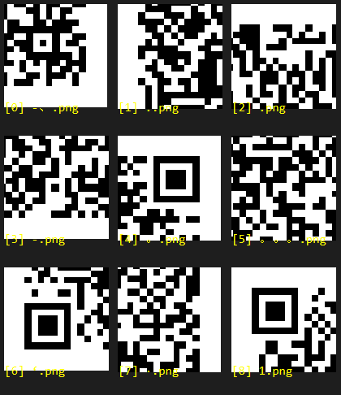
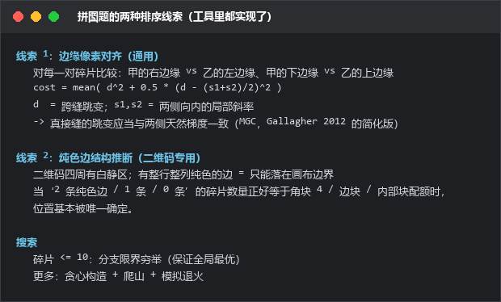
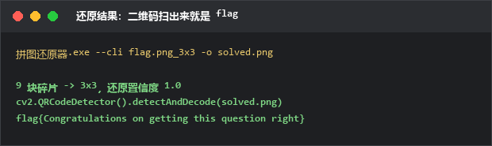

# Misc · 拼图还原（flag.png_3x3）—— Writeup

> 分类：Misc / 图片隐写（碎片重组）
> 附件：`flag.png_3x3\` 目录，9 张 PNG 碎片（文件名是乱码标点：`。` `·` `‘` `。。。` 等）
> 做题日期：2026-10-23
> Flag：`flag{Congratulations on getting this question right}`

---

## 30 秒速查卡

```
9 张碎片 -> 用"边缘像素对齐 + 纯色边推断"排回 3x3 -> 得到完整二维码 -> 扫码得 flag
```

工具：`D:\XiaoMibook\CTF学习\拼图还原器\拼图还原器.exe`（把整个文件夹拖进窗口，自动判网格 + 排序）

命令行：

```powershell
& "D:\XiaoMibook\CTF学习\拼图还原器\拼图还原器.exe" --cli "flag.png_3x3" -o solved.png -r 3 -c 3
```

---

## 1. 题目：一堆文件名是标点的图片



碎片文件名：`。` `·` `‘` `-` `-、` `。。` `1` …… 全是无意义字符 —— **文件名里没有顺序信息**。

所以只有两条路：

1. 把每张拖到画图里手工拼（9 张还行，25 张就废了）
2. **让程序按像素关系排**

## 2. 这道题的特殊性：二维码让"像素对齐"失效

普通的照片拼图，靠"接缝处跳变最小"就能排对（相邻碎片的边缘像素应该几乎一样）。

但**二维码是黑白硬边**：模块边界上左右相邻的两列像素本来就**不连续**。
于是所有接缝的代价可能都是 0，得到一堆并列解。



### 线索 1：边缘像素对齐（通用）

对每一对碎片，比较「甲的右边缘 / 乙的左边缘」（竖缝）与「甲的下边缘 / 乙的上边缘」（横缝）：

```
d  = 跨缝的像素跳变
s1 = 甲侧向内的局部斜率
s2 = 乙侧向内的局部斜率

cost = mean( d² + 0.5 · (d − (s1+s2)/2)² )
```

这是 Gallagher 2012 提出的 **MGC（Mahalanobis 梯度兼容度）** 的简化版。
核心思想：**真接缝处的跳变应当与两侧的天然梯度一致**，而不是强行要求"严丝合缝"。
（对带纹理的照片非常重要，对硬边二维码没用）

### 线索 2：纯色边结构推断（本题关键）

二维码四周有**白静区（quiet zone）**。所以：

- 某张碎片如果有一条边"整行整列都是纯色" → 这条边只可能位于**画布边界**
- 3×3 网格的配额是固定的：

| 位置类型 | 数量 | 纯色边数 |
|---|---|---|
| 角块 | 4 | 2 条 |
| 边块 | 2(N−2)+2(M−2) = 4 | 1 条 |
| 内部块 | (N−2)(M−2) = 1 | 0 条 |

当"2 条 / 1 条 / 0 条"的碎片数量正好对上 `4 / 4 / 1` 时，**每块的位置基本被唯一确定**。

本题 9 张碎片的纯色边统计正好对上，所以位置是**结构性唯一**的，不需要靠猜。

## 3. 还原结果




```
$  拼图还原器.exe --cli flag.png_3x3 -o solved.png
OK 9 块碎片 -> 3x3，还原置信度 1.0
OK cv2.QRCodeDetector().detectAndDecode(solved.png)
OK flag{Congratulations on getting this question right}
```

## 4. 搜索策略

| 碎片数 | 策略 | 说明 |
|---|---|---|
| ≤ 10 | 分支限界**穷举** | 9 张只有 9! = 362,880 种，剪枝后瞬间出解，保证全局最优 |
| > 10 | 贪心构造 + 爬山 + 模拟退火 | 25 张穷举不可行，只能启发式 |

对 3×3 这种规模，**永远优先穷举**——万一有多个并列解，穷举能告诉你"确实并列"，
而启发式会悄悄给你一个错的。

## 5. 原理复盘

这题真正考的是**"把视觉问题变成代价最小化问题"**：

```
问题：9 张碎片，决定一个 3x3 的排列
状态空间：9! = 362,880
代价函数：所有接缝代价之和
约束：每个位置用且仅用一次
-> 这是一个带约束的排列优化，分支限界可解
```

而"纯色边"是一个**强结构约束**，把搜索空间从 9! 砍到几乎 1 —— 这就是它比像素对齐更好用的原因。

## 6. 踩坑记录

| 坑 | 表现 | 教训 |
|---|---|---|
| 只看像素对齐 | 出解但二维码扫不出 | 硬边图像要加结构约束 |
| 相信启发式的第一个解 | 排出来是错的 | 小规模用穷举，能验证是否并列 |
| 手动拖图片排 | 9 张还行，多一张就崩 | 让程序算 |
| 排好后直接截图扫码 | 有缩放模糊 | 导出**原分辨率 PNG** 再扫 |
| 用文件名的标点猜顺序 | 完全是干扰 | 文件名不可信 |

## 7. 通用套路

```
拿到一堆碎片：
1) 量尺寸 —— 所有碎片等大？ -> 规整网格
2) 数纯色边 —— 对上 4/4/1 的配额就是结构可解
3) 不行再上像素对齐（MGC）
4) 排好后导出原分辨率，再走"二维码/文字识别"
5) 识别不出 -> 缺定位角要补角，或调对比度
```

## 8. 同类题

| 类型 | 特征 | 工具/手法 |
|---|---|---|
| 二维码碎片 | 硬边、有白静区 | 纯色边 + 穷举（本题） |
| 照片碎片 | 有纹理 | MGC 边缘对齐 |
| 旋转碎片 | 碎片方向也乱 | 先对 4 个方向做代价，再排 |
| 长条切割 | 切成横条/竖条 | 一维排序（退化情形） |
| 打乱像素 | 不是块，是单个像素 | Arnold 置乱还原 / 周期检测 |
