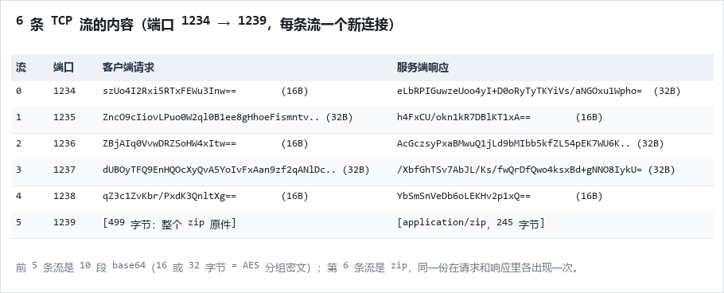
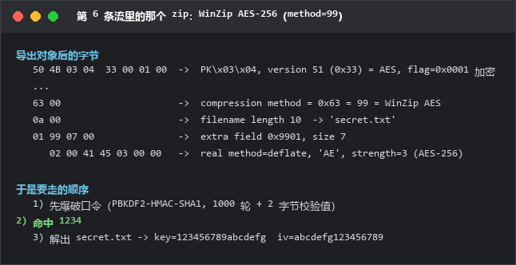
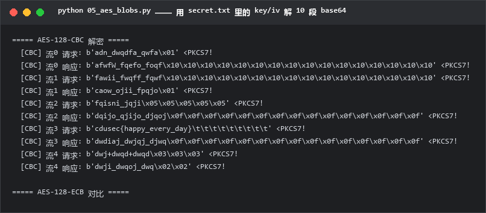
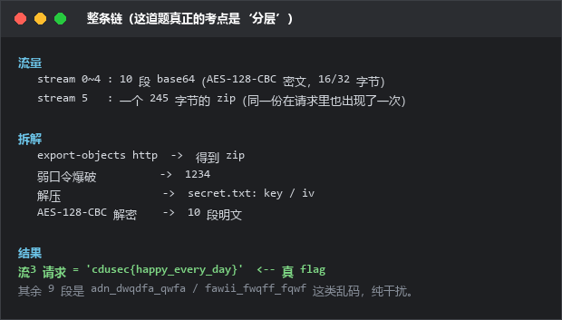

# Misc · misc.pcapng（流量里的加密 zip + AES 密文）—— Writeup

> 分类：Misc / 流量分析 + 压缩包 + 对称加密
> 附件：`misc.pcapng`（6,419 字节，54 个包，6 条 TCP 流）
> 做题日期：2026-10-25
> Flag：`cdusec{happy_every_day}`
> zip 口令：`1234`

---

## 30 秒速查卡

```
6 条 TCP 流，前 5 条各带一段 base64，第 6 条整个是一个 245 字节的 zip
  ↓ 文件 → 导出对象 → HTTP（或追踪流）
得到一个 WinZip AES-256 加密的 zip，里面是 secret.txt
  ↓ 弱口令爆破（PBKDF2-HMAC-SHA1 + 2 字节校验值）
命中 1234
  ↓ 解开
secret.txt:  key=123456789abcdefg   iv=abcdefg123456789
  ↓ 用这对 key/iv 做 AES-128-CBC 解密前面那 10 段 base64
10 段明文里有 9 段是乱码干扰项，1 段是真货
  ↓
cdusec{happy_every_day}
```

一句话：**这道题的考点是"分层"——zip 不是终点，它装的是下一层的钥匙。**

---

## 1. 先看清流量结构



```
frame          frames:54 bytes:5531
  eth          frames:54
    ip         frames:54
      tcp      frames:54
        http   frames:12
```

`GET /` 一共 6 次，目的端口从 `1234` 递增到 `1239`（每条流一个新连接）：

| 流 | 端口 | 请求体（客户端 → 服务端） | 响应 |
|---|---|---|---|
| 0 | 1234 | `szUo4I2Rxi5RTxFEWu3Inw==` | `eLbRPIGuwzeUoo4yI+D0oRyTyTKYiVs/aNGOxu1Wpho=` |
| 1 | 1235 | `ZncO9cIiovLPuo0W2ql0B1ee8gHhoeFismntvc2vcok=` | `h4FxCU/okn1kR7DBlKT1xA==` |
| 2 | 1236 | `ZBjAIq0VvwDRZSoHW4xItw==` | `AcGczsyPxaBMwuQ1jLd9bMIbb5kfZL54pEK7WU6KAcw=` |
| 3 | 1237 | `dUBOyTFQ9EnHQOcXyQvA5YoIvFxAan9zf2qANlDcJ0s=` | `/XbfGhTSv7AbJL/Ks/fwQrDfQwo4ksxBd+gNNO8IykU=` |
| 4 | 1238 | `qZ3c1ZvKbr/PxdK3QnltXg==` | `YbSmSnVeDb6oLEKHv2p1xQ==` |
| 5 | 1239 | **（499 字节：整个 zip）** | **`application/zip`，245 字节** |

前 10 段 base64 解出来都是 16 或 32 字节的随机二进制 —— **典型的 AES 分组密文**。
第 6 条流的请求和响应里**是同一份 zip**（原始文件里 `PK\x03\x04` 出现两次，偏移 5489 和 5894）。

> 用户当时的提示是"wp 里面说里面有压缩包"，所以目标很明确：**把这个 zip 抠出来**。

## 2. 抠出 zip

图形界面：`文件 → 导出对象 → HTTP`，或者选中第 6 条流 `右键 → 追踪 → TCP 流`，选 `Raw` 存出来。

命令行：

```powershell
& "D:\Program Files\Wireshark\tshark.exe" -r misc.pcapng --export-objects "http,.\out"
```

导出的目录里会出现几个按 URI 编码命名的文件，其中两个 245 字节的就是那个 zip。

## 3. 这个 zip 是 AES-256 加密的



```
50 4B 03 04               PK\x03\x04  局部文件头
33 00                     version needed = 51 (0x33) = WinZip AES
01 00                     general purpose flag = 0x0001 = 加密
63 00                     compression method = 0x63 = 99 = WinZip AES
0a 00                     filename length = 10  -> "secret.txt"
01 99 07 00               extra field id=0x9901, size=7
   02 00 41 45 03 00 00   real method=deflate / "AE" / strength=3 (AES-256)
```

Python 验证：

```python
import zipfile
z = zipfile.ZipFile("secret.zip")
for i in z.infolist():
    print(i.filename, i.file_size, hex(i.flag_bits), i.compress_type)
# secret.txt 41 0x1 flag_bits 99
```

`compress_type = 99` + `flag_bits = 0x0001` → **真加密**，不是伪加密。

### WinZip AES 的密钥推导

```
PBKDF2-HMAC-SHA1(口令, salt, 1000 轮, 66 字节)
  -> aesKey    = 前 32 字节   (AES-256)
  -> hmacKey   = 中间 32 字节
  -> pwdVerify = 最后 2 字节  <-- 用来快速判断口令对不对
HMAC-SHA1(hmacKey, ciphertext)[:10] == 文件末尾 10 字节  <-- 再验一次
```

`pwdVerify` 只有 2 字节，所以**先用它筛，再用 HMAC 确认**，两边都过才算命中（这也是避免误报的关键）。

## 4. 口令爆破：`1234`

候选顺序（175 个）：

```
password / Password / secret / flag / admin / 123456 / 666666 / zip / aes / scapy /
key / ctf / hack / test / demo / 1234 / 12345678 / qwerty / abc123 /
secret.txt / MyCustomScapyClient / winzip / 压缩包 / 密码 … 以及上面那些的 b64/hex 形式
```

命中 **`1234`**（4 位纯数字，字典末尾附近）。

> 这道题的 zip 口令确实是弱口令；**先字典、再纯数字爆破**是最省时间的顺序。

## 5. 解出 secret.txt —— 它不是终点，是钥匙

```
key=123456789abcdefg
iv=abcdefg123456789
```

正好 16 字节 key + 16 字节 iv → **AES-128-CBC**。
这时候才明白前面那 10 段 base64 是干什么的。

## 6. AES-128-CBC 解密那 10 段



```
[CBC] 流0 请求: b'adn_dwqdfa_qwfa\x01'
[CBC] 流0 响应: b'afwfW_fqefo_foqf\x10\x10\x10\x10...'
[CBC] 流1 请求: b'fawii_fwqff_fqwf\x10\x10\x10...'
[CBC] 流1 响应: b'caow_ojii_fpqjo\x01'
[CBC] 流2 请求: b'fqisni_jqji\x05\x05\x05\x05\x05'
[CBC] 流2 响应: b'dqijo_qjijo_djqoj\x0f\x0f...'
[CBC] 流3 请求: b'cdusec{happy_every_day}\t\t\t\t\t\t\t\t\t'      <-- 真货
[CBC] 流3 响应: b'dwdiaj_dwjqj_djwq\x0f\x0f...'
[CBC] 流4 请求: b'dwj+dwqd+dwqd\x03\x03\x03'
[CBC] 流4 响应: b'dwji_dwqoj_dwq\x02\x02'
```

- **90% 的段都是 `xxx_yyy_zzz` 形状的乱码**，纯粹是干扰项
- 唯一有语义的是流 3 的请求：`cdusec{happy_every_day}`
- 每段尾部都是**合法的 PKCS7 填充**（`\x09`×9 正好补齐 32 字节），所以"能正常填充"**不能**作为判断标准

> 这就是出题人的设计：让你怀疑"是不是每一段都要提交"。

## 7. 整条链



```
流量里 6 条流
  ├─ 流 0~4：10 段 base64  = AES-128-CBC 密文（其中 9 段是干扰）
  └─ 流 5  ：245 字节 zip  = WinZip AES-256，口令 1234
                    ↓ 解压
              secret.txt: key + iv
                    ↓ 用 key/iv 解前面 10 段
              cdusec{happy_every_day}
```

**考点排序**（重要的在前面）：

1. **导出对象**——别手工抠字节
2. **判断加密类型**（`compress_type=99` + `0x9901` extra field）
3. **弱口令爆破**（PBKDF2 + pwdVerify）
4. **AES-CBC 解密**（key/iv 在同一层的产物里）
5. **在干扰项里挑真货**（PKCS7 正常 ≠ 内容是答案）

## 8. 复现工具（`misc_pcap\` 目录）

| 脚本 | 作用 |
|---|---|
| `01_extract.py` | 从 pcap 里把 zip 抠出来 |
| `02_hexdump.py` | 看 zip 头结构 |
| `03_crack.py` | WinZip AES 口令验证器（纯标准库，PBKDF2 + HMAC 双判据） |
| `04_winzip_aes.py` | 解开 zip（AES-256-CTR，计数器从 1 开始的小端） |
| `05_aes_blobs.py` | 用 key/iv 解 10 段 base64（AES-128-CBC） |
| `aes_lib.py` | 纯 Python 的 AES-128/256 实现（含自测） |

## 9. 原理备忘

### WinZip AES 与普通 ZipCrypto 的区别

| | ZipCrypto | WinZip AES |
|---|---|---|
| `compress_type` | 8（deflate） | **99** |
| extra field | 无 | **`0x9901`** |
| 加密算法 | 自研流密码 | AES-128/192/256 |
| 密钥推导 | 3 个 32 位密钥 | PBKDF2-HMAC-SHA1, 1000 轮 |
| 完整性 | CRC32 | HMAC-SHA1 |
| 破解工具 | `bkcrack`（已知明文） | hashcat `-m 13600`（WinZip） |

### 为什么 `1234` 这种口令还能用

因为 WinZip AES 的 PBKDF2 只有 **1000 轮**（设计年代早），单条验证极快。
纯 Python 一秒也能跑几千个；hashcat 一秒几百万。所以"4 位数字 + AES"仍然是可破的。

## 10. 踩坑记录

| 坑 | 表现 | 教训 |
|---|---|---|
| 想手抠 zip | 偏移找错就坏包 | 用 `导出对象`，别手抠 |
| 以为 zip 里就是 flag | 解出 `secret.txt` 只有 key/iv | zip 可能是**中间产物** |
| 以为"填充正常"就是答案 | 10 段全都填充正常 | PKCS7 正常是概率事件，不是判据 |
| 直接上 hashcat 却没装 | 环境里没有 | 纯标准库也能写验证器（PBKDF2 用 `hashlib.pbkdf2_hmac`） |
| 只爆数字 | 1~3 位全失败 | 先跑弱口令字典（175 个候选几秒就完） |
