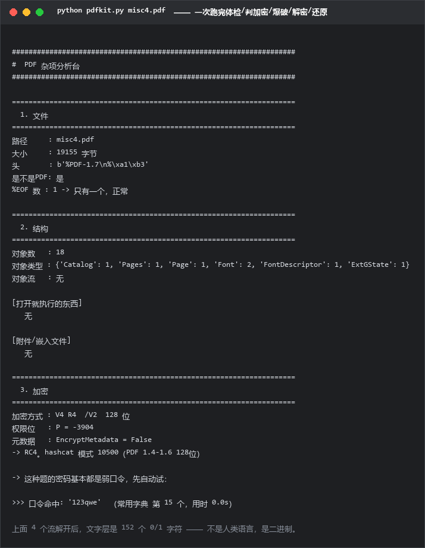
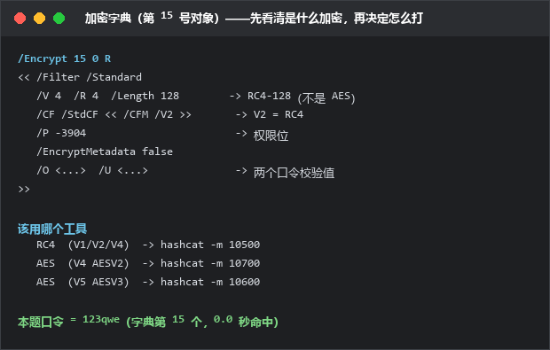
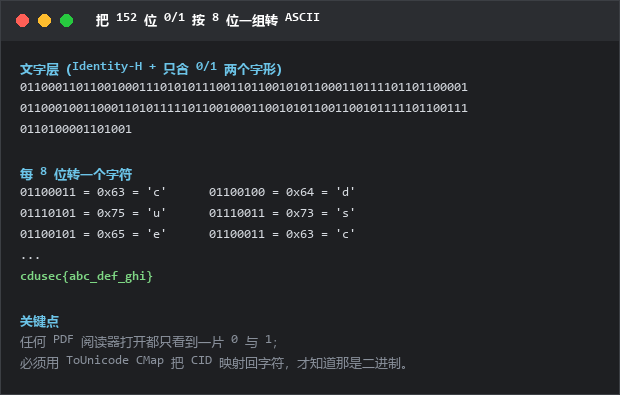

# Misc · PDF 加密（misc4.pdf）—— Writeup

> 分类：Misc / 文档隐写
> 附件：`misc4.pdf`（19,155 字节，PDF 1.7，WPS 产出）
> 做题日期：2026-10-24
> Flag：`cdusec{abc_def_ghi}`
> 口令：`123qwe`

---

## 30 秒速查卡

这题表面上是"PDF 杂项"，真正考的是**两个连续的坑**：

```
1) PDF 是加密的    -> 扫到 /Encrypt 15 0 R, /V 4 /R 4 /CFM /V2 = RC4-128
2) 口令是弱口令    -> 123qwe（字典第 15 个）
3) 解开后文字层是   -> 152 个 0 和 1（用一个只含 '0' '1' 两个字形、Identity-H 编码的字体画的）
4) 每 8 位转 ASCII -> cdusec{abc_def_ghi}
```

一条命令链跑完（工具在 `D:\XiaoMibook\CTF学习\misc\`）：

```powershell
cd D:\XiaoMibook\CTF学习\misc
python pdf_triage.py misc4.pdf     # 体检
python pdf_crack2.py misc4.pdf     # 字典爆破 -> 123qwe
python pdf_dump.py misc4.pdf 123qwe # 解密 + 按 CMap 还原文字
```

---

## 1. PDF 杂项的 8 步体检表

拿到任何 PDF 先跑这 8 步，这题的分数全在第 3 步和第 6 步：

```
1  file / 大小 / 头尾 / hash           —— 是不是真 PDF、尾部有没有夹东西
2  %%EOF 个数                          —— >=2 = 增量更新或被拼接
3  扫这些字典                          —— /Encrypt /ObjStm /EmbeddedFiles
                                          /JavaScript /OpenAction /AA /Launch
4  有 /Encrypt -> 空口令 -> 弱口令 -> 爆破
                                       —— RC4: hashcat -m 10500
                                          AES: hashcat -m 10700 / 10600
5  解流                                —— FlateDecode 用 zlib；/ObjStm 要展开
6  文字层                              —— ToUnicode CMap + Identity-H 手解
7  隐藏内容                            —— 白色文字 / 渲染模式 3(Tr) / 负坐标 / 超小字号
8  附件与图片                          —— /EmbeddedFiles 提链，pdfimages 导出
```

## 2. 体检结果



| 项 | 值 | 判断 |
|---|---|---|
| 大小 | 19,155 字节 | — |
| 头 | `%PDF-1.7` | 真 PDF |
| `%%EOF` 个数 | 1 | 只有一版，没有增量更新/拼接 |
| 对象数 | 18 | Catalog / Pages / Page / Font×2 / FontDescriptor / ExtGState |
| 对象流 | 无 | 不用展开 ObjStm |
| `/OpenAction` `/JavaScript` `/Launch` | 无 | 没有自动执行 |
| `/EmbeddedFiles` | 无 | 没有内嵌附件 |
| **`/Encrypt`** | **`15 0 R`** | **文件是加密的** |

关键点：**`/Encrypt` 同时出现在 trailer 和 Catalog 里**（正常只在 trailer），这是 WPS 写出来的特征。

## 3. 加密参数：先判类型，再决定用什么打



```
15 0 obj
<< /Filter /Standard
   /V 4  /R 4  /Length 128
   /CF /StdCF << /CFM /V2 >>
   /P -3904
   /EncryptMetadata false
   /O <...>   /U <...>
>>
```

| 参数 | 含义 | 结论 |
|---|---|---|
| `/V 4` `/R 4` | 安全处理器版本 / 修订号 | 支持 RC4 或 AES-128 |
| `/CFM /V2` | 加密算法 = RC4 | **RC4-128，不是 AES** |
| `/Length 128` | 密钥 128 位 = 16 字节 | — |
| `/P -3904` | 权限位（禁打印/复制） | 与破解无关 |
| `/EncryptMetadata false` | 元数据不加密 | 推导密钥时**要**追加 `FF FF FF FF` |

对应 hashcat 模式：

| 情况 | hashcat |
|---|---|
| RC4（`/V 1/2/4` + `/CFM /V2`） | `-m 10500` |
| AES-128（`/V 4` + `/CFM /AESV2`） | `-m 10700` |
| AES-256（`/V 5` + `/CFM /AESV3`） | `-m 10600` |

## 4. 破解：两次假阳性教会我的事

没有 hashcat，于是手写 RC4 安全处理器（R4）：

```
算法（ISO 32000-1, Algorithm 2）：
1. 口令用 32 字节标准 PAD 补齐
2. MD5( padded_pwd + O + P(4字节小端) + ID[0] + FF FF FF FF )
3. R>=3: 对结果前 n 字节做 50 次 MD5
4. 密钥 = 最终 MD5 的前 n 字节（n = Length/8 = 16）
```

对象密钥 = `MD5(密钥 + 对象号(3字节小端) + 代号(2字节小端))` 取前 `min(n+5,16)` 字节。

### 踩的第一个坑：空口令打不开 ≠ 加密是假的

一开始我判断"CTF 常见假加密"，于是把 `/Encrypt` 删掉直接 zlib 解流——失败。
说明流**真的**是 RC4 密文，必须拿口令。

### 踩的第二个坑：判据太松，误报两次

用"zlib 能解压就算命中"当判据，几十万次随机尝试里 zlib 偶尔会蒙对 8 字节垃圾：

| 误报口令 | 解出来的东西 | 真相 |
|---|---|---|
| `305` | `b'\x8b$\x1e\x1e\x1e...'` | 全 `0x1E`，不是真内容 |
| `689810` | `b'V\x1cBTF\x00'`（8 字节） | 只是碰巧含 `BT` |

**修正后的判据**（三条必须同时满足）：

1. zlib 解压完整成功（`eof=True` 且无 `unused_data`）
2. 解出长度 > 100
3. 含 `begincmap` / `CIDInit` / `beginbfchar` 之一（ToUnicode CMap 的固定结构）

用这个严格判据 + 日期/弱口令字典，第 15 个候选命中 **`123qwe`**。

## 5. 解密：三个流

| 对象 | 解密后大小 | 内容 |
|---|---|---|
| 7 | 4,381 字节 | 内容流（`q 1 0 0 -1 0 841.9 cm` …） |
| 9 | 462 字节 | ToUnicode CMap（`/CIDInit /ProcSet findresource begin`…） |
| 12 | 48,232 字节 | 字体（TTF，`00 01 00 00`） |

## 6. 文字层：为什么打开只看到一片 0 和 1



内容流里是：

```
/FT8 161 Tf
<0013 0013 0014 0014 ...> Tj
```

- 字体是 `Identity-H` 编码（每个字符 2 字节 CID）
- ToUnicode CMap 里只有 10 个映射，例如 `<0013> -> 0`、`<0014> -> 1`
- 所以**整页文字就是用这两个字形画出来的一串 0/1**

先用 CMap 把 CID 还原成字符，得到 152 个 0/1：

```
01100011 01100100 01110101 01110011 01100101 01100011 01111011 ...
   c        d        u        s        e        c        {
```

每 8 位转一个字符 → **`cdusec{abc_def_ghi}`**

## 7. 原理复盘

| 层 | 现象 | 本质 |
|---|---|---|
| 文件层 | 打不开 / 提示输入密码 | 标准安全处理器 RC4 加密 |
| 口令层 | 空口令、常见口令全失败 | 弱口令但不在最前面 → 需要字典/爆破 |
| 内容层 | 打开只见一片 0/1 | 自定义子集字体 + Identity-H，字符不是 ASCII |
| 语义层 | 0/1 串 | 二进制 ASCII |

**这题不需要会写 RC4。**需要的是：

1. 知道第 3 步该查 `/Encrypt`
2. 看得懂 `V/R/CFM` → 知道用哪个 hashcat 模式
3. 知道 PDF 文字可能是 CID 编码的，得用 ToUnicode 还原

## 8. 复用工具（都在 `misc\` 目录）

| 脚本 | 作用 |
|---|---|
| `pdf_triage.py` | 8 步体检（结构 / 加密 / 流 / 文字 / 自动解码） |
| `pdf_crack.py` | 纯数字爆破（6 位约 80 秒） |
| `pdf_crack2.py` | 字典：8 位日期 + 常见弱口令 + 词根组合 |
| `pdf_dump.py` | 已知口令 → 解密全部流 → 按 CMap 还原文字 |
| `pdf_analyze.bat` | **把 PDF 拖上去**的交互式分析台（英文名 + 纯 ASCII，避免中文乱码） |
| `pdfkit.py` | 上面那个 BAT 的引擎 |

## 9. 踩坑记录

| 坑 | 表现 | 教训 |
|---|---|---|
| 以为加密是假的 | 删 `/Encrypt` 后 zlib 解不开 | 空口令失败 ≠ 加密是假的 |
| 判据用"能解压就行" | 误报 `305` / `689810` | 必须要求解出的**结构**正确 |
| 用 `/U` 校验当唯一判据 | 一直"口令错误" | `/U` 可能被改；用"解出内容像不像真的"更硬 |
| 只爆破数字 | 1–6 位全失败 | 先跑弱口令字典，再考虑纯数字 |
| 中文路径 / 中文名脚本 | BAT 乱码、cmd 报错 | BAT 保持纯 ASCII，逻辑放 Python |
