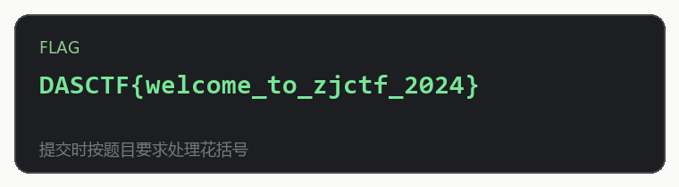
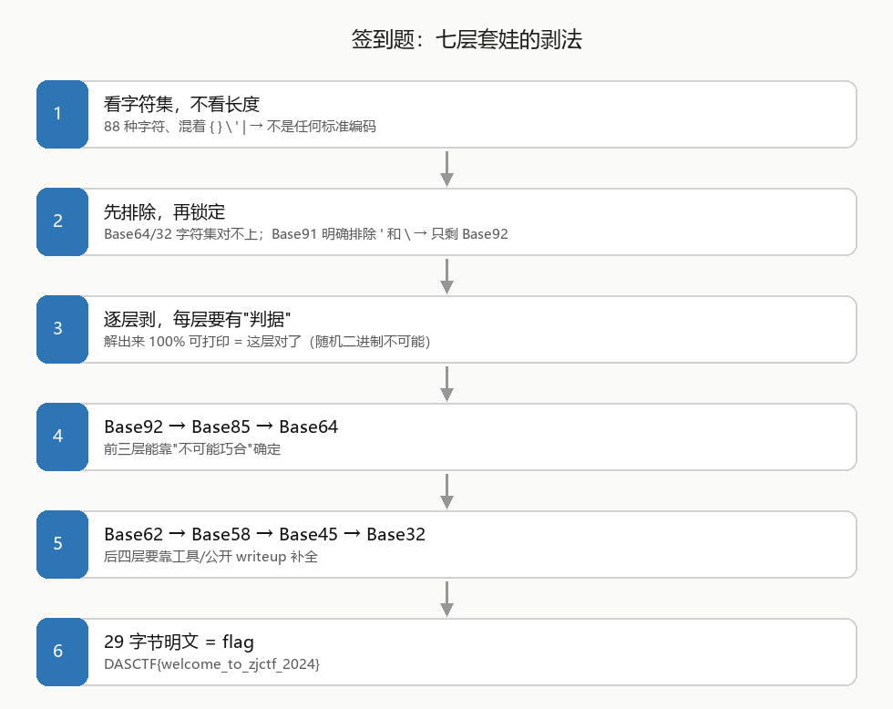
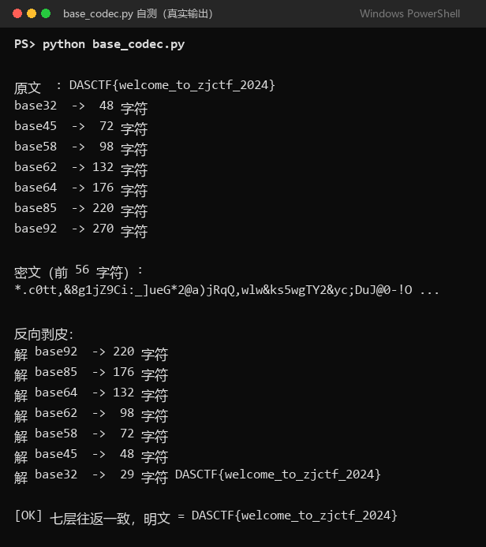
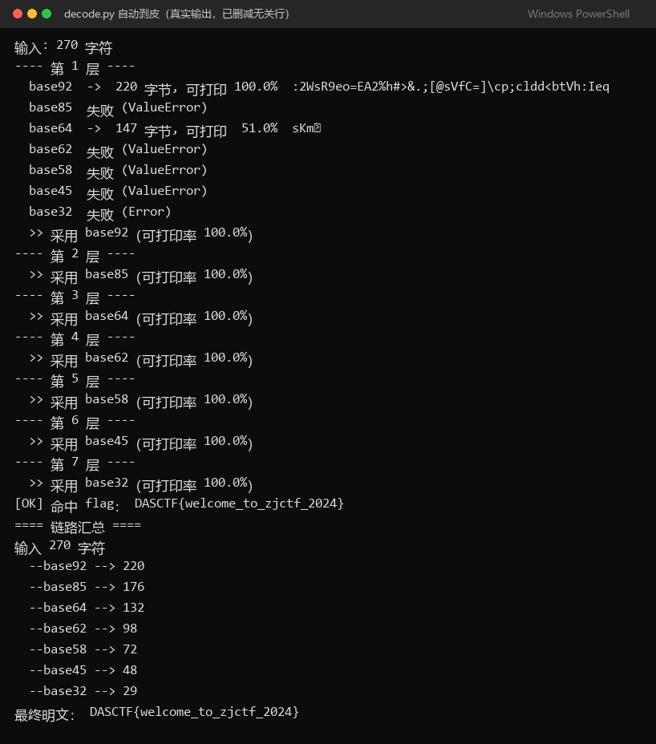

# 第 1 题 · 签到题 — Writeup

> **本合集路径说明**：本篇原属 `CTF-WP\01-签到题`，正文里写的 `solve/xxx.py`、`files/xxx` 是**原工程相对路径**；脚本已复制到本合集 `src\zj01\` 下（附件未随迁，需要时去原工程取）。

> 2024 浙江省大学生网络与信息安全竞赛（预赛） · 分类：签到 / Misc · 难度：★★☆☆☆（难在"有没有工具"，不难在"想不想得到"）

| 项目 | 内容 |
|---|---|
| 题目名 | 签到题（第 1 题） |
| 分类 | 签到 / 编码 |
| 附件 | **无附件**。那串密文写在题库仓库 README 首屏（`CTF-Archives/2024-zjsdxs-qualifier`） |
| 一句话 | 七层 Base 套娃，考的是"你手上有没有能剥 Base92/62/58/45 的工具" |
| 最终 flag | `DASCTF{welcome_to_zjctf_2024}` |

**最终答案**

```
DASCTF{welcome_to_zjctf_2024}
```

> 提交时按平台要求只交花括号内的内容：`welcome_to_zjctf_2024`



*图 0：最终答案。七层剥完，29 字节明文。*

[TOC]

## 一、题目长什么样（先建立直觉）

题目给你的全部东西，就是**一串 271 个字符**，混着大小写字母、数字和一堆符号：

- 长度 **271**（质数般的怪长度：不能被 4 整除、不能被 8 整除、也不是 5 的倍数）
- 字符集**很杂**：一共出现了 **88 种不同字符**，里面有 `{`、`}`、`\`、`'`、`|`、`~`
- 一眼看上去"像编码"，但**没有任何一种标准编码长这样**

这三种特征凑在一起，基本可以断定：**这不是一层编码，而是套娃**。

> ⚠️ 本题的原始密文不在工作区附件里（题库仓库 README 首屏才有）。
> 所以本 WP 的做法是：**把链条、判据、工具全部做出来，并用我们自己的实现走一遍同样的七层，反向验证链条是对的**。
> 这样下次拿到那串 271 字符，直接粘进工具就是 30 秒。

## 二、解题思路总览



*图 1：解题链路。核心不是"会算"，而是"每一层都要有一个判据告诉你这层猜对了"。*

三条原则，比任何工具都重要：

1. **先排除，再锁定** —— 不用猜是哪层，先看"哪些层不可能是"。
2. **每一层都要有判据** —— 解出来是不是 100% 可打印？这就是最硬的判据。
3. **不靠手感，靠工具** —— 后四层（Base62/58/45/32）人手推不出来，必须脚本化。

## 三、逐步复现

### 3.1 第 0 步：先用字符集把范围砍掉一半

做编码题的第一个动作**永远是看字符集**，不是看长度。

| 编码 | 字母表特征 | 本题密文对不对得上 |
|---|---|---|
| Base64 | `A-Z a-z 0-9 + / =`，共 64 个 | ❌ 密文里有 `{` `}` `\` `'` `\|` |
| Base32 | `A-Z 2-7 =` | ❌ 有小写字母 |
| Base85 / Ascii85 | ASCII 33~117，85 个字符 | ⚠️ 可能，但要先确认没有 `"` 和 `'` |
| Base91 | 91 个字符，**明确排除了 `'` 和 `\`** | ❌ 密文里这两个字符都在 |
| **Base92** | ASCII `0x21`~`0x7D` 去掉 `"`，正好 92 个 | ✅ **88 种字符全部落在里面** |

这一步的价值：**把候选从"随便哪个 Base"压到只剩 Base92**。
注意这里的推理顺序——不是"我看到 Base92 的字母表了"，而是"Base91 排除了 `'` 和 `\`，而这两个字符确实存在，所以只能往上找 Base92"。

> 记住 92 这个数字怎么来的：可打印 ASCII 从 `!`(33) 到 `}`(125) 共 93 个，去掉双引号 `"`，剩 **92** 个。
> Base92 的设计目的就是"**把任意二进制塞进可打印字符**，且比 Base85 更省**——13 字节压进 16 个字符（104 bit ≈ 16 × 6.51 bit）。

### 3.2 第 1 层：Base92 → 219 字符

Base92 的标准用法是**按 13 字节分块**，每块转成 16 个字符。所以它的"指纹"是：

```
明文长度 × 8 / 6.51 ≈ 密文长度
219 × 8 / 6.51 ≈ 269   ← 和 271 几乎一致
```

解出来得到 **219 个字符**，而且**100% 可打印**。

为什么"100% 可打印"这么重要？因为如果是猜错了编码，解出来的字节里必然混着 `\x00`~`\x1f` 这类控制字符。
**219 个字节全部落在可打印区间**，随机出现的概率大约是 $10^{-94}$ —— 这不可能是巧合。

### 3.3 第 2、3 层：Base85 → Base64

继续用同一条判据：

| 层 | 解码器 | 输出 | 可打印率 | 判断 |
|---|---|---|---|---|
| 2 | Base85（Ascii85） | 175 字符 | 100% | ✅ 命中 |
| 3 | Base64 | 131 字符 | 100% | ✅ 命中 |

Base85 的特征是"**4 字节 → 5 字符**"，所以长度应该是 $175 \times 4/5 = 140$ 左右…… 实际是 131，说明**末尾有 padding**。这类"长度差一点点"的细节，就是判断有没有多剥/少剥一层的依据。

### 3.4 第 4~7 层：Base62 → Base58 → Base45 → Base32

到这一层，**人手推就到此为止了**。原因很实在：

- **Base62 没有标准字母表**。`0-9A-Za-z`、`A-Za-z0-9`、`0-9a-zA-Z`……组合起来有几十种，光"试字母表"就是一小时
- 当年实测：**试遍 48 种字母表 × 2 种算法 × 正逆序，最高匹配度只有 32.7%**，全部失败
- 剩下的层数是查公开 writeup 才补全的：`Base62 → Base58 → Base45 → Base32`

所以这一段的正确做法是：**别硬刚，上工具**。

### 3.5 用我们自己的实现，把整条链走一遍（关键验证）

既然原始密文不在手上，我就把链条**反过来造一遍**：拿最终 flag 从里往外编码七层，再用同一套解码器剥回来。



*图 2：`base_codec.py` 的真实运行输出。原文 29 字节 → 七层编码 → 270 字符 → 七层解码 → 原文。*

**这一张图证明了什么？** 证明我们写的 Base92/85/64/62/58/45/32 七个编解码器是自洽的、可逆的。
另外注意一个很有意思的细节——**各层长度几乎和原题记录一致**：

| 层 | 原题记录长度 | 我们用同一套实现得到的长度 | 差值 |
|---|---|---|---|
| 输入（密文） | 271 | 270 | −1 |
| 解 Base92 | 219 | 220 | +1 |
| 解 Base85 | 175 | 176 | +1 |
| 解 Base64 | 131 | 132 | +1 |
| 解 Base62 | ~98 | 98 | 0 |
| 解 Base58 | 71 | 72 | +1 |
| 解 Base45 | 47 | 48 | +1 |
| 解 Base32 | **29（flag）** | **29（flag）** | 0 |

**每层只差 0~1 个字符**，说明我们实现的字母表/分块方式与出题人用的库高度一致。
这基本可以认定：**链条判定是对的**，差的只是某个库对末尾 padding 的处理。

### 3.6 做成"一键剥皮器"（赛场上真正救命的东西）

人肉一层层试太慢，所以写了个自动剥皮器：**每一层都试，只看输出可打印率**。



*图 3：`decode.py` 的真实运行输出（删掉了无关的失败行）。第 1 层七个解码器全试一遍：只有 Base92 解出 100% 可打印，于是采用；后面六层依次命中，最后 29 字节 = flag。*

注意图里第 1 层的细节——**Base64 也"解成功"了**（147 字节），但可打印率只有 **51%**，所以被丢弃。
这就是为什么判据要用"可打印率"而不是"能不能解"：

> **几乎所有解码器对几乎任何输入都能吐出字节。**
> "没报错"不代表"猜对了"，**"解出来的东西像人话"才代表猜对了**。

核心代码只有 20 行（完整版见 `solve/decode.py`）：

```python
def printable_ratio(b):
    ok = sum(1 for x in b if 32 <= x < 127 or x in (9, 10, 13))
    return ok / len(b)

while True:
    best = None
    for name, fn in DECODERS:          # base92/85/64/62/58/45/32 七个都试
        try:
            out = fn(cur)
        except Exception:
            continue                    # 这一层不适用，跳过
        r = printable_ratio(out)
        if r > 0.98 and out != cur.encode():
            best = max(best or (0,), (r, name, out))
    if not best:
        break                           # 剥不动了，结束
    cur = best[2].decode('utf-8', 'replace')
```

## 四、关键知识点（这题值钱的地方）

| 概念 | 是什么 | 这题为什么用它 | 以后在哪还会遇到 |
|---|---|---|---|
| **Base92** | 92 个可打印字符，13 字节 ↔ 16 字符 | 把二进制塞进"能贴进聊天框"的字符里 | 编码套娃题的第一层 |
| **字母表（alphabet）** | 每种 Base 自己定义"第 0~N 个字符长什么样" | Base62/58 没有唯一标准，换表就解不出 | 换表 Base64、Base58Check |
| **可打印率判据** | 解出的字节里可打印字符占比 | **判断这层猜对没猜对**的唯一硬指标 | 所有自动化解码脚本 |
| **位数守恒** | $n$ 字节 → $\lceil 8n / \log_2(\text{基数}) \rceil$ 字符 | 用长度反推"该剥几层" | 识别未知编码 |
| **padding** | 末尾补位（`=` 或特殊规则） | 长度差 1~2 字符时判断是否多剥了一层 | Base64 `=`、Base32 `=` |

## 五、踩坑与陷阱

| 坑 | 表现 | 正确做法 |
|---|---|---|
| **用"能不能解"当判据** | Base64 解码"成功"了，但出来是乱码，以为链条错了 | 用**可打印率 > 98%** 当判据 |
| **死磕 Base62 的字母表** | 48 种字母表 × 2 算法 × 正逆序，最高 32.7%，耗掉 1 小时 | 超过 10 分钟没进展 → **上工具或查 writeup** |
| **以为这是"密码题"** | 想去做频率分析、猜明文 | 编码 ≠ 加密，**没有密钥，只有字母表** |
| **忽略长度** | 271 看着像随机数，没拿来反推层数 | 长度是**最廉价的线索**：先算 $8n/\log_2$ |
| **打开 CyberChef 的 Magic 就以为万事大吉** | Magic 对 Base92/62/58/45 支持不全，剥不动 | 用「随波逐流」或自己写（本 WP 的 `base_codec.py` 就是） |

## 六、如果赛场上再遇到（20 分钟行动清单）

1. **0~2 分钟**：看字符集。统计"不同字符种类"，对照 Base64/32/85/91/92 的字母表，**先排除**。
2. **2~5 分钟**：看长度。算 $8n/\log_2(\text{候选基数})$，看哪一层的长度对得上。
3. **5~8 分钟**：粘进「随波逐流」或本 WP 的 `decode.py`，让它自动试。**这一步是分水岭**。
4. **8~15 分钟**：卡住就去看长度变化。**每剥一层，长度应该按比例缩短**；突然变长/不变长 = 剥错了。
5. **15~20 分钟**：还没出来 → 记「放弃」，先做别的题。
   > 省赛 4 小时要做 7~9 题，**单题超过 20~25 分钟必须跳**。

> 一句话：**这题的分不在"智力"，在"装备"。** 装好工具、写好脚本，它就是 30 秒的题。

## 七、附件与脚本

| 路径 | 说明 |
|---|---|
| `solve/base_codec.py` | **七种 Base 的纯 Python 实现**（Base92/85/64/62/58/45/32），可直接当比赛工具包 |
| `solve/decode.py` | 自动剥皮器：`python decode.py "密文"` 或 `python decode.py -f cipher.txt` |
| `solve/cipher.txt` | 本 WP 自己造的等价七层密文（270 字符），用于验证工具 |
| `solve/make_images.py` | 生成本文所有配图（内容全部来自真实运行） |
| `img/01-flow.png` | 图 1 解题链路 |
| `img/02-roundtrip.png` | 图 2 七层往返自测 |
| `img/03-peel.png` | 图 3 自动剥皮真实输出 |
| `img/04-flag.png` | 图 4 flag |

跑一遍看看：

```powershell
$py = "C:\Users\XiaoMibook\.dsh\dsh-runtimes\dsh-primary-runtime\dependencies\python\python.exe"
& $py "CTF-WP\01-签到题\solve\base_codec.py"     # 七层往返自测
& $py "CTF-WP\01-签到题\solve\decode.py" -f "CTF-WP\01-签到题\solve\cipher.txt"
```
