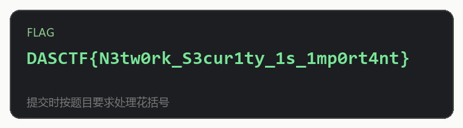
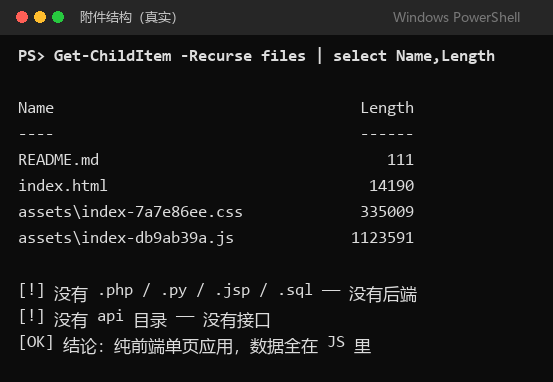
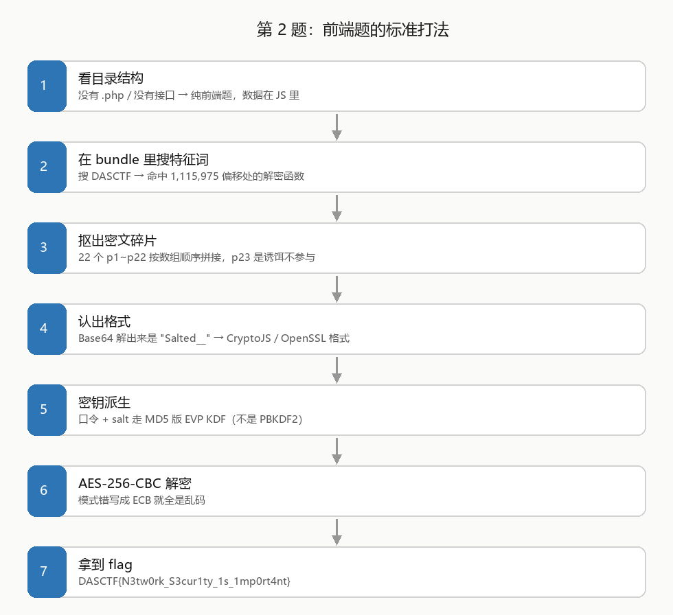
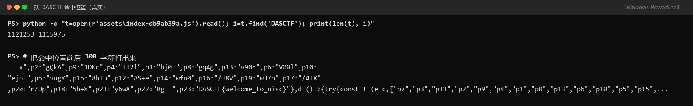
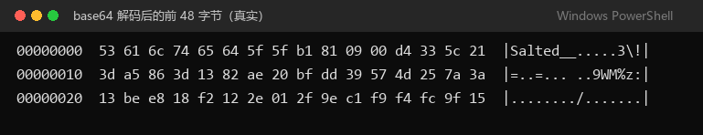
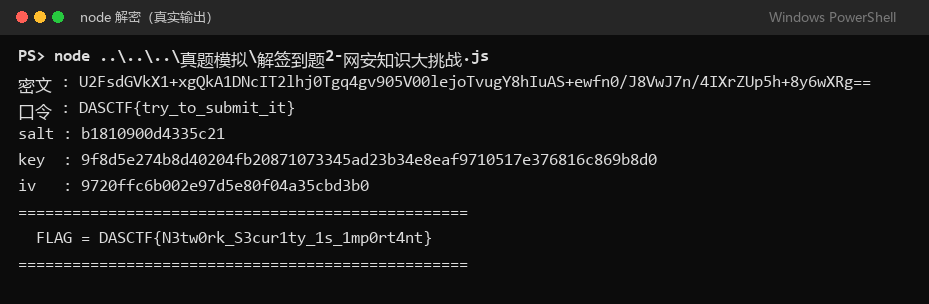

# 第 2 题 · 网安知识大挑战 — Writeup

> **本合集路径说明**：本篇原属 `CTF-WP\02-网安知识大挑战`，正文里写的 `solve/xxx.py`、`files/xxx` 是**原工程相对路径**；脚本已复制到本合集 `src\zj02\` 下（附件未随迁，需要时去原工程取）。

> 2024 浙江省大学生网络与信息安全竞赛（预赛） · 分类：签到 / 前端 JS · 难度：★★★☆☆

| 项目 | 内容 |
|---|---|
| 题目名 | 网安知识大挑战（第 2 题） |
| 分类 | 前端 / JS 逆向 / 密码学应用 |
| 附件 | `files/`（388 KB 的 Vite 打包站，Zip 解压后 4 个文件） |
| 一句话 | 纯前端题：flag 用 CryptoJS AES 加密后拆成 22 片藏在打包 JS 里，**外加两个诱饵** |
| 最终 flag | `DASCTF{N3tw0rk_S3cur1ty_1s_1mp0rt4nt}` |

**最终答案**

```
DASCTF{N3tw0rk_S3cur1ty_1s_1mp0rt4nt}
```

> 提交时只交花括号内的内容：`N3tw0rk_S3cur1ty_1s_1mp0rt4nt`



*图 0：最终答案（走完"拼密文 → 派生根钥 → AES-256-CBC"整条链才拿到，不是诱饵）。*

[TOC]

## 一、题目长什么样（先建立直觉）

附件解压出来只有 4 个文件，**一个后端文件都没有**：



*图 1：附件真实目录。没有 `.php`、没有 API 目录、没有数据库脚本 —— 这基本就宣判了：**这是一道纯前端题**。*

这个判断非常重要，因为接下来所有动作都由它决定：

| 判断题 | 答案 | 结论 |
|---|---|---|
| 有后端吗？ | 没有 | 不用起 PHP/MySQL，也**不用去找接口** |
| 题目逻辑在哪？ | `assets/index-db9ab39a.js`（1.12 MB） | 数据、flag、解密函数全在这个文件里 |
| 要跑页面吗？ | 可以不用 | 直接**静态读 JS** 更快，浏览器只是辅助 |

> 很多人一上来就 `npm run`、起 phpStudy、开 F12 打断点。这题**不需要**。
> 打包后的 JS 是"白盒"——源码都给你了，**读代码比调代码快十倍**。

## 二、解题思路总览



*图 2：前端题的标准六步。每一步都有明确的"输入 → 输出"，不靠感觉。*

## 三、逐步复现

### 3.1 第 1 步：在 1.1 MB 的打包 JS 里搜特征词

**不要通读压缩后的代码**（一行几万字符，读了会疯）。用搜索定位：

```
1. DASCTF        ← 直接搜 flag 前缀，命中率最高
2. flag / Flag
3. decrypt / encrypt / AES / DES / RSA
4. key / iv / password / secret
5. 中文题目文案   ← 能定位到题库数据
```

搜索结果：



*图 3：`DASCTF` 在 1,121,253 字符的文件里，第一次出现在 **偏移 1,115,975**。后面紧跟着的就是解密函数。*

### 3.2 第 2 步：读懂那 300 个字符

把命中的片段整理一下（为了可读性做了换行，逻辑一字未改）：

```js
const c = {
  p7:"U2Fs", p3:"dGVk", p11:"X1+x", p2:"gQkA", p9:"1DNc", p4:"IT2l",
  p1:"hj0T", p8:"gq4g", p13:"v905", p6:"V00l", p10:"ejoT", p5:"vugY",
  p15:"8hIu", p12:"AS+e", p14:"wfn0", p16:"/J8V", p19:"wJ7n", p17:"/4IX",
  p20:"rZUp", p18:"5h+8", p21:"y6wX", p22:"Rg==",
  p23:"DASCTF{welcome_to_nisc}"          // ← 诱饵 1
};

const d = () => {
  try {
    const t = (e = c,
      ["p7","p3","p11","p2","p9","p4","p1","p8","p13","p6","p10","p5",
       "p15","p12","p14","p16","p19","p17","p20","p18","p21","p22"].map(t => e[t]).join("")),
      n = "DASCTF{try_to_submit_it}";    // ← 诱饵 2
    return sq.AES.decrypt(t, n, { mode: sq.mode.CBC, padding: sq.pad.Pkcs7 })
             .toString(sq.enc.Utf8);
  } catch (_q) { return console.error("解密失败:", _q), "解密失败"; }
  var e;
};
```

**这 15 行里有三个关键信息，缺一不可：**

| 信息 | 值 | 怎么读出来的 |
|---|---|---|
| **密文** | 22 个碎片**按数组顺序**拼接 | `.map(k => c[k]).join("")`，数组就是拼接顺序 |
| **口令** | `DASCTF{try_to_submit_it}` | `AES.decrypt(密文, 口令, ...)` 的第二个参数是**字符串** |
| **算法** | AES / **CBC** / **Pkcs7** | 第三个参数里写死了 |

### 3.3 第 3 步：警惕两个诱饵 ⚠️

这一节是本题**最值钱**的部分。

#### 诱饵 1：`p23:"DASCTF{welcome_to_nisc}"`

它长得就是一个 flag。**但它不在拼接数组里**——数组只到 `p22`。
直接复制提交，**错**。

#### 诱饵 2：口令 `"DASCTF{try_to_submit_it}"`

它的名字直白地写着"**试试提交它**"。
它是**解密口令**，不是答案。谁忍不住提交谁错。

> **黄金法则**：
> 看到 `DASCTF{...}` 不要直接提交，先问一句：
> **它是密文？口令？诱饵？还是真的答案？**
>
> CTF 出题人非常喜欢在 JS 里埋假 flag。**只有走完整个解密流程得到的那个，才是真的。**

### 3.4 第 4 步：认出 `Salted__` 格式

把 22 个碎片拼起来，是一串 88 字符的 Base64：

```
U2FsdGVkX1+xgQkA1DNcIT2lhj0Tgq4gv905V00lejoTvugY8hIuAS+ewfn0/J8VwJ7n/4IXrZUp5h+8y6wXRg==
```

Base64 解码后看前 16 个字节：



*图 4：真实 hexdump。前 8 字节 `53 61 6c 74 65 64 5f 5f` = ASCII **`Salted__`**，紧跟 8 字节 salt（`b1810900d4335c21`）。*

**`Salted__` 是 OpenSSL / CryptoJS 的标志性文件头**。看到它，就等于知道后面该怎么做了：

```
"Saltd__"(8B) | salt(8B) | 密文
```

为什么会出现它？因为 **CryptoJS 的 `AES.encrypt(明文, "字符串口令")` 只要第二参数是字符串**，就会自动：
1. 随机生成 8 字节 salt
2. 用 salt + 口令**派生密钥**（而不是把口令当密钥）
3. 按 OpenSSL 兼容格式输出

这一步是**分水岭**：认不出 `Salted__`，你就会去把口令当 raw key 用，怎么解都是乱码。

### 3.5 第 5 步：CryptoJS 的密钥派生（**不是 PBKDF2**）

这是本题最容易做错、也最值得记的一点。

```
D₁ = MD5(口令 ‖ salt)
D₂ = MD5(D₁ ‖ 口令 ‖ salt)
D₃ = MD5(D₂ ‖ 口令 ‖ salt)

key = D₁ ‖ D₂     → 32 字节，正好 AES-256 的密钥
iv  = D₃          → 16 字节，正好一个分组
```

它不是一次 MD5，而是**一条链**：每一轮都把上一轮的摘要接在前面。这种 KDF 叫 **EVP_BytesToKey**（OpenSSL 的老做法），CryptoJS 照抄了它。

为什么必须知道这个？因为**它和 PBKDF2 完全不同**：

| | CryptoJS / OpenSSL EVP_BytesToKey | 现代 PBKDF2 |
|---|---|---|
| 迭代 | MD5 链，**几十次以内** | 通常 10 万次以上 |
| 参数 | 只要 salt | 还要 iterations、salt、HMAC |
| 用错会怎样 | 解出来是乱码 | 解出来是乱码 |

本题实算出来的值（脚本输出，可直接对拍）：

```
salt : b1810900d4335c21
key  : 9f8d5e274b8d40204fb20871073345ad23b34e8eaf9710517e376816c869b8d0
iv   : 9720ffc6b002e97d5e80f04a35cbd3b0
```

### 3.6 第 6 步：AES-256-CBC 解密



*图 5：`node` 真实运行输出。注意口令那一行 —— 它是口令，不是 flag。*

核心代码 4 行：

```js
const d  = crypto.createDecipheriv("aes-256-cbc", key, iv);
const pt = Buffer.concat([d.update(ct), d.final()]).toString("utf8");
```

**为什么不用自己手写 AES？**

> 自己写 AES 会遇到两个必踩的坑：**密钥派生** 和 **CBC 链式异或**。
> 本题实测踩过：把 CBC 写成 ECB（`P[i] = Decrypt(C[i])` 而不是 `P[i] = Decrypt(C[i]) ⊕ C[i-1]`），
> 解出来全是乱码，然后花两小时怀疑算法写错了。
>
> **正确姿势：人负责"认"（认出格式、找到口令、判断 KDF），机器负责"算"（AES 交给库）。**

## 四、关键知识点（这题值钱的地方）

| 概念 | 是什么 | 这题怎么用 | 以后在哪还会遇到 |
|---|---|---|---|
| **`Salted__` 文件头** | OpenSSL 兼容加密格式的标志 | 一眼确认"这是 CryptoJS/OpenSSL 输出" | 所有 `openssl enc` 产物、PHP 的 `openssl_encrypt` |
| **EVP_BytesToKey** | 口令 + salt → 密钥，用 MD5 链 | 决定 key/iv 怎么算出来 | CryptoJS、老 OpenSSL、部分安卓加固 |
| **AES 四要素** | key / iv / mode / padding | 错一个就乱码，且**症状一样** | 所有对称加密 |
| **CBC vs ECB** | CBC 每块先和上一块密文异或 | 写错模式是本题最大坑 | 一切分组密码 |
| **纯前端题识别** | 无后端 + JS 里带逻辑 | 决定"读代码"而不是"挖接口" | 所有前端逻辑题 |
| **诱饵 flag** | 出题人故意放的假 flag / 假口令 | 必须走完流程才算数 | 一切 JS 题、APK 题 |

## 五、踩坑与陷阱

| 坑 | 表现 | 正确做法 |
|---|---|---|
| **用 F12 的"样式"过滤器搜 `dasctf`** | 永远搜不到 | 样式面板只筛 CSS 规则。搜 JS 用**源代码面板 `Ctrl+Shift+F`** |
| **双击 index.html 打开是白页** | 页面空白 | 用了 ES module，`file://` 会被 CORS 拦。起 `python -m http.server 8000` |
| **手写 AES 忘了 CBC 的链式异或** | 解密全是乱码 | 先用 **FIPS-197 官方测试向量**验证算法，再查模式；最省事是用库 |
| **把口令当答案提交** | 交上去错 | 口令写着 `try_to_submit_it`，就是让你别交它 |
| **把 `p23` 当答案提交** | 交上去错 | 它没参与拼接，是纯诱饵 |
| **以为要起 phpStudy/MySQL** | 白折腾 | 看目录：没有 `.php`、没有 `.sql`，就不是那种题 |

## 六、如果赛场上再遇到（20 分钟行动清单）

1. **0~2 分钟**：解压看目录。有 `.php`/接口 → 后端题；只有 `index.html` + `assets/*.js` → **纯前端题**（本题）。
2. **2~4 分钟**：在 JS 里搜 `DASCTF` / `flag` / `decrypt` / `AES`。
3. **4~8 分钟**：读出三要素——**密文在哪、口令是什么、算法/模式/填充是什么**。抄进笔记。
4. **8~10 分钟**：看密文开头。Base64 解出来是 `Salted__` → 用 CryptoJS 兼容 KDF；是纯十六进制 → 可能是 raw key。
5. **10~15 分钟**：**本地写脚本解**，别在浏览器里调试。Node 的 `crypto` 或 Python 的 pycryptodome 都行。
6. **15~18 分钟**：检查有没有诱饵。得到 flag 后再回头确认：这个字符串是**解密结果**吗？还是我又抄了个口令？
7. **18~20 分钟**：没出来就跳题。前端题的坑（打包混淆、wasm、动态 key）可以吃掉一晚上。

## 七、附件与脚本

| 路径 | 说明 |
|---|---|
| `files/index.html` | 题目页面（14 KB） |
| `files/assets/index-db9ab39a.js` | **主战场**：1.12 MB 打包 JS，flag 和解密逻辑都在这 |
| `files/assets/index-7a7e86ee.css` | 样式（本题无用） |
| `solve/decrypt.js` | 完整解密脚本（Node 直接跑） |
| `solve/make_images.py` | 生成本文配图（内容来自真实文件/真实运行） |
| `solve/blob.txt` | 拼好的 88 字符密文 |
| `img/01-flow.png` … `img/06-flag.png` | 图 1~6 |

跑一遍：

```powershell
# 1) 解密（最省事）
node "CTF-WP\02-网安知识大挑战\solve\decrypt.js"

# 2) 或者把页面跑起来看（可选，本题不需要）
cd "CTF-WP\02-网安知识大挑战\files"
python -m http.server 8000     # 然后浏览器开 http://localhost:8000
```
