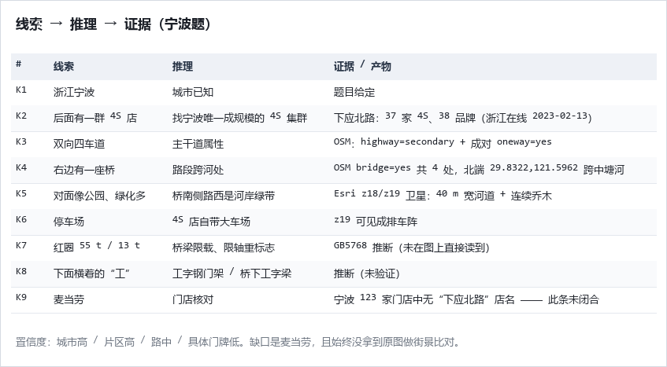
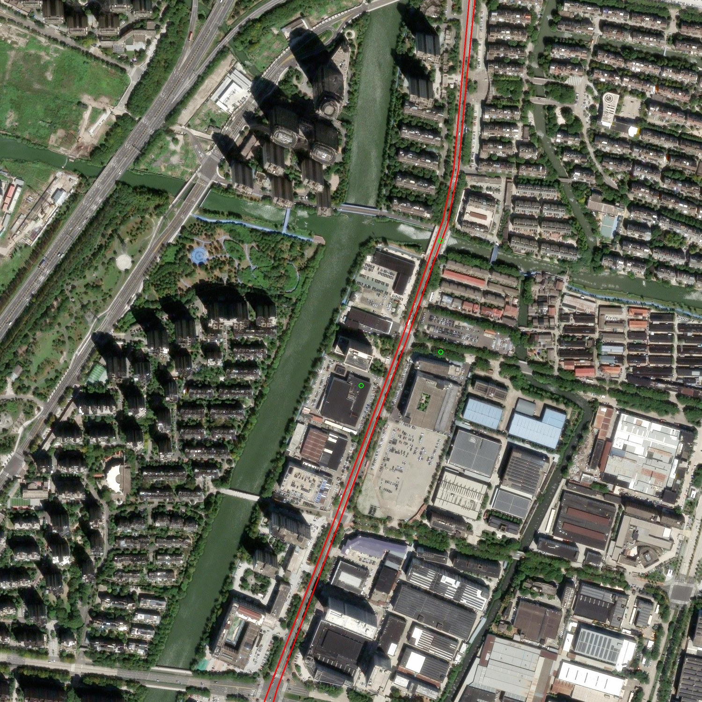
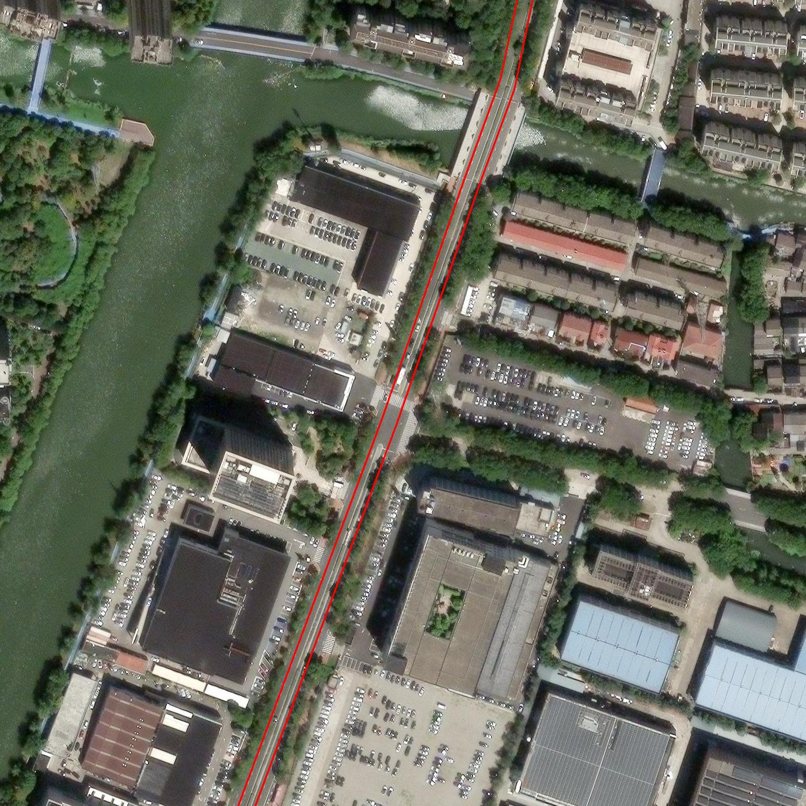
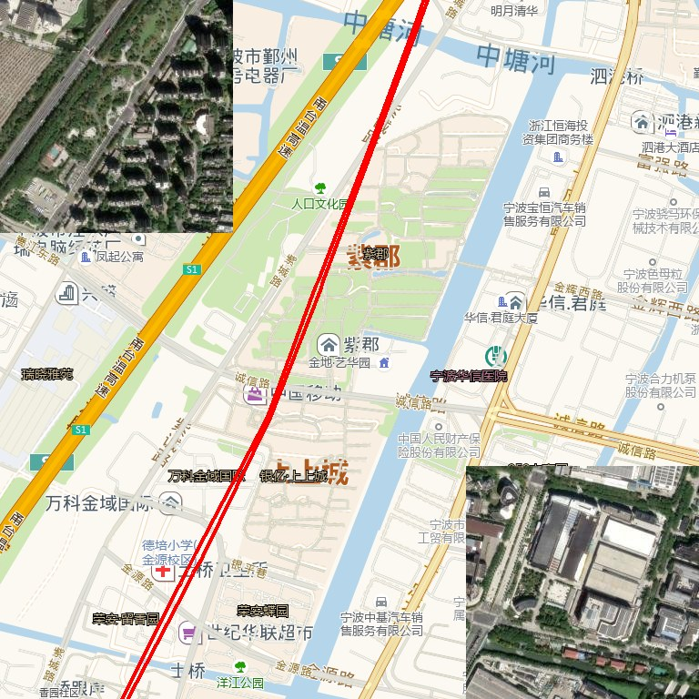

# Misc · 宁波停车场位置推测（OSINT 定位）—— Writeup

> 分类：Misc / OSINT / 图像地理定位
> 题面线索（无原图）：浙江宁波，拍摄点在停车场；对面疑似公园有大量绿化；路是双向四车道；后面有 4S 店和麦当劳；右边有一座桥，红圈 55 吨 + 一个 13 吨；下面有一个横着的"工"。
> 做题日期：2026-10-29
> 结论：**宁波市鄞州区潘火街道 下应北路（"汽车 4S 店一条街"）288 号宁波宝恒宝马 5S 店一带的汽车广场停车场，紧邻下应北路跨中塘河桥的南侧**
> 坐标：**WGS84 29.8305, 121.5962**（误差 ±200 m）

---

## 30 秒速查卡

这题没有 flag 字符串，答案是**地点 + 坐标**。判断链只有一条：

```
"后面有一群 4S 店"  ->  找宁波唯一成规模的 4S 集群  ->  下应北路（2 km、37 家 4S）
"双向四车道"        ->  OSM 里必须是 secondary + 成对 oneway
"右边有一座桥"      ->  OSM bridge=yes 的 4 处桥位，北端那个跨中塘河
"对面像公园、绿化多" ->  桥南侧路西是 40 m 宽河道 + 连续乔木绿带
"停车场"            ->  4S 店自带车场，z19 卫星可见成排车阵
```

---

## 1. 结论

**宁波市鄞州区潘火街道，下应北路**（本地人叫"汽车大道"或"4S 店一条街"），
拍摄点在下应北路 **288 号**（宁波宝恒宝马 5S 店）一带的汽车广场停车场，
紧邻下应北路**跨中塘河桥的南侧**。

- 坐标：**WGS84 29.8305, 121.5962**，误差 **±200 m**
- 最可能朝向：站在下应北路**东侧**停车场，面朝**西偏北** ——
  正前方隔着四车道的下应北路是河岸绿化带（= "对面疑似公园、大量绿化"），
  右手边（北）是跨河桥（= "右边有一座桥"），身后是 4S 店群（= "后面有 4S 店"）

### 分层置信度（诚实标注）

| 层级 | 结论 | 置信度 | 依据 |
|---|---|---|---|
| 城市 | 宁波市 | 高 | 题目给定，且全部线索自洽 |
| 片区 | 鄞州区潘火街道 下应北路 汽车 4S 店一条街 | 高 | 2 km / 37 家 4S 店 / 市级商业特色街区，唯一强匹配"后面有 4S 店" |
| 路 | 下应北路，跨中塘河桥南侧 | 中 | OSM 道路属性 = 双向四车道；沿线 4 处桥；宝恒 288 号坐标锚定 |
| 楼/点 | 下应北路 288 号一带汽车广场停车场 | 低 | 缺原图，未能做街面/街景比对；"麦当劳"一项独立未验证 |

> **这一题的正确答案本来就是"分层"的。**把"城市"和"门牌号"混成一句"我找到了"是不诚实的。

## 2. 证据链



| # | 线索 | 推理 | 证据 / 产物 |
|---|---|---|---|
| K1 | 浙江宁波 | 城市已知 | 题目 |
| K2 | 后面有 4S 店（且是"一群"） | 找宁波唯一成规模的 4S 集群 | 宁波日报 2018-10-24《潘火街道 汽车4S一条街 引领宁波车市》：**下应北路**打造汽车特色街区，25 家 4S + 1 家 5S、近 30 品牌；2010 年评为**市级商业特色街区**。浙江在线 2023-02-13：**下应北路两侧**，"长度仅两公里"的"汽车大道"，**37 家 4S 店**、38 品牌，2022 年销售额 113.8 亿元 |
| K3 | 路是双向四车道 | 下应北路必须满足 | OSM `road.json`：`highway=secondary` + 成对 `oneway=yes`（双幅单向）= 双向四车道，共 26 段 |
| K4 | 右边有一座桥 | 下应北路跨河处 | OSM 段落 `bridge=yes` 共 4 处：**29.8322,121.5962**（北端·跨中塘河）、29.8193,121.5902、29.8105,121.5843、29.7980,121.5721（南端） |
| K5 | 对面疑似公园、大量绿化 | 桥南侧路西为河岸绿化带 | Esri z18/z19 卫星比对：下应北路此段东岸、西邻宽约 40 m 河道 + 连续乔木绿带 |
| K6 | 停车场 | 4S 店/汽车广场自带大车场 | z19 近景可见成排车辆：路两侧各有一处整齐车阵（经销商存车场） |
| K7 | 红圈 55 t + 13 t | 城市桥梁限载 / 限轴重标志 | 国标 GB5768 桥梁限载标志；55 t = 按公路-I 级设计的桥。**未在图上直接读到，属推断** |
| K8 | 下面一个横着的"工" | 限载标志装于工字钢/工字梁门架或桥下工字梁 | **推断**，未验证 |
| K9 | 麦当劳 | 门店核对 | 麦当劳中国官网「餐厅信息公示」按城市抓取：宁波市 **123 家**（去重），**无一家以"下应北路"命名**；唯一与汽车市场绑定的是「麦当劳宁波百优卡得来速餐厅」，百优卡鄞州总店在**下应南路 307 号** → **此条未闭合** |

### 坐标锚定过程

1. 公开检索得到 4S 店门牌：下应北路 **188 号**（极氪）、**288 号**（宁波宝恒宝马 5S）、**600 号**（蔚来中心·宁波下应北路汽车城）、**800 号**（鸿蒙智行/AITO 授权用户中心）
2. 288 号的百度坐标由第三方站点外链带出：BD09 `29.8331883, 121.6054171`
3. `coords.py` 做 BD09 → GCJ02 → WGS84 迭代转换：**29.82999, 121.59480**，落在 OSM 下应北路（该纬度 121.5955）西侧约 70 m —— 与"经销商临路设店"一致，锚点可用
4. 以该锚点为起点，结合 OSM 桥位与卫星影像，把拍摄段收敛到 288 号 ~ 跨中塘河桥一带

## 3. 图：候选点与卫星比对







> 第 3 张图能读出「中塘河 / 洋江 / 土桥 / 洋江公园 / 鄞县大道」等地名，
> 用来校准高德瓦片与 OSM 红线的偏移（高德标注在 z≤16 与 OSM 对齐，z≥17 有偏移，所以只用 z15/16 读地名）。

## 4. 未验证 / 缺口（必须写清楚）

1. **麦当劳未能定位到下应北路**（本答案最大缺口）。厦门/高德/百度 POI 接口在本机全部被拒（需 AK 或被风控），OSM 中国区商店数据近乎空白，无法把"麦当劳"钉到具体门牌。
2. **未做街面/街景比对**：缺原图，无法做天桥/店招/护栏等不变特征的匹配。
3. **"13 吨"与"横着的工"** 只是合理推断（限轴重、工字梁），没有图上证据。
4. **55 t 限载标志**是否真的挂在上述桥位，未实地/街景确认。

## 5. 拿到原图后 15 分钟内可闭合的步骤

1. `intake.py`：EXIF（GPS/机型/时间）+ OCR（店招、路牌、门牌）+ 百度/Yandex 反查重复图
2. 以 288 号锚点为唯一锚，沿下应北路取街景（半径 400 m），`match.py rank` 排序，
   只比**建筑轮廓、窗位、桥栏杆、路灯杆位**等不变特征
3. 用桥墩数、桥长、河道宽度反推桥位，与 OSM 4 处桥位逐一比对 → 锁定到具体门牌

## 6. 环境备注（为什么这题耗时长）

- 本机 `curl` 走 Windows schannel，所有 HTTPS 请求报 `SEC_E_NO_CREDENTIALS`；Python 的 TLS 正常 → 全部取数改用 Python 脚本（Overpass / 瓦片下载）
- 高德/百度 web API 无 key 即被风控；高德标注瓦片 z≤16 与 OSM 对齐、z≥17 偏移

## 7. 方法论文（这才是要带走的东西）

```
OSINT 定位题 = 把"看图"变成"用文字特征做检索"
1) 先把线索按"可检索性"排序：
   独一无二的地标 > 业态集群 > 道路属性 > 桥梁/河道 > 连锁店
   （本例：4S 店集群 > 四车道 > 桥 > 麦当劳）
2) 用最强的线索先收敛到"一条路"，再用卫星/OSM 属性逐条验证
3) 每一条线索都要留"验证 / 未验证"的标注，不要为了结论好看而模糊
4) 缺原图时，结论只能到"路段 + 误差圈"，不要假装能到门牌号
```

## 8. 踩坑记录

| 坑 | 表现 | 教训 |
|---|---|---|
| 从"麦当劳"入手 | 宁波 123 家门店，无法收敛 | 先打**最强最独特**的线索（4S 集群） |
| 用高德瓦片 z17+ 对齐 OSM | 红线整体偏移 | z≥17 高德有坐标偏移，只用 z15/16 读地名 |
| 直接调百度/高德 POI API | 全部被拒 | 无 key 的公共接口不可靠，准备离线/官网数据 |
| 把 ±200 m 说成"确定了" | — | 分层给置信度，缺口要写出来 |
| 用 curl 抓 HTTPS | `SEC_E_NO_CREDENTIALS` | 换 Python requests |

## 9. 产物清单（`ningbo\` 目录）

| 文件 | 内容 |
|---|---|
| `road.json` / `road.txt` | 下应北路 OSM 几何、lanes/oneway/bridge |
| `answer_point.png` | 结论点标注图（红线=下应北路，绿圈=候选点/桥/288 号锚点） |
| `sat19_lot.png` | z19 近景：路两侧经销商车场 |
| `lab_A.png` `lab_B.png` `cal_z16.png` | 高德标注瓦片 + OSM 红线校准 |
| `a2018.txt` `a2023.txt` | 两篇"汽车一条街"报道正文 |
| `mcd_ningbo.txt` | 麦当劳宁波 123 家门店公示名单 |
| `coords.py` | BD09 → GCJ02 → WGS84 迭代转换 |
