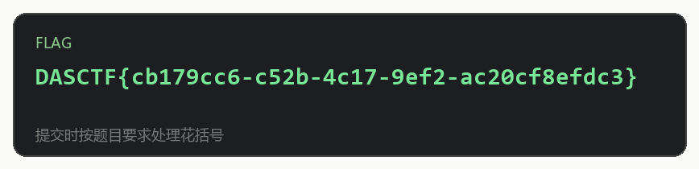
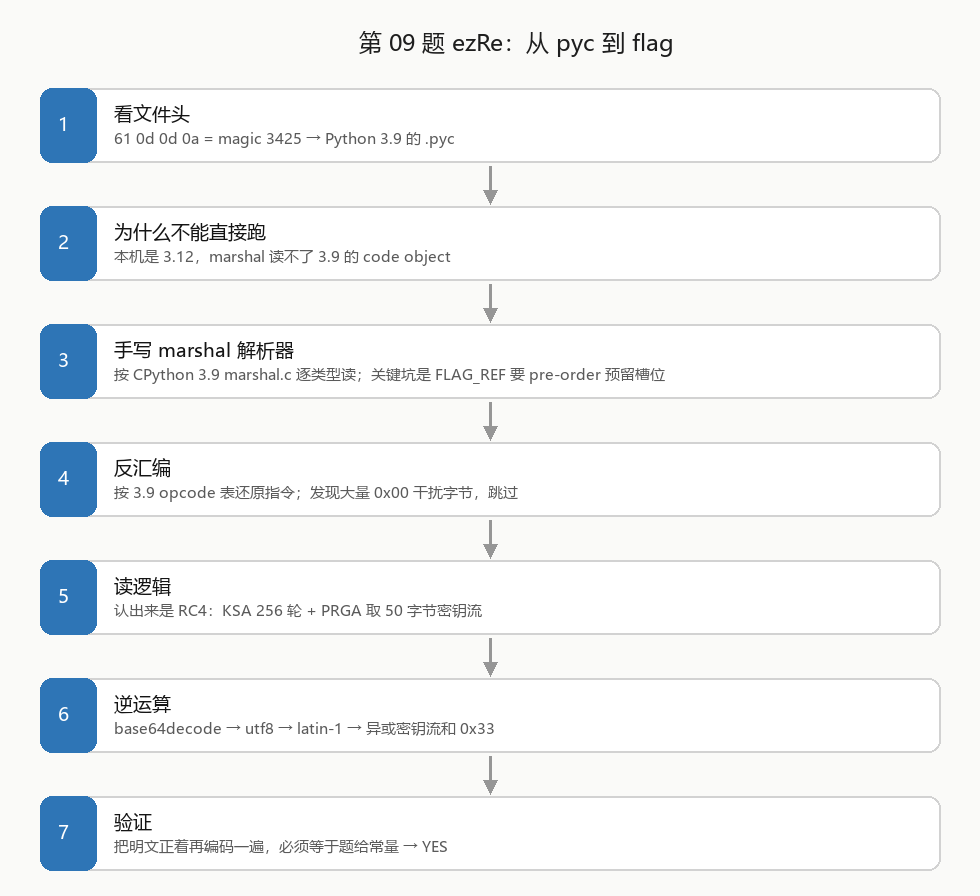
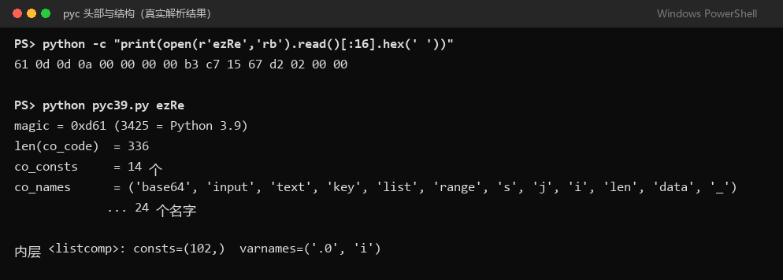
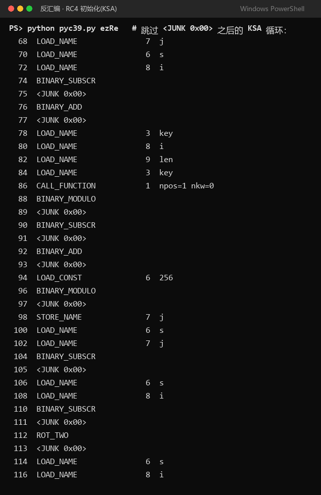
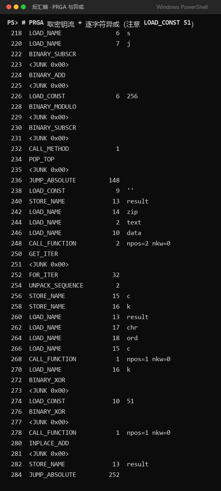
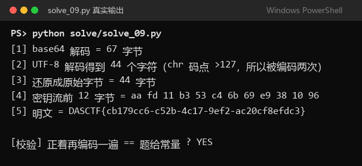

# 第 9 题 · ezRe — Writeup

> **本合集路径说明**：本篇原属 `CTF-WP\09-ezRe`，正文里写的 `solve/xxx.py`、`files/xxx` 是**原工程相对路径**；脚本已复制到本合集 `src\zj09\` 下（附件未随迁，需要时去原工程取）。

> 2024 浙江省大学生网络与信息安全竞赛（预赛） · 分类：Reverse · 难度：★★★☆☆

| 项目 | 内容 |
|---|---|
| 题目名 | ezRe（第 9 题） |
| 分类 | Reverse（Python 字节码） |
| 附件 | `files/tempdir/REVERSE附件/ezRe`（**920 字节**，没有扩展名） |
| 一句话 | 一个 **Python 3.9 的 .pyc**，里面是 RC4 + 两次编码；只能"读"，不能"跑" |
| 最终 flag | `DASCTF{cb179cc6-c52b-4c17-9ef2-ac20cf8efdc3}` |

**最终答案**

```
DASCTF{cb179cc6-c52b-4c17-9ef2-ac20cf8efdc3}
```



*图 0：最终答案。*

[TOC]

## 一、题目长什么样（先建立直觉）

附件只有一个 920 字节、**没有扩展名**的文件。`strings` 一下就能看出不对劲：

```
Flag: 
7e021a7dd49e4bd0837e22129682551b
w53Cj3HDgzTCsSM5wrg6FMKcw58Qw7RZSFLCljRxwrxbwrVdw4AEwqMjw7/DkMKTw4/Cv8Onw4NGw7jDmSdcwq4GGg==
yes!
try again...
flag_checker.py
```

两个信号非常明确：

1. 有 `flag_checker.py`、`<listcomp>`、`b64encode`、`ord`、`chr` 这些**Python 运行时才有的字符串** → 这是 **Python 字节码（.pyc）**，不是 C 程序；
2. 有一串 base64 和一句 `yes! / try again...` → 典型的**输入 flag、校验、对就 yes** 结构。

所以第一步不是扔进 IDA，而是**认出来这是个 .pyc**。

## 二、解题思路总览



*图 1：整条链。核心难点不在密码学（这里只是 RC4），而在**把 3.9 的字节码读出来**。*

## 三、逐步复现

### 3.1 第一步：从 magic 认出 Python 版本

`.pyc` 的前 4 个字节是 **magic number**，直接对应 Python 版本：



*图 2：真实解析结果。`61 0d 0d 0a` 小端读出 **0x0d61 = 3425**，正好是 **Python 3.9** 的 magic。*

顺带得到的信息（都在图里）：

| 字段 | 值 | 意义 |
|---|---|---|
| magic | `0x0d61` (3425) | Python 3.9 编译 |
| `co_code` 长度 | 336 字节 | 真正的指令区 |
| `co_names` | `base64, input, text, key, list, range, s, j, i, len, data, append, result, zip, c, k, chr, ord, b64encode, encode, decode, enc, print` | **变量名的名字本身就是伪代码** |
| 内层 `<listcomp>` | `consts=(102,)`、`varnames=('.0','i')` | 一个 `[ord(i) ^ 102 for i in ...]` |
| 关键常量 | `'7e021a7dd49e4bd0837e22129682551b'`、`50`、`51`、`256`、`102` | 后面全靠它们 |

> **提示**：`co_names` 这张表在逆向里价值极高。它相当于把"程序用了哪些变量/函数"全列给你，
> 有经验的选手光看名字就能猜出七八成逻辑（`s`、`j`、`i`、`key`、`256` 一起出现 → 十有八九是 RC4）。

### 3.2 第二步：为什么不能直接 `python ezRe` 跑

两个原因，一个比一个硬：

1. **版本不对**：本机是 Python 3.12，`marshal.loads` 读不了 3.9 的 code object
   （3.11 起 code object 的序列化格式变了，多了 `co_qualname`、`co_exceptiontable` 等字段）；
2. **这个 pyc 本身就被"动过手脚"**：指令流里插了大量 `0x00` 字节。在 CPython 3.9 里 **opcode 0 不是合法指令**，
   执行到会直接 `SystemError: unknown opcode`。

所以出题人从一开始就没打算让你"跑一下看结果"——**这是一道纯静态读字节码的题**。

### 3.3 第三步：自己写一个 3.9 的 marshal 解析器

既然没有现成工具（本机也没有 uncompyle6 / decompyle3），就按 CPython 的 `marshal.c` 自己写。
3.9 的 code object 序列化顺序是固定的：

```
'c' argcount posonlyargcount kwonlyargcount nlocals stacksize flags
    code consts names varnames freevars cellvars filename name
    firstlineno lnotab
```

**我在这里踩了一个大坑，值得单独说：**

> marshal 支持"对象引用"：带 `FLAG_REF(0x80)` 的对象会登记到引用表，之后用 `TYPE_REF('r')` 回指，避免重复。
> **登记必须发生在读内容之前（pre-order 预留槽位）**——因为容器内部可能引用它自己（code object 的 consts 里就可能嵌套 code）。
>
> 我第一版是"读完内容再登记"，结果引用表整体错位，报
> `IndexError: list index out of range`（读到第 3 层的 `cellvars` 时炸）。

修法只有一行——先占位、后填值：

```python
if flag:                          # 带 FLAG_REF
    slot = len(self.refs)
    self.refs.append(None)        # ★ 先预留
obj = self._read(t)
if flag:
    self.refs[slot] = obj         # ★ 后填值
```

修完之后解析一次通过，得到 336 字节的 `co_code`。

### 3.4 第四步：反汇编，并处理"干扰字节"

按 3.9 的 opcode 表把 336 字节翻译成指令。第一遍输出**是错位的**，长这样：

```
  35  OP_0      131      ← 明显不对：0 不是指令，131 是参数位置
```

原因就是 3.2 说的：**出题人插了 38 个 `0x00` 字节**，还插了 3 条 `JUMP_FORWARD 0`
（`6e 00`——这是**合法的空跳转**，执行起来等于 NOP，但会让反汇编器错位）。

处理方式很土但很有效：**把 `0x00` 当作 1 字节的 JUNK 跳过，`JUMP_FORWARD 0` 当 NOP 忽略**。
跳过之后指令流立刻变得完全连贯：



*图 3：跳过 JUNK 之后的 KSA 循环。`LOAD_NAME s / i / key / len / CALL_FUNCTION / BINARY_MODULO 256 / STORE_NAME j` —— 这是 RC4 密钥调度（Key Scheduling Algorithm）的标准形状。*



*图 4：PRGA 段。`data.append(s[(s[i]+s[j]) % 256])`，然后 `zip(text, data)` 逐字符 `chr(ord(c) ^ k ^ 51)`，最后 `b64encode().encode().decode()` 和常量比较。*

把两张图翻译成人话，就是这样一个程序：

```python
import base64
text = input('Flag: ')
key  = '7e021a7dd49e4bd0837e22129682551b'
key  = [ord(i) ^ 102 for i in key]          # ← 内层 listcomp，常量 102

s = list(range(256)); j = 0
for i in range(256):                         # ← RC4 KSA
    j = (j + s[i] + key[i % len(key)]) % 256
    s[i], s[j] = s[j], s[i]

data = []
for _ in range(50):                          # ← RC4 PRGA，只取 50 字节
    i = (i + 1) % 256
    j = (j + s[i]) % 256
    s[i], s[j] = s[j], s[i]
    data.append(s[(s[i] + s[j]) % 256])

result = ''
for c, k in zip(text, data):
    result += chr(ord(c) ^ k ^ 51)           # ← 异或密钥流 + 0x33

enc = base64.b64encode(result.encode()).decode()
print('yes!' if enc == '<常量>' else 'try again...')
```

### 3.5 第五步：认出 RC4，然后倒着算

**怎么一眼认出 RC4？** 三个特征同时出现就够了：

| 特征 | 在这题里的样子 |
|---|---|
| 一个 256 长度的状态数组 | `s = list(range(256))` |
| KSA：`j = (j + s[i] + key[i % len]) % 256` 然后交换 | 图 3 整段 |
| PRGA：`i=(i+1)%256; j=(j+s[i])%256; swap; 输出 s[(s[i]+s[j])%256]` | 图 4 整段 |

解密就是把每一步反过来。**只有一个地方要小心**：
原程序是 `chr(码点)` 拼成字符串再 `.encode()`，所以码点 >127 的字符在 UTF-8 里会变成 **2 个字节**——
**这就是为什么 base64 解出来是"乱码"**：它不是真的乱码，是 **UTF-8 编码两次（mojibake）**。

```python
raw   = base64.b64decode(CIPHER)      # 67 字节
text  = raw.decode('utf-8')           # 44 个字符  ← 说明原字节被 UTF-8 展开过
latin = text.encode('latin-1')        # 44 字节     ← 拿回"一个字符一个字节"
flag  = ''.join(chr(latin[i] ^ ks[i] ^ 51) for i in range(len(latin)))
```

运行结果：



*图 5：真实运行。最后一行 `[校验] 正着再编码一遍 == 题给常量 ? YES` 是本题最硬的证据。*

**为什么必须做这个"正着再编码一遍"的校验？**
因为我上面的伪代码是**从字节码推出来的**，不是跑出来的。万一我某个常量看错了（比如把 `^51` 写成 `^102`），
逆出来的明文也会"像 flag"，但一定是错的。**把明文按同样的流程再编码一次，和题给常量逐字节相等**，
这才证明"重建的算法"和"出题人的算法"完全一致——**不是猜对，是证明对**。

## 四、关键知识点（这题值钱的地方）

| 概念 | 是什么 | 这题怎么用 | 以后在哪还会遇到 |
|---|---|---|---|
| **.pyc / magic number** | Python 编译后的字节码文件，前 4 字节标版本 | 一眼定版本，决定用什么工具读 | 所有 Python 逆向、PyInstaller 拆包 |
| **marshal 格式** | CPython 序列化对象（含 code object）的私有格式 | 手写解析器才能拿到 `co_code`/`co_consts` | pyc 提取、内存取证里的 code object |
| **FLAG_REF / 引用表** | 避免重复序列化，用索引回指 | 解析顺序错了整体错位（本题最大的坑） | 所有需要读 marshal 的场合 |
| **opcode 表 / 反汇编** | 字节 → 指令，注意每条指令是否带参数 | 参数宽度错一个字节，后面全错 | x86/ARM 反汇编同理 |
| **反汇编干扰（anti-disasm）** | 插入 NOP / 空跳转 / 无效字节让反汇编错位 | 本题 38 个 `0x00` + 3 条 `JUMP_FORWARD 0` | 加壳、混淆、VM 保护 |
| **RC4** | 256 字节状态 + KSA + PRGA 的流密码 | 认出结构 → 倒着算 | 老协议、恶意样本、CTF 高频 |
| **mojibake / 双重编码** | `chr(x).encode()` 会把 0x80~0xFF 变成 2 字节 | base64 解出来"乱码"其实是编码问题 | 所有编码套娃题 |

## 五、踩坑与陷阱

| 坑 | 现象 | 正解 |
|---|---|---|
| **想直接 `python ezRe`** | 3.12 报 `Bad magic number` / marshal 解析炸 | 先认 magic，再决定用哪个版本处理 |
| **FLAG_REF 先读内容后登记** | `IndexError: list index out of range`（第 3 层 cellvars 处） | **pre-order 预留槽位** |
| **opcode 参数表写错**（把 `BUILD_SLICE`/`RAISE_VARARGS`/`LIST_EXTEND` 当无参数） | 反汇编从中间开始整体错位，越读越乱 | 严格按 opcode 表标参数；错位就立刻回头看表 |
| **把 `0x00` 当真实指令** | `OP_0`、莫名其妙的 `131` | 3.9 没有 opcode 0 → 当 JUNK 跳过 |
| **base64 解出"乱码"就以为方向错了** | 前几个字节是 `\xc3\x9d` 之类 | 这是 UTF-8 双重编码；`decode('utf-8').encode('latin-1')` 拿回原字节 |
| **不校验就交 flag** | 可能交了个"看起来对"的错答案 | **正着再编码一遍，必须等于题给常量** |

## 六、如果赛场上再遇到（20 分钟行动清单）

1. **0~2 分钟**：`xxd` 看前 4 字节。`0d0d0a` 系列 → .pyc；`MZ` → PE；`7f 45 4c 46` → ELF。
2. **2~4 分钟**：定版本。magic 查表（3425=3.9、3439=3.10、3495=3.11、3531=3.12…）。
3. **4~8 分钟**：有同版本 Python 就 `import marshal, dis` 直接 `dis.dis()` 完事；
   **没有就手写 marshal 解析**（本 WP 的 `pyc39.py` 就是模板，改一下版本号就能复用）。
4. **8~12 分钟**：先看 `co_names` / `co_consts` 猜逻辑，再逐段读指令。
5. **12~16 分钟**：认出算法（RC4 / AES / 逐字节异或），写逆运算。
6. **16~19 分钟**：**正着再算一遍校验**。
7. **19~20 分钟**：交 flag；没出来就跳题。

> 一句话：**`.pyc` 逆向 = 认版本 + 读常量 + 反汇编**。三者缺一，就会在"跑不起来"上耗掉半小时。

## 七、附件与脚本

| 路径 | 说明 |
|---|---|
| `files/tempdir/REVERSE附件/ezRe` | 原始附件（920 字节，未改动） |
| `solve/pyc39.py` | ★ 最小 Python 3.9 marshal 解析器 + 反汇编器（可复用；改 `NOARG`/`OP` 表即可支持别的版本） |
| `solve/solve_09.py` | ★ 还原算法 + 逆运算 + **正着再编码的自校验** |
| `solve/_dis_clean.txt` | 跳过 JUNK 后的完整反汇编（205 行） |
| `solve/make_images.py` | 生成本文全部配图 |
| `solve/parse_pyc39.py` | （废弃）第一版解析器，留着当"FLAG_REF 踩坑"的反面教材 |

跑法：

```powershell
$py = "C:\Users\XiaoMibook\.dsh\dsh-runtimes\dsh-primary-runtime\dependencies\python\python.exe"
$env:PYTHONIOENCODING = "utf-8"
cd CTF-WP\09-ezRe
& $py solve\pyc39.py "files\tempdir\REVERSE附件\ezRe"   # 反汇编
& $py solve\solve_09.py                                  # 出 flag + 校验
```
