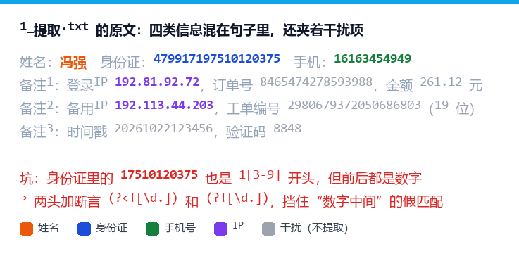
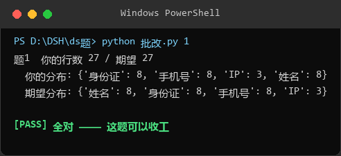

# 数据安全 · 敏感信息提取 Writeup

> **来源**：本地练习 `D:\DSH\ds题\1_提取.txt`（省赛数据安全题型）
> **考点**：从自由文本里提取姓名 / 身份证 / 手机号 / IP，**边界断言**挡住"数字中间"的假匹配
> **验收**：`python 批改.py 1` → `[PASS]`（27 行全对）

---

## 1. 题目

输入是一份"系统导出"的文本，人和 IP 混在句子里：

```text
=== 某单位人员信息导出（虚构测试数据，仅用于练习）===
导出时间：2026-10-22 09:15:03
操作人IP：192.62.38.226

---- 明细 ----
姓名：冯强　身份证：479917197510120375　手机：16163454949
姓名：卫芳　身份证：130779196908289769　手机：19624043964
姓名：卫平超　身份证：142090200505092506　手机：18889935844
姓名：卫伟平　身份证：266864197704071581　手机：13599290820
姓名：王兰　身份证：252546198005264606　手机：13767686192
姓名：褚英强　身份证：556547199309277510　手机：13318793403
姓名：吴兰　身份证：587240197006151270　手机：17352570906
姓名：杨芳涛　身份证：163405197607119245　手机：13493917414

备注1：登录IP 192.81.92.72，订单号 8465474278593988，金额 261.12 元
备注2：备用IP 192.113.44.203，工单编号 2980679372050686803（19 位）
备注3：时间戳 20261022123456，验证码 8848
```

要求输出 `1_提取.csv`，两列 `类型,数据值`，四类各条都要有，**不能多也不能少**。

---

## 2. 看起来简单，坑在"数字中间"

如果直接写：

```python
re.findall(r"1[3-9]\d{9}", text)      # 手机号
re.findall(r"\d{17}[\dXx]", text)     # 身份证
```

会出两类错：

1. **身份证里藏手机号**：`479917197510120375` 中间有一段 `17197510120`，恰好是 `1[3-9]` 开头的 11 位数字 → 会被当成手机号多切一条；
2. **19 位工单号里切出 18 位**：`2980679372050686803` 是 19 位，`\d{17}[\dXx]` 会从里面切出前 18 位当身份证 → 又错一条。

解法是给正则加**前后断言**，要求匹配的两侧不再是数字（IP 还要求不是点）：

```text
(?<![\d.])  +  模式  +  (?![\d.])
```

实测对比（同一份 `1_提取.txt`）：

| 写法 | 手机号条数 | 身份证条数 |
|---|---|---|
| 朴素正则（无断言） | **16**（多出 8 条，全是身份证内部的片段） | **9**（多出 1 条，来自 19 位工单号） |
| 加边界断言 | **8**（正确） | **8**（正确） |

例如 `479917197510120375` 从第 5 位开始切出的 `17197510120` 就是一条假手机号：它左边是 `9`、右边是 `3`，前后断言一加就挡住了。



*图 2-1：颜色标出四类信息；灰色的是订单号、时间戳、验证码，全部不提取。*

---

## 3. 判定规则

| 类型 | 正则 | 说明 |
|---|---|---|
| 身份证 | `\d{17}[\dXx]` | 18 位，最后一位可能是 X；两侧不能是数字 |
| 手机号 | `1[3-9]\d{9}` | 11 位，第二位 3–9；两侧不能是数字或点 |
| IP | `(?:\d{1,3}\.){3}\d{1,3}` | 四段点分十进制；两侧不能是数字或点 |
| 姓名 | `姓名[：:]\s*([\u4e00-\u9fa5]{2,4})` | 没有固定格式，只能靠"姓名："前缀 |

> 长度先挡一层：19 位工单号不是 18 位、14 位时间戳不是 18 位、16 位订单号也不是 —— 但它们会被"部分匹配"，所以断言必须加。

---

## 4. 完整解题脚本

```python
import os, re, csv

D = r"D:\DSH\ds题"
text = open(os.path.join(D, "1_提取.txt"), encoding="utf-8").read()

TYPES = [
    ("身份证", r"\d{17}[\dXx]"),
    ("手机号", r"1[3-9]\d{9}"),
    ("IP",     r"(?:\d{1,3}\.){3}\d{1,3}"),
]
NAME_RE = re.compile(r"姓名[：:]\s*([\u4e00-\u9fa5]{2,4})")

rows = []
for t, pat in TYPES:
    for m in re.findall(r"(?<![\d.])" + pat + r"(?![\d.])", text):
        rows.append((t, m))
rows += [("姓名", m) for m in NAME_RE.findall(text)]

with open(os.path.join(D, "1_提取.csv"), "w", encoding="utf-8", newline="") as f:
    w = csv.writer(f)
    w.writerow(["类型", "数据值"])
    w.writerows(rows)

print(len(rows))          # 27
```

输出（节选）：

```text
类型,数据值
身份证,479917197510120375
...
手机号,16163454949
...
IP,192.62.38.226
IP,192.81.92.72
IP,192.113.44.203
姓名,冯强
...
```

---

## 5. 批改验收



*图 5-1：用原批改器验收，27/27 行全对。*

```text
PS D:\DSH\ds题> python 批改.py 1
题1  你的行数 27 / 期望 27
  你的分布: {'身份证': 8, '手机号': 8, 'IP': 3, '姓名': 8}
  期望分布: {'姓名': 8, '身份证': 8, '手机号': 8, 'IP': 3}

[PASS] 全对 —— 这题可以收工
```

分布对得上：8 个姓名、8 个身份证、8 个手机号、3 个 IP（含表头里的操作人 IP 和两条备注 IP）。

---

## 6. 复盘

1. **先定"边界"，再定"模式"**：`(?<![\d.])` / `(?![\d.])` 是这类题的核心，不加就会在长数字里切出假手机号、假身份证。
2. **长度是最便宜的过滤器**：18 位身份证、11 位手机号，先按长度想一遍，再看正则，能避免大部分误报。
3. **姓名只能靠上下文**：中文姓名没有可校验的格式，只能吃 `姓名：` 这个前缀；没有前缀的姓名（比如正文里出现）只能靠词表。
4. **验收用 multiset**：本题批改器是"多重集合"比较，顺序随意，但**多一条、少一条都 FAIL**。
5. **CSV 细节**：`newline=""` 防止 Windows 下多空行；`utf-8` 编码，Excel 打开不乱码可以再加 BOM（本题批改器读 `utf-8-sig`，也兼容）。
6. **别把 IP 当小数**：`261.12 元` 里的 `261.12` 只有两段，不会命中四段 IP；但 `(?<![\d.])` 同时防住了"IP 里再切 IP"。

---

## 7. 本题文件

| 文件 | 说明 |
|---|---|
| `D:\DSH\ds题\1_提取.txt` | 输入 |
| `D:\DSH\ds题\1_提取.csv` | 本次生成的答案（27 行） |
| `D:\DSH\ds题\批改.py` | 官方批改器 |
| `WP\src\ds_solve.py` | 三题统一求解脚本 |
| `WP\src\out\grade_1.txt` | 批改输出原文 |
| `WP\images\ds1-*.png` | 本文配图 |
