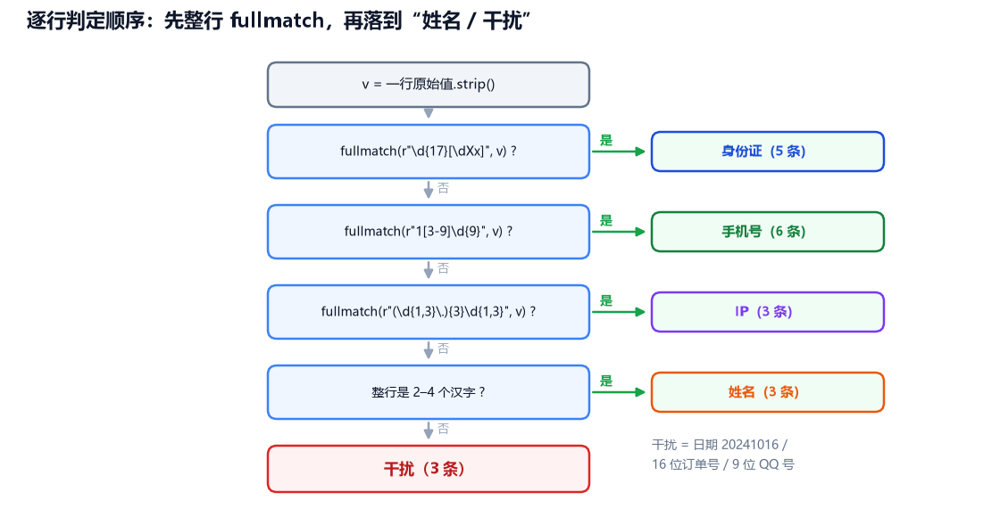
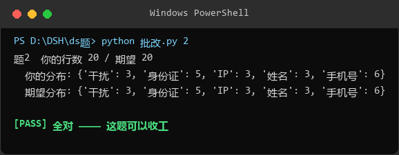

# 数据安全 · 逐行分类 Writeup

> **来源**：本地练习 `D:\DSH\ds题\2_分类.txt`（省赛数据安全题型）
> **考点**：一行一个值、无标签，用 `re.fullmatch` 按顺序判定；顺序必须与输入一致
> **验收**：`python 批改.py 2` → `[PASS]`（20 行全对）

---

## 1. 题目

输入 20 行，一行一个值，混着真实数据和干扰项，**没有任何标签**：

```text
20241016
558515197906256387
192.241.50.225
杨静
18412165009
钱勇
14046848940
陈丽秀
510833200012058601
18283388058
601308196910045957
167561196303168732
114.219.200.31
15903953475
382847198108154225
192.53.2.155
19258598991
18046317677
1213168962443369
123456789
```

要求：逐行判定 `身份证 / 手机号 / IP / 姓名 / 干扰`，输出 `2_分类.csv`（表头 `类型,数据值`），**顺序与输入一致**。

---

## 2. 判定顺序



*图 2-1：先整行匹配三种格式，再判断是不是 2–4 个汉字，最后落到"干扰"。*

```
v = 一行.strip()
  ① fullmatch 身份证 \d{17}[\dXx] ?      → 身份证（5 条）
  ② fullmatch 手机号 1[3-9]\d{9} ?       → 手机号（6 条）
  ③ fullmatch IP (\d{1,3}\.){3}\d{1,3} ? → IP（3 条）
  ④ 整行是 2–4 个汉字 ?                  → 姓名（3 条）
  ⑤ 都不是                                → 干扰（3 条）
```

本题分布：**身份证 5 / 手机号 6 / IP 3 / 姓名 3 / 干扰 3**，合计 20。

---

## 3. 关键点：fullmatch，不是 search

| 写法 | 行为 | 本题后果 |
|---|---|---|
| `re.search(pat, v)` | 只要行内任意位置命中就算 | `1213168962443369` 里可能切出身份证/手机号；IP 行里也可能切出数字 |
| `re.fullmatch(pat, v)` | **整行**必须完全匹配 | 只有"整行就是那个值"才算，干净 |

用 `fullmatch` 时**不要再加 `^`、`$`、`\b`**：它本身已经要求整串匹配，额外的锚点和边界只会让可读性变差（`\b` 在中文/数字边界上还容易误判）。

干扰项正好是三类"纯数字但不是三种值"的东西：

| 值 | 为什么是干扰 |
|---|---|
| `20241016` | 8 位日期 |
| `1213168962443369` | 16 位订单号 |
| `123456789` | 9 位 QQ 号 |

---

## 4. 完整解题脚本

```python
import os, re, csv

D = r"D:\DSH\ds题"
lines = [l.strip() for l in
         open(os.path.join(D, "2_分类.txt"), encoding="utf-8") if l.strip()]

TYPES = [
    ("身份证", r"\d{17}[\dXx]"),
    ("手机号", r"1[3-9]\d{9}"),
    ("IP",     r"(?:\d{1,3}\.){3}\d{1,3}"),
]
NAME = re.compile(r"[\u4e00-\u9fa5]{2,4}")

def classify(v):
    for t, pat in TYPES:
        if re.fullmatch(pat, v):
            return t
    if NAME.fullmatch(v):
        return "姓名"
    return "干扰"

rows = [(classify(v), v) for v in lines]

with open(os.path.join(D, "2_分类.csv"), "w", encoding="utf-8", newline="") as f:
    w = csv.writer(f)
    w.writerow(["类型", "数据值"])
    w.writerows(rows)
```

---

## 5. 分类结果

```text
类型,数据值
干扰,20241016
身份证,558515197906256387
IP,192.241.50.225
姓名,杨静
手机号,18412165009
姓名,钱勇
手机号,14046848940
姓名,陈丽秀
身份证,510833200012058601
手机号,18283388058
身份证,601308196910045957
身份证,167561196303168732
IP,114.219.200.31
手机号,15903953475
身份证,382847198108154225
IP,192.53.2.155
手机号,19258598991
手机号,18046317677
干扰,1213168962443369
干扰,123456789
```

注意第 17 行 `19258598991`：没有点号、11 位、`1[3-9]` 开头 → **手机号**，不是 IP。

---

## 6. 批改验收



*图 6-1：用原批改器验收，20/20 行、顺序完全一致。*

```text
PS D:\DSH\ds题> python 批改.py 2
题2  你的行数 20 / 期望 20
  你的分布: {'干扰': 3, '身份证': 5, 'IP': 3, '姓名': 3, '手机号': 6}
  期望分布: {'干扰': 3, '身份证': 5, 'IP': 3, '姓名': 3, '手机号': 6}

[PASS] 全对 —— 这题可以收工
```

本题批改器是 **ordered** 模式：不仅内容要对，**第 i 行必须对应第 i 行**，顺序错了直接 FAIL。

---

## 7. 复盘

1. **分类题先想"整行匹配"**：一行一个值的场景，`fullmatch` 永远比 `search` 安全；`search` 只适合"从长文本里找"。
2. **顺序按"特征强弱"排**：身份证 18 位 → 手机号 11 位 → IP 带点 → 姓名汉字。先判特征强的，能减少歧义。
3. **干扰项要能解释**：日期、订单号、QQ 号都是"纯数字但不是三类"，`isdigit()` 之后落到"干扰"即可；不要用"长度猜"。
4. **输出顺序 = 输入顺序**：用列表推导按行处理，天然保序；用字典/集合会丢顺序。
5. **不要给 fullmatch 加锚点**：`^...$` 和 `\b` 在 `fullmatch` 下是冗余的，中文边界还容易出问题。
6. **自检**：先数分布（5/6/3/3/3），再跑批改器；分布不对时先查某一类是不是漏了前缀/多切了子串。

---

## 8. 本题文件

| 文件 | 说明 |
|---|---|
| `D:\DSH\ds题\2_分类.txt` | 输入 |
| `D:\DSH\ds题\2_分类.csv` | 本次生成的答案（20 行） |
| `D:\DSH\ds题\批改.py` | 官方批改器 |
| `WP\src\ds_solve.py` | 三题统一求解脚本 |
| `WP\src\out\grade_2.txt` | 批改输出原文 |
| `WP\images\ds2-*.png` | 本文配图 |
