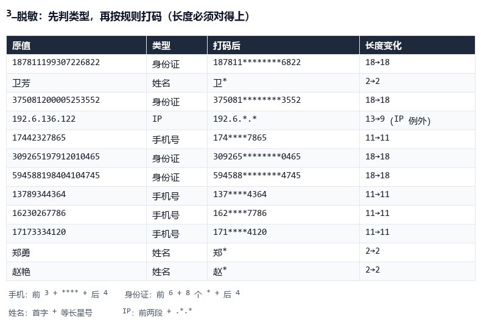
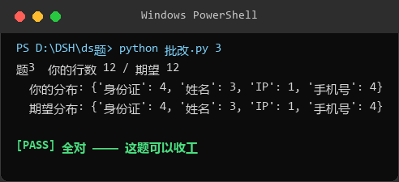

# 数据安全 · 脱敏打码 Writeup

> **来源**：本地练习 `D:\DSH\ds题\3_脱敏.txt`（省赛数据安全题型）
> **考点**：先判类型、再按规则打码；**打码后长度必须和原值一致**（IP 除外）
> **验收**：`python 批改.py 3` → `[PASS]`（12 行全对）

---

## 1. 题目

输入 12 行（手机 / 身份证 / 姓名 / IP 混排）：

```text
187811199307226822
卫芳
375081200005253552
192.6.136.122
17442327865
309265197912010465
594588198404104745
13789344364
16230267786
17173334120
郑勇
赵艳
```

要求输出 `3_脱敏.csv`（表头 `类型,数据值`），顺序与输入一致。

---

## 2. 脱敏规则

| 类型 | 规则 | 示例 |
|---|---|---|
| 手机号 | 前 3 + `****` + 后 4 | `17442327865` → `174****7865`（仍是 11 位） |
| 身份证 | 前 6 + 8 个 `*` + 后 4 | `187811199307226822` → `187811********6822`（仍是 18 位） |
| 姓名 | 首字 + 等长星号 | `卫芳` → `卫*`（长度不变） |
| IP | 前两段 + `.*.*` | `192.6.136.122` → `192.6.*.*`（长度可变） |

**一条自检判据**：打码后长度必须和原值一样（IP 除外）。星号数量不对，长度就对不上，直接暴露错误。

- 手机号：`3 + 4 + 4 = 11`，中间固定 4 个星；
- 身份证：`6 + 8 + 4 = 18`，中间的星数是 `len - 10`；
- 姓名：`1 + (len-1) = len`，星数是 `len - 1`；
- IP：只保留前两段，后面固定 `*.*`。

---

## 3. 完整解题脚本

```python
import os, re, csv

D = r"D:\DSH\ds题"
lines = [l.strip() for l in
         open(os.path.join(D, "3_脱敏.txt"), encoding="utf-8") if l.strip()]

TYPES = [
    ("身份证", r"\d{17}[\dXx]"),
    ("手机号", r"1[3-9]\d{9}"),
    ("IP",     r"(?:\d{1,3}\.){3}\d{1,3}"),
]
NAME = re.compile(r"[\u4e00-\u9fa5]{2,4}")

def classify(v):
    for t, pat in TYPES:
        if re.fullmatch(pat, v):
            return t
    return "姓名" if NAME.fullmatch(v) else "干扰"

def mask(t, v):
    if t == "手机号":
        return v[:3] + "****" + v[-4:]
    if t == "身份证":
        return v[:6] + "*" * (len(v) - 10) + v[-4:]
    if t == "姓名":
        return v[0] + "*" * (len(v) - 1)
    if t == "IP":
        p = v.split(".")
        return ".".join(p[:2] + ["*", "*"])
    return v

rows = []
for v in lines:
    t = classify(v)
    rows.append((t, mask(t, v)))

with open(os.path.join(D, "3_脱敏.csv"), "w", encoding="utf-8", newline="") as f:
    w = csv.writer(f)
    w.writerow(["类型", "数据值"])
    w.writerows(rows)

# 长度自检（IP 除外）
for (t, m), raw in zip(rows, lines):
    if t != "IP":
        assert len(m) == len(raw), (t, raw, m)
print("length check OK")
```

> 注意 `mask()` 里身份证用 `len(v) - 10`，不是写死的 8：万一遇到末尾是 `X` 的 18 位身份证，长度仍然是 18，规则不会错位。

---

## 4. 打码结果



*图 4-1：12 行原值 → 类型 → 打码后，右侧是长度变化；只有 IP 长度会变。*

```text
类型,数据值
身份证,187811********6822
姓名,卫*
身份证,375081********3552
IP,192.6.*.*
手机号,174****7865
身份证,309265********0465
身份证,594588********4745
手机号,137****4364
手机号,162****7786
手机号,171****4120
姓名,郑*
姓名,赵*
```

---

## 5. 批改验收



*图 5-1：用原批改器验收，12/12 行、顺序一致。*

```text
PS D:\DSH\ds题> python 批改.py 3
题3  你的行数 12 / 期望 12
  你的分布: {'身份证': 4, '姓名': 3, 'IP': 1, '手机号': 4}
  期望分布: {'身份证': 4, '姓名': 3, 'IP': 1, '手机号': 4}

[PASS] 全对 —— 这题可以收工
```

---

## 6. 复盘

1. **先判类型再打码**：同一套规则不能套在未知类型上；判错类型，星号位置一定错。
2. **长度是最好用的自检**：打码后长度不变（IP 除外），一行 `assert` 就能抓住"星号多吃了一位"这种错。
3. **星号数量要算，不要背**：身份证 `len-10`、姓名 `len-1`、手机号固定 4 个。背"8 个星"遇到 18 位 X 结尾也还是 18 位，但写 `len-10` 更稳。
4. **IP 是唯一例外**：规则只保留前两段，长度必然变短（本题 `13 → 9`），所以校验时要排除 IP。
5. **保留格式细节**：手机号打码后仍是 11 位、身份证仍是 18 位，这是省赛平台的判分点（错一位 = 0 分）。
6. **CSV 写法**：`newline=""` + `utf-8`；表头固定 `类型,数据值`，顺序与输入一致（本题 ordered 模式）。

---

## 7. 本题文件

| 文件 | 说明 |
|---|---|
| `D:\DSH\ds题\3_脱敏.txt` | 输入 |
| `D:\DSH\ds题\3_脱敏.csv` | 本次生成的答案（12 行） |
| `D:\DSH\ds题\批改.py` | 官方批改器 |
| `WP\src\ds_solve.py` | 三题统一求解脚本 |
| `WP\src\out\grade_3.txt` | 批改输出原文 |
| `WP\images\ds3-*.png` | 本文配图 |
